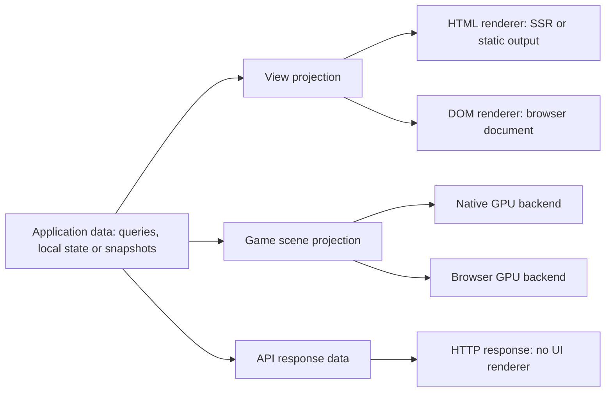
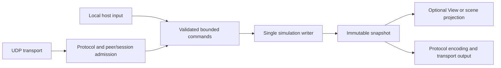

# M28 — Composable Application and Multi-Host Plan

- **Date:** 2026-11-17.
- **State:** M28-A/B0/B1/B2/C1/C2/C3/D1/D2/D3 completed and locally committed at separately reviewed private scopes; D3 HEAD `cde0a03`, independent R2 `wc_job_-kuV4Ftw7m4omNAI` actual PASS and original R1 FAIL3 retained. D4 original physical two-device LAN remains **Not verified** after selected campus UDP ingress failure; two-Multipass-VM same-binary UDP via per-VM relays converged at Revision462 but is not physical D4 or direct non-loopback D3. M28-E/YT-275 [evidence-based promotion proposal](M28-E-PROMOTION-DECISION.md) completed independent documentation review: original R1 `wc_job_tHV6cHY7qckBm8pG` actual FAIL3 corrected, R2 `wc_job_yKyyePqAbLGP4xaz` terminal exit0 actual PASS with zero issues/followups; **owner decision still pending**, no public Host/Transport/Renderer API. ADR 0013 remains Proposed.
- **Source baseline:** `c9437357b2bb9e88a13a09435ed9645cea5462a8`, observed remote master at the start of the initial study; this amendment starts from `4e5bdc1c52f4e724f093467478958563dd98ede2`.
- **Decision:** [ADR 0013](adr/0013-composable-application-and-hosts.md) is **Proposed**. A successful document review does not accept its runtime design.
- **Tracking:** [M28 backlog](BACKLOG.md#m28--composable-application-and-multi-host-research), [milestone gates](ROADMAP.md#m28--composable-application-and-multi-host-research).

- **Current delivery follow-through (2026-11-19):** The owner reaffirmed same-process Game + Network + native Web, usable opt-in SDK composition and compatible custom Hosts. The [delivery plan](M28-MULTI-HOST-DELIVERY-PLAN.md) and YT-277–285 track the next work; F0-C retains its scoped no-extraction decision. Earlier research/decision evidence below is preserved; private examples do not complete the SDK objective. This update plans work only, with ADR0013 Proposed and physical D4 Not verified.

## Scope and authority

The owner requested investigation of **Yetlet — Composable Application Framework**.
Historical HTML-first language describes existing delivery; it does not constrain
this study. This document does not rename the product, rewrite public package
descriptions, accept a new framework API, refactor Axum, or authorize publication.
The current SDK and CLI contracts remain in force.

The requested end state permits an application without HTTP, a socket, a window,
a GPU, Axum, or Tokio. A host supplies selected execution facilities. Rendering,
transport and protocol remain different responsibilities. Ordinary Rust
composition and explicit opt-in are the starting point.

Requirement provenance:

| Source | Required boundary |
|---|---|
| Explicit owner request, M28 handoff sections 2–12 | Source inventory, at least two candidates, Proposed ADR, staged implementation and acceptance plan, independent review; this delivery changes documentation only |
| Explicit owner request, sections 5–8 | Multiple hosts, one authoritative simulation, thread ownership, bounded ingress, transport/protocol separation and renderer separation |
| Existing [ADR 0011](adr/0011-application-startup-api.md) and [ADR 0012](adr/0012-server-axum-prelude.md) | Preserve Axum startup, native escape hatch, prelude and existing paths |
| Existing [repository instructions](../AGENTS.md) | English documentation, evidence-scoped platform checks, retained failures, strict/builtin Git guard |
| Design assumptions in this plan | Two-player integer-coordinate example and initial numeric budgets; proposed choices to freeze or adjust explicitly in their implementation slice, not already accepted product guarantees |

## 1. Source inventory and gaps

The directory names in the handoff must not be mistaken for current crate
boundaries. The root [workspace](../Cargo.toml) has two public SDK packages,
`yetlet` and `yetlet-browser`. The old Core, Actions, Reactive, DOM, server-Axum
and wgpu directories are historical guide entries.

The inventory retains its inspected baseline claims. File links follow current
source locations; later migrations do not rewrite that historical evidence.

| Inspected surface | Current carrier and evidence | Useful boundary | Remaining coupling or gap |
|---|---|---|---|
| `crates/yetlet-core` | [Historical entry](../crates/yetlet-core/README.md); [current View implementation](../crates/yetlet/src/view/mod.rs) | Owned View values and ordinary component functions need no runtime | View contains text/elements/attributes; it is not a general game scene |
| `crates/yetlet-actions` | [Historical entry](../crates/yetlet-actions/README.md); [current actions](../crates/yetlet/src/actions/mod.rs) | `Command`, static `ActionExecutor<C>`, `LocalExecutor` do not require HTTP, serialization of local commands, or Send futures | Actions feature includes Serde and HTTP error-envelope vocabulary; there is no scheduler, bounded mailbox, host lifecycle or simulation authority |
| `crates/yetlet-reactive` | [Historical entry](../crates/yetlet-reactive/README.md); [current local graph](../crates/yetlet/src/reactive/mod.rs) | Explicit owner, weak handles, disposal, bounded reentrant passes and published-state reads are useful patterns | `Rc<RefCell<_>>`, synchronous callbacks and local queues are intentionally local; pass limit is not a cross-thread queue-capacity guarantee |
| `crates/yetlet` | [Feature manifest](../crates/yetlet/Cargo.toml), [target gates](../crates/yetlet/src/lib.rs) | Default HTML and opt-in native modules already avoid a mandatory server runtime | No general Application owner or Host contract is implemented; current package wording remains historical |
| `crates/yetlet-server-axum` | [Historical entry](../crates/yetlet-server-axum/README.md); [App](../crates/yetlet/src/web/app.rs), [adapter](../crates/yetlet/src/web/mod.rs) | Opt-in native adapter; `into_router` retains Axum/Tower composition | `App<S>` holds `Router<S>`; its constructors require `S: Clone + Send + Sync + 'static`; serving uses Tokio TCP and Axum |
| `crates/yetlet/src/actions` | [Executor implementation](../crates/yetlet/src/actions/mod.rs) | Domain commands can execute locally; no mandatory remote event circuit | Async method syntax alone does not create a runtime or guarantee Send; queued admission must not be reported as completed domain work |
| `crates/yetlet-browser` | [Manifest](../crates/yetlet-browser/Cargo.toml), [HTTP executor](../crates/yetlet-browser/src/actions/mod.rs) | One-way dependency on base package; HTTP transport is explicitly selected | HTTP executor uses WASM/browser fetch, same-origin endpoint rules, Serde and HTTP status; it is not a native UDP executor |
| `crates/yetlet-dom` | [Historical entry](../crates/yetlet-dom/README.md); [DOM implementation](../crates/yetlet-browser/src/dom/mod.rs) | Shared View and bounded validation can be reused for actual UI | DOM mounting, browser object ownership and HTML vocabulary remain browser-specific |
| `crates/yetlet-wgpu` | [Historical entry](../crates/yetlet-wgpu/README.md); [current CPU contracts](../crates/yetlet-browser/src/wgpu/mod.rs), [browser backend](../crates/yetlet-browser/src/wgpu/browser.rs) | Bounded records, checked versions, lifetime retirement and CPU validation provide precedents | `wgpu` is a CPU-contract feature; `wgpu-browser` selects actual WASM/canvas backend. This is not a native GameHost or complete scene engine |
| `examples/physics-lab` | [Standalone manifest](../examples/physics-lab/Cargo.toml), [sample](../examples/physics-lab/README.md), [simulation](../examples/physics-lab/src/physics.rs) | CPU simulation/snapshots and fixed-step clock are separated from private GPU code | Native executable is Axum/Tokio SSR; active scene is browser/WASM, private GPU owns canvas and generation. The nested workspace does not prove a native winit host |
| `examples/webgpu-scene-research` | [Manifest](../examples/webgpu-scene-research/Cargo.toml), [record](../examples/webgpu-scene-research/README.md) | Native offscreen wgpu 27.0.1/Vulkan proof without Yetlet, DOM, window or HTTP | It has no window/event loop, playable game, networking or multi-host lifecycle; historical measurements are not M28 results |
| Shared identity | [View binding contracts](../crates/yetlet/src/view/binding.rs) | Keys/identity and explicit ownership may inform application composition | HTML slot/attribute constraints are not entity IDs, GPU handles or network peer authentication |

### Dependency observations

Read-only `cargo tree --offline --locked --edges normal` observations at the
source baseline:

| Selection | Observed normal graph |
|---|---|
| `-p yetlet` | Base package only; default HTML adds no normal external dependency |
| `-p yetlet --no-default-features --features actions,reactive` | Base package plus Serde and its derive dependencies; no Axum, Tokio, winit or wgpu |
| `-p yetlet-browser --no-default-features --features wgpu` on native | Browser package plus base package; no GPU backend selected |

These are dependency inspections, not compile, runtime, visual, browser or
network qualification. Dev-dependencies and a full workspace build can have a
larger graph. Actual browser wgpu is target-gated and pinned at 27.0.1 in the
repository. M28-C must select and lock its own compatible winit/wgpu pair; this
study does not upgrade existing dependencies.

### Existing decisions

[ADR 0001](adr/0001-separation-of-concerns.md) already separates execution,
rendering, interactivity and action transport. [ADR 0003](adr/0003-renderers-and-loading.md)
keeps GPU scenes separate from HTML/DOM. [ADR 0005](adr/0005-opt-in-capability-modules.md)
prefers native composition and optional capability costs. These support this
research direction, but none proves a general host lifecycle.

ADRs 0011/0012 deliberately scope `server_axum::App` to the Axum adapter.
In particular, `serve()` is loopback HTTP on port 7878, the application owns its
Tokio runtime, and coordinated shutdown uses native Axum via `into_router()`.
Do not reinterpret that App as an already existing universal Application.

## 2. Candidate comparison

| Candidate | Shape | Abstraction and dependency cost | Thread/lifecycle fit | Compatibility and decision |
|---|---|---|---|---|
| A — Explicit composition with application-owned ports | Concrete owner, typed command ingress, immutable snapshot reads and explicit start/stop/join functions in a research example | No public Host trait, registry, container or new SDK crate; channels and snapshot cost are explicit | Foreground loop stays on its required thread; background workers may use std threads or a caller-owned async runtime | Recommended for B–D; existing Axum API unchanged; repeated contracts can later justify extraction |
| B — Static generic lifecycle adapters | A small private lifecycle interface plus separate foreground/background adapters and typed capabilities | More generic bounds and adapter boilerplate; can remain runtime-neutral without dynamic dispatch | Viable only if it does not require every host to be Send, async, or driven by one executor; foreground run cannot be disguised as background spawn | Candidate for E if at least two real consumers repeat the same contract and the API simplifies their code |
| C — Dynamic HostGroup runtime | Trait objects, registry, dynamic addition/removal and a universal run/supervision interface | Boxed futures/object-safety decisions, registration state, error normalization, lifecycle synchronization and larger API surface | A universal Send future or poll-all-hosts loop conflicts with foreground ownership; would need separate execution classes anyway | Reject for the initial POC; dynamic membership has no demonstrated requirement |

The recommendation is not that no abstraction will ever be useful. The
demonstrated common boundary is **commands, snapshots and explicit lifetime**.
Whether this needs a public `Application` type is an M28-E decision. HostGroup
is initially the composition root's coordination responsibility, not a required
exported class or trait.

## 3. Responsibility and ownership

### Independent composition dimensions

Host (events/resources/lifecycle), renderer (output), execution model
(caller thread, task, worker or process), and state policy are independent
choices. Orthogonal does not mean every pairing is valid: the selected data
representation and environment must support it. A host may use zero, one or
multiple compatible renderers; it does not select a backend by type alone.

This output-capability map is not a deployment or shared-memory diagram.
Queries/local state and simulation snapshots are alternative data sources.
A remote browser has its own process/context and receives data explicitly.

The next diagram is specifically the proposed shared-game-state pattern, not a
mandatory framework request pipeline. Only routes deliberately operating that
simulation use its ingress; ordinary Web handlers call their services directly.

| Responsibility | Owner | Minimal boundary |
|---|---|---|
| Domain state/invariants | Application-selected state/service design | Shared simulation has one writer; Web services need not become one global actor |
| Events/commands | Selected host and domain boundary | Semantic intent and validation; bounded queued admission where the application selects it |
| Snapshots | Shared-state POC publisher | Immutable generation/revision/tick values, no mutable domain alias; not compulsory for Web requests |
| Host lifecycle | Concrete host, coordinated by composition root | Readiness, failure, stop and resource release independent of execution thread count |
| Execution topology | Caller/composition root | Owns scheduler, runtime and any selected workers; no implicit one-thread/process-per-host |
| Transport and Protocol | Separate concrete adapters/codecs | IO versus message/version/validation; neither is a renderer |
| Output projection | Application | View, SceneData or API DTO; no universal render-data representation |
| Renderer | Compatible selected backend | HTML/DOM/GPU output without direct authoritative simulation mutation |
| Window/surface | Foreground host and renderer with explicit lifetime | Main-thread callbacks and backend resource ownership remain distinct |

Identity, typed actions and explicit subscription/disposal patterns remain
reusable where their existing semantics fit. Camera, mesh, materials, textures,
pipelines and hit testing stay game/rendering concerns. No rendering may simply
mean that no renderer is constructed.

### Execution ownership

Multiple hosts normally compose in one application process. A host can be
caller-driven, comprise several async tasks on a shared runtime, or own an
explicit worker when its workload needs one. Host count determines neither
thread count nor process count. A caller-driven lifecycle is still a lifecycle.

| Mode | Example | Ownership rule |
|---|---|---|
| Caller-thread / event-loop driven | B1 cooperative hosts; native window callbacks | No new worker required; respect affinity and avoid blocking the loop |
| Tasks on a shared runtime | Axum plus an explicitly async network adapter | Many tasks may share runtime threads; one host may own several tasks; host stop does not own runtime shutdown |
| Dedicated worker | Selected simulation or blocking native socket worker | Explicit stop and completion/join; do not impose this on other hosts |
| Separate application process | D's second player/client or future isolated deployment | Explicit protocol/transport and supervisor authority; no shared Rust Arc/state references across the boundary |

For C/D, one foreground thread, a simulation worker and a network worker remain
a proposed example topology, not an Application/Host requirement. The browser
is its own event-loop environment, not a native background thread created by
Axum. One native process can contain GameHost plus NetworkHost plus Axum without
creating three child processes. Generic process supervision/IPC is deferred.

Only values actually crossing threads require the applicable Send/Sync bounds.
B1 uses Rc-owned local data without universal Send. A latest-snapshot slot may
hold Arc<Snapshot> behind a short-lived mutex; clone the Arc, release the lock,
then render or serialize. Payloads contain no mutable alias to GameState.
Across processes use explicit messages and keep a single authoritative
simulation with read-only replicas, not independent authorities.

The [winit contract](https://docs.rs/winit/latest/winit/event_loop/struct.EventLoopBuilder.html)
requires main-thread event-loop creation for portable use. Callback-driven
readiness avoids blocking before the loop can initialize its window. A shared
foreground loop is a scarce platform resource, not something each Host creates.
[Tokio tasks](https://docs.rs/tokio/latest/tokio/task/) are scheduled by a runtime,
not one OS thread each. The [bridging guide](https://tokio.rs/tokio/topics/bridging)
explains caller-owned runtime integration; a current-thread runtime must remain
driven. These references constrain the design, not force a new dependency.

### Pure Web preservation

Pure API and SSR remain first-class application modes. No universal Application
owner, HostGroup, actor, command queue, tick, snapshot publication, GPU renderer
or additional supervisor/thread/process is required on their direct HTTP path.
Existing App, native Router/Tower handlers/middleware, extractors/responses,
state and explicit listener/runtime/graceful-shutdown control remain available.
Existing Web CLI templates need no new bootstrap ceremony.

API-only code need not construct or call a UI renderer. This does not claim a
feature-graph change: current server-axum enables html, and that existing
compile-time relationship is preserved. HTML serialization remains useful
without an HTTP listener as well. Only a Web route explicitly controlling a
shared simulation must use that simulation's command/snapshot boundary.

The cost principle is **no mandatory composition overhead**, not a measured
zero-overhead guarantee. Optional multi-host features may not add compulsory
queues, allocations, locks, dependencies or workers to the existing Web path.
Normal Axum/Tokio costs remain. B0 records current source/features/behavior;
later HTTP-path changes require focused before/after evidence. Unchanged source
and graphs do not manufacture a benchmark result; universal zero latency or
throughput regression is not claimed.

## 4. State, scheduling and lifecycle contract

### Single writer and alternatives

| Mechanism | Value | Cost or correctness limitation | Proposed use |
|---|---|---|---|
| Shared `Arc<Mutex<GameState>>` across every host | Small initial code | Hosts can bypass ordering/validation, hold locks during IO/rendering and introduce contention; mutual exclusion alone does not define tick semantics | Do not expose this as the multi-host state model |
| Bounded channels/message passing | Clear ownership, ordered admission, measurable overload | Queue capacity, closure, fairness and application acknowledgment need definition | Use for discrete control commands |
| Latest-value slots | Bounded memory; obsolete input/snapshots can be replaced | Intermediate states intentionally disappear; unsuitable for irreversible one-shot commands | Use for held movement state and rendering/network snapshots |
| Existing LocalGraph | Useful explicit local lifetime and subscription behavior | Rc/RefCell and synchronous observer semantics do not provide cross-thread scheduling | Optional local UI use; no conversion into the simulation runtime |

All producers target the same owner. NetworkHost cannot obtain `&mut GameState`.
In a two-process game the host process owns the only authoritative simulation;
the client process holds a read-only snapshot replica and client UI state.
A future prediction buffer would be distinct and is not part of D.

Admission is not execution. A queued command can return an admission ticket,
while actual application/rejection is reflected in an owner result or snapshot.
The existing ActionExecutor may adapt a typed command where that response
meaning is explicit; it is not a new mailbox, clock or RPC runtime.

### Fixed tick

C uses an original two-square arena with bounded integer coordinates, cardinal
movement and host-local Pause/Resume. It has no Rapier, ECS, rollback or asset
pipeline dependency. Proposed simulation rate is 60 ticks/s. The reducer takes
a tick and a stable, ordered set of commands; it does not read a wall clock,
window or network object.

Headless tests supply tick/input sequences directly. Native scheduling uses a
monotonic clock, a bounded catch-up policy (initial proposal: at most four steps,
admit at most 100 ms of elapsed time, record discarded debt), and no claim of
hard real-time execution. Render callbacks read the newest snapshot at their
own cadence. Pause clears timing debt and held movement; resuming does not
replay a wall-time backlog. Network freshness timers continue while gameplay is
paused. Movement tick and snapshot revision remain distinct.

The owner chooses a stable order for commands consumed at each tick. Record
admitted command order for replay; live network arrival order is not promised
to be deterministic. Tests prove identical output for the same initial state,
ordered inputs, source and arithmetic, not arbitrary floating-point physics or
cross-device replay.

### Readiness, failure and shutdown

Every host has a logical resource lifetime even when it has no dedicated thread.
Use Prepared, Starting, Running, Stopping and Stopped as observable phases;
a failure also records cleanup as pending, complete or timed out. Failed does
not imply that an owned thread/task has terminated. No public lifecycle trait
or separate supervisory thread is required to describe those outcomes.

The composition root coordinates its selected components; concrete hosts own
their resources and report readiness/failure/completion. Shared scheduler/runtime
ownership stays with the caller. Stopping one host must not shut down a borrowed
runtime or unrelated tasks. For a single Web server, reuse existing native
startup/graceful-shutdown behavior; do not add a new lifecycle API to App::serve().

For the shared-state POC:

1. Validate configuration and construct the owner/ports without implicit IO.
2. Prepare selected hosts with ingress closed. Caller-driven hosts need no spawned worker; an explicitly owned worker reports readiness/failure.
3. If a foreground host is selected, enter its event loop on the required thread. Window/GPU readiness is produced by callbacks, not a wait before entering the loop.
4. Open ingress after all required components are ready. No unrelated listener, renderer or scheduler is created.
5. Required host/owner failure or foreground exit closes ingress and requests coordinated stop, preserving the primary error.
6. Reject late generations, cancel/wake owned work through a non-starvable control path, and stop publication. Detach callbacks/listeners/subscriptions where applicable.
7. Observe completion of actual owned tasks/threads and release resources in dependency order. Do not join a nonexistent worker or terminate a caller-shared runtime; retain cleanup errors.

B2/D propose a five-second completion observation, not forced termination.
A deadline expiry remains failed/incomplete cleanup with live/uncertain work;
dropping a thread join handle is not joining it. Suspend/Resume/Pause are
capability-specific behaviors, not compulsory lifecycle methods for all hosts.

All POC hosts are required unless a selected optional policy is separately tested.
There is no silent LAN-to-local downgrade. A peer timeout removes that peer,
not its NetworkHost. Host membership stays static for B–D; reconnect is not
host hot-plugging and does not require process creation.

simulation advancement. They are not interchangeable. Use checked counters;
exhaustion fails or creates a new explicitly fenced lifetime rather than wrapping
into a valid old identity.

## 5. NetworkHost, Transport and Protocol

RPC is a possible later semantic API. It is not the multiplayer host foundation.

| Candidate | Semantics and useful workload | Initial decision |
|---|---|---|
| Local/InMemory | Direct bounded delivery and controlled fault fixtures without a socket | B and D1; cannot establish native network or LAN evidence |
| UDP | Datagram delivery for replaceable input and complete snapshots; application handles loss/order/session policy | D2/D3 first native transport |
| TCP | Reliable ordered byte stream; explicit framing still needed; useful for control/turn-based applications | Compare only; do not implement a second transport merely to justify a trait |
| QUIC | Reliable streams plus separately negotiated unreliable datagrams; mature library, handshake/security/runtime costs | Future candidate; no home-grown QUIC or cryptography |
| WebSocket | Message transport suitable for a future browser adapter with its own origin/security rules | Future adapter; browser support does not imply raw native UDP access |

The distinctions follow [RFC 8085](https://www.rfc-editor.org/rfc/rfc8085.html),
[TCP](https://www.rfc-editor.org/rfc/rfc9293.html),
[QUIC DATAGRAM](https://www.rfc-editor.org/rfc/rfc9221.html) and
[WebSockets](https://websockets.spec.whatwg.org/). Do not hide stream/datagram
or reliability differences behind a premature universal send method.

### Proposed D contract

D1 freezes one small internal wire contract before D2 sends bytes. It includes
magic, protocol version, message kind, exact encoded length, server epoch,
session ID, server-issued peer ID, per-direction sequence, and relevant tick.
Use fixed byte order, finite fields and a bounded decoder. Unknown versions,
unknown message kinds, trailing/truncated bytes and invalid input bits fail
before domain admission.

Message set: Join, Welcome, InputState, Snapshot, Leave and bounded Reject.
Join carries a client attempt nonce; Welcome echoes it and assigns a fresh
server/session identity. Retries reuse the same attempt nonce and return the
same live assignment within a bounded pending-entry lifetime. Only an InputState
that returns that assignment from the expected endpoint activates snapshot
delivery. A new join attempt/reconnect fences previous Welcome/Input/Leave and
snapshot traffic. Join retries and pending entries are finite; this is not a
general reliable-message layer.

Use checked u64 sequence numbers initially. Reject duplicate/older sequence
numbers within the current session; end the session before overflow. A future
wrapping sequence design must specify modular comparison and ambiguous windows,
as illustrated by [RFC 1982](https://www.rfc-editor.org/rfc/rfc1982.html).
The client cannot advance server simulation time by claiming a large tick.

InputState periodically carries complete held movement state. A lost release is
repaired by a later full state or input freshness expiry. Do not place Pause,
purchases or other one-shot irreversible commands on this replaceable channel.
Pause remains host-local in D. Snapshots contain the entire tiny two-player state;
no delta baseline, retransmission history, prediction or interpolation is required.

Initial implementation hypotheses, to freeze and disclose before their tests:

| Resource or policy | Proposed bound |
|---|---|
| Player count | Two total: local host player plus one remote peer |
| Control command queue | 16 entries; try-admission returns Full or Closed |
| Movement and snapshots | One replaceable input slot per player; one latest snapshot per consumer |
| Processing fairness | Finite per-tick control work; at most one latest movement state per player; finite network receive work before checking stop |
| UDP payload | At most 512 bytes including application header; no application fragmentation |
| Receive storage | At least maximum payload plus one byte; reject oversize/truncation outcomes before decode |
| Send rates | At most 30 input datagrams/s and 20 snapshots/s per remote peer |
| Input freshness and peer timeout | Initially 250 ms and 3 seconds, measured by monotonic local time |
| Join control | At most three retries per attempt, one bounded pending remote assignment, bounded reply rate |
| Fault fixture | Fixed seed, 10% drop, 5% duplicate, up to 100 ms reorder delay, finite buffer and test duration |

The payload budget is an application limit, not a universal MTU or
fragmentation guarantee. D records the tested path/MTU assumptions. At these
proposed maxima, data traffic is at most 25,600 application bytes/s per remote
peer before control and UDP/IP headers; this is arithmetic, not measured
throughput or a safe Internet congestion-control policy.

Use `std::net::UdpSocket` first if it meets the bounded POC; its
[documented behavior](https://doc.rust-lang.org/std/net/struct.UdpSocket.html)
includes possible receive truncation and a connectionless peer-selection API.
UDP connect is not a session handshake. A worker uses bounded IO waits or
nonblocking polling plus a wake mechanism; dropping another socket clone is
not assumed to cancel a blocked read.

### Trust and reconnect

Default binds are explicit IPv4 loopback; integration tests may use port zero
and record the actual endpoint. Physical LAN mode requires an explicit selected
interface address. No implicit wildcard bind, discovery broadcast, firewall
change, UPnP or NAT traversal is included.

NetworkHost maps endpoint plus current epoch/session to a server-assigned peer,
enforces bounds/rate/freshness, then submits authorized movement. Endpoint or
token matching is not cryptographic user authentication. Unencrypted LAN tokens
do not resist an on-path attacker; this POC assumes a controlled test network.
Unknown senders must not trigger large snapshots or unbounded allocation.
If authenticated/encrypted hostile-LAN or Internet service becomes a requirement,
select a mature secure transport in a later decision.

Leave is advisory; correctness relies on local stop and timeout. Reconnect
creates a fresh session; delayed old commands, Leave, Welcome and snapshots
cannot revive or delete the replacement. Reject/timeout reasons and bounded
counters are observable. A stopped host stops ingress and sending before
declaring its socket and workers released.

## 6. Renderer and GPU lifecycle

Renderer choice is independent of Host identity, subject to compatible output
data and environment capabilities. View is data; a browser is an execution
environment. Neither is itself a rendering backend. An application may select
zero, one or multiple compatible renderers without adding a universal trait.

| Output model | Compatible output path | Boundary |
|---|---|---|
| Existing Yetlet View | HTML serialization for SSR or static output; DOM rendering in a browser document | Preserve both existing paths; HTML serialization does not require an Axum listener |
| Game SceneData | Native wgpu or browser WebGPU adapter where separately implemented/qualified | Do not promise one shared native/browser game backend or force scene objects into HTML View |
| API DTO / domain response | Existing HTTP response/serialization | No UI renderer, game scene or simulation snapshot required |
| Headless simulation | No rendering output | No window/GPU construction and no mandatory NullRenderer |

A browser application may combine DOM UI and a WebGPU canvas; a Web host may
serve both API and SSR routes, or API only. Compatibility is not an automatic
mapping from Host type to backend. A native window does not acquire DOM support
without a separately chosen browser/WebView environment, which is outside this
POC. Stateless HTML rendering need not implement an artificial start/stop loop;
DOM owners dispose subscriptions/listeners and GPU owners release resources.

For C, GameHost owns event-loop/window lifetime; the chosen WgpuRenderer owns
surface configuration, device/queue, buffers and pipeline. It retains the
window for the surface lifetime. Resize/minimize changes presentation, not
GameState. Zero-size windows suspend rendering; outstanding frames are released
before reconfiguration. Surface/device errors use bounded explicit handling.
The [surface reference](https://docs.rs/wgpu/30.0.2/wgpu/struct.Surface.html)
is research, not a selected upgrade; C checks its pinned version.

Real visual evidence records backend, adapter/device type, environment, window
presentation and keyboard interaction. Offscreen, software, hardware and compile
results are separate evidence classes. The browser/native compatibility map is
not additional C scope or proof that every pairing works today.
## 7. Work breakdown and dependencies

YT-265 covers the accepted architecture planning. The owner subsequently
selected YT-276 / B0 for an existing pure-Web baseline only. B1 through E
remain proposed work and require their own implementation scope.

| ID | Stage | Deliverable and minimum acceptance | Dependencies |
|---|---|---|---|
| ID | Stage | Deliverable and minimum acceptance | Dependencies |
|---|---|---|---|
| YT-265 | A | Source inventory, candidates, Proposed ADR, corrected orthogonal boundaries and pure-Web preservation plan; independent document review | None |
| YT-276 | B0 | Focused existing pure API/SSR compatibility baseline and normal feature graph; no new runtime API or universal actor; preserve native Axum lifecycle | YT-265 |
| YT-266 | B1 | Private example: two cooperative caller-thread hosts, distinct lifetimes and one shared owner; bounded commands/snapshots, no socket/GPU/Tokio or dedicated worker required | YT-276 |
| YT-267 | B2 | One explicitly owned worker variation plus readiness/failure/saturation/stop; cleanup respects shared scheduler ownership; preserve B0 Web path | YT-266 |
| YT-268 | C1 | Original integer-coordinate two-square simulation and headless runner using the same reducer; deterministic ordered-input tests | YT-267 |
| YT-269 | C2 | Native winit/wgpu GameHost with independently selected scene backend; keyboard movement, Pause and render cadence decoupling | YT-268 |
| YT-270 | C3 | Actual native GPU/window controls, resize/minimize/error/exit evidence, bounded scheduling and measured costs | YT-269 |
| YT-271 | D1 | Internal bounded wire/session contract and InMemory codec/admission/freshness tests; no transport trait promotion | YT-267, YT-268 |
| YT-272 | D2 | Two independent application processes with real UDP: host process composes GameHost plus NetworkHost, client composes GameHost plus NetworkClient; only host owns authority | YT-270, YT-271 |
| YT-273 | D3 | Seeded socket loss/duplicate/reorder, freshness, overload, reconnect/stop and headless network composition | YT-272 |
| YT-274 | D4 conditional | Two physical LAN devices with explicit interface/evidence when available | YT-273 |
| YT-275 | E | Evidence-based promotion decision including pure-Web preservation, API/crate/adapter/template/positioning scope | YT-276, YT-270, YT-273 |

YT-276 is appended without renumbering existing IDs and runs first in B.
D1 can proceed after C1/B2 independently of GPU work. D4 is optional for making
an honest E decision, not for claiming physical-LAN support. Two-process D
means two application instances, not one process for each Host.

### M28-B acceptance

| Gate | Observable result |
|---|---|
| B0 direct API path | Existing Axum handlers and native Router/Tower still serve API responses without constructing a renderer or game/composition runtime; preserve App, prelude, state and native escape hatches |
| B0 SSR path | Existing View-to-HTML SSR remains usable; no GPU, game SceneData, global tick or snapshot subscription is introduced |
| B0 optional costs | Locked normal dependency/feature inspection shows no new winit/wgpu/UDP-host dependency or compulsory scheduler. Compare with existing Web features; server-axum currently enables html, which is not a newly removable requirement |
| B0 evidence scope | Use existing focused API-compatibility, startup, prelude and relevant HTTP/SSR tests; record exact source/features/results. Reuse unaffected platform receipts; no broad browser/Windows rerun or performance certification |
| B1 same-thread composition | Two concrete hosts with separate lifecycle state cooperate on the same caller thread, including Rc-owned local data, using one owner and matching snapshot generation/revision; no one-thread-per-host assumption |
| B1 no IO assumption | The selected POC creates no socket, window, GPU or HTTP listener; normal graph excludes those backends. B0's separate HTTP evidence is not attributed to this no-IO run |
| B2 execution variation | One explicitly owned background worker uses the same domain contract; record which component owns it, without introducing a framework runtime |
| B2 startup | A required host fails to start; already-started owned resources are stopped/released and worker completion is observed; group never becomes Running |
| B2 runtime failure | Required host/owner failure reaches the coordinator and stops the group, preserving the cause |
| B2 overload and stop | Queue full, closed ingress and late generation have explicit outcomes; stop is not blocked by saturation |
| B2 lifecycle vs scheduler | Host cleanup releases its callbacks/subscriptions/tasks/resources without claiming ownership of a caller-shared scheduler. Host lifecycle can finish with no dedicated thread to join; shared scheduler stays usable |
| B2 cleanup and compatibility | Actual owned workers are joined; timeout remains incomplete cleanup. B0's direct Web API/SSR path is unchanged; recheck only evidence invalidated by changes |

B0 records the existing compatibility baseline without creating another HTTP
harness or rewriting product code. Then B1 uses an isolated publish=false
example, proposed `examples/composable-host-research/`, with its own lock and
no root default-workspace expansion. Use concrete functions/structs and existing
typed actions where useful. No public Application, Host, HostGroup, Renderer or
Transport API is introduced. B2 adds the worker/failure cases, C adds native
rendering and D adds networking. A BrowserHost, dynamic host manager or generic
process supervisor is not added to make the documentation matrix appear complete.

### M28-C acceptance

| Gate | Observable result |
|---|---|
| C1 deterministic domain | Same initial state and ordered commands over explicit ticks yield identical states/hashes; pause, bounds and checked counter exhaustion are covered |
| C1 headless isolation | Same simulation runs without window/display variables, GPU construction or socket; selected normal graph excludes graphical/network dependencies |
| C2 interaction | Actual keyboard movement and Pause/Resume change authoritative simulation; render consumes snapshots only |
| C2 frame separation | Different scripted render cadences preserve the same explicit-tick simulation result |
| C3 scheduler bounds | Slow callbacks/catch-up never cause an unbounded work loop; dropped debt is visible |
| C3 lifecycle | Resize, zero-size/minimize, error and close follow foreground ownership; background workers terminate |
| C3 visual | Real native window shows the expected rectangles; backend/adapter and screenshots/readback are retained |
| C3 scope | One supported Ubuntu graphics path is enough for this shared design; no Windows, browser, mobile or hardware claim without corresponding evidence |

Do not install or launch graphical tools in A. C inspects actual available
hardware/backend before one bounded visual attempt. Missing GPU capability leaves
that gate unverified; compiling or selecting a no-op backend cannot turn it PASS.

### M28-D acceptance

| Gate | Observable result |
|---|---|
| D1 decode/session | Unknown version/type, excess length, truncation, invalid bits, bad peer/session/epoch and sequence exhaustion are rejected with state unchanged |
| D1 authority | Peer mapping comes from NetworkHost; local and remote inputs target the same simulation owner |
| D2 real transport | Separate PIDs, actual endpoints and send/receive/session counters; a real socket exchange rather than in-process transport |
| D2 visible game | Both independent processes show both players moving using received authoritative snapshots |
| D3 controlled faults | Fixed-seed user-space fault adapter/proxy records actual drops/duplicates/reordering with bounded buffers; old input/snapshot cannot overwrite newer state |
| D3 convergence | After faults cease, a fresh complete snapshot restores the client to the corresponding authoritative revision; no smoothness guarantee |
| D3 safety | Lost release expires to neutral input; malformed/flood input stays bounded and cannot starve stop or simulation |
| D3 reconnect | Delayed old Input/Leave/Welcome/Snapshot cannot affect the replacement session; timeout removes only that peer |
| D3 lifecycle | Bind failure, worker failure, host exit and client exit have bounded observable cleanup; no uncertain worker is labeled stopped |
| D3 headless | Same authoritative simulation with NetworkHost runs without window/GPU/HTTP |
| D4 physical LAN | Distinct physical devices and explicit LAN addresses with real traffic; unavailable equipment remains Not verified |

Use a small scoped fixture around the POC, not a new validation framework or OS
network-policy modification. Decoder tests and an InMemory fault fixture do not
replace D2/D3 process/socket evidence.

### M28-E promotion gate

E produces a reviewed decision, not an automatic package release:

1. Compare B–D evidence with the original target scenarios and report unsupported combinations.
2. Preserve the B0 pure-Web contract before promoting any shared runtime/module. Reuse exact-source evidence when unchanged; test only affected paths if an implementation changes HTTP or feature boundaries.
3. Extract an Application/Host contract only where consumers demonstrate useful shared invariants. State policy, render-data policy and execution topology remain independent choices; no universal game actor.
4. Decide whether a module, private example or independent crate is justified. Keep Axum App, native Router/Tower and its direct request path intact; an optional composition adapter may consume into_router().
5. Decide whether a CLI game template has a repeatable supported dependency/tooling story. Existing Web templates remain equally supported and need no new HostGroup bootstrap.
6. Decide product positioning only after POC evidence. Promote, simplify, retain private, or reject are valid outcomes; keep ADR Proposed until owner acceptance.

The target matrix includes pure Web/API/SSR, standalone game, headless,
GameHost plus NetworkHost, GameHost plus NetworkClient, headless plus network,
game plus network plus Axum, and CustomHost. Browser DOM and browser GPU are
compatible output directions, not a newly implemented BrowserHost. B–D do not
prove the three-host Axum combination, every renderer combination or CustomHost.
E identifies any additional bounded work needed before claiming those capabilities.

## 8. Costs, risks and migration

| Risk or cost | Consequence | Bounded response/evidence |
|---|---|---|
| Over-generalization | More traits, lifetimes and public API obligations than consumers justify | Keep examples/private ports first; compare repeated code before E |
| Foreground affinity | Startup deadlock or invalid window/surface operations | Main-thread ownership and callback-driven readiness; real C lifecycle proof |
| Queue and lock cost | Admission contention, allocations and lag | Bound queues/slots; never hold snapshot lock during renderer/IO; measure high-water and latency |
| Snapshot copy cost | O(P) projection/copy at publication; serialization and GPU upload are additional costs | P is two players initially; Arc saves reader copies, not producer projection or network serialization |
| Fixed tick lag | Slow work can delay input or discard wall-time debt | Bound catch-up, record tick drift/debt; no hard real-time claim |
| Native threads/runtime | Stack memory, scheduling/context switches and extra shutdown ownership | Explicitly count owners/workers; no hidden runtime; record actual resource use |
| UDP limitations | Lost/reordered input, stale replicas and uncontrolled exposure | Full input/snapshots, expiry/session fences, loopback default, bounded traffic and controlled-network scope |
| Compatibility drift | Accidental SDK feature/default or API changes | No A product edits; B–D private feature graphs; retain existing Axum tests as affected |
| Renderer reuse mismatch | HTML semantics forced into scene/game engine | Reuse only suitable identity/commands/lifetime patterns; game scene remains private |
| Platform evidence | Compile success mislabeled as visual/LAN/cross-platform support | Separate static, native, browser, GPU, process and physical-device evidence |
| Abandoned worker | Shutdown report hides a live thread/task | Explicit join result; report timeout and preserve uncertain execution |

Measure admission-to-application delay, tick work time/drift, queue high-water,
snapshot publication size, native frame presentation and shutdown duration on
the POC's exact backend. Report sample counts and conditions. This study has no
measured M28 performance result and sets no unsupported FPS/latency target.

Migration is additive. Existing `server_axum::App`, `serve`, `serve_on`,
`from_router`, `with_state`, `into_router` and prelude remain. Base/default
features stay GPU/network-runtime-free; browser dependencies stay one-way.
Do not move current browser wgpu into Core as a shortcut. A later promoted
runtime-neutral port may be supplied as Axum State, but the domain state itself
need not acquire Axum's bounds. No SDK/CLI version change or template migration
belongs to A.

## 9. Documentation verification and review boundary

A requires `cargo xtask check docs`, whitespace/new-file checks, focused local
links/anchors and independent semantic review. The existing docs checker validates
its required-file list, English documentation and backlog DAG; it does not
automatically prove every new ADR link or a runtime design. Inspect the new
document links explicitly without adding a new verification framework.

Store raw commands, failures, source identities, reviewer output and final
handoff in ignored evidence locations. Keep a short reviewed result here only
after terminal Reviewer output is available. The document review can complete
YT-265; all B–E runtime gates remain open.

### Initial M28-A acceptance at 4e5bdc1

Independent Reviewer `wc_job_p58KYVEFdOUlz_1C` completed with exit 0, actual JSON PASS and no issues/followups. Its role-directed Codex Job recorded `gpt-6-astra` with effective `high`; this was independent documentation review, not native managed-role identity or runtime assurance. Six reviewed hashes were unchanged, with only declared completion metadata added afterward. The initial docs gate passed with 29 required documents and 272 backlog items; 42 local links/anchors in the two new documents were checked. Original evidence remains under `.pipeline-output/m28-a-20261117/` and `artifacts/verification/m28-a-20261117/`.

### Owner clarification amendment — 2026-11-17

The owner confirmed preservation of View/HTML/DOM rendering, independent Host/Renderer composition, lifecycle separate from execution topology, and pure Web/API non-regression. This amendment corrects the general diagrams, bounds the single-writer model to the shared-state POC, and puts YT-276 / B0 before YT-266. Independent delta Reviewer `wc_job__Fg38dxSv31AqFr5` completed with exit 0, actual JSON PASS and no issues/followups. Observed model/effort were `gpt-6-astra` / `high`; this was a role-directed Job, not native managed-role dispatch. All five input hashes were unchanged at terminal observation. Only review/completion metadata and its header line break changed after review. Docs/DAG checks passed (29 required documents, 273 Backlog items), as did focused scope/whitespace and 42 local links/anchors. Evidence remains under `.pipeline-output/m28-a-web-preservation-20261117/`; original acceptance evidence is preserved separately.

**Runtime POC:** Not run. **ADR status:** Proposed. Neither document review establishes runtime capabilities or measured zero overhead.

## 10. B0 existing Web baseline — YT-276

**Date:** 2026-11-17. **Source:** `30b0625174e05546f0f26b53d59e112c05136884`.
Ubuntu 26.04.1 LTS, Linux 7.0.0-43-generic x86_64; Rust/Cargo 1.99.0.
This is a fresh, source-bound baseline of existing Web behavior, not a new
Application/Host implementation or proof of future performance preservation.

The product paths `crates`, `examples`, `tools`, root Cargo manifests/lock and
`.cargo` have no changes from the initial `c9437357` study baseline to this
source. The original M27-C file is unchanged. This task changes only this
baseline record and the Roadmap/Backlog status, plus ignored evidence.
No product tests, framework API, runtime, feature, dependency, template or
verification framework was added. The accepted architecture and ADR are not
re-reviewed; ADR 0013 stays Proposed.

### Existing test results

Five locked/offline Cargo invocations completed once, all exit 0. Counts below
come from complete retained logs, not the shortened Job stdout summary.

| Existing test selection | Actual result | Observed boundary |
|---|---|---|
| `server_axum_app_builder`, `server_axum_app_serve`, `server_axum_configuration`, `server_axum_handler_results`, `server_axum_http_pipeline`, `server_axum_prelude`, `server_axum_public_api_compat`; `yetlet --no-default-features --features server-axum` | 35 passed, 0 failed/ignored | Native App/Router/Tower, typed state/extractors/results, route/method behavior, middleware ordering/scope, streaming bodies, API/SSR and security headers, startup and source compatibility |
| `yetlet --no-default-features --features html --lib html::` | 9 passed, 14 outside-filter tests not run | Existing View-to-HTML escaping, unsafe markup rejection, element/control output and no GPU dependency |
| `yetlet --no-default-features --features server-axum --doc server_axum::` | 8 passed, 7 outside-filter doctests not run | Seven selected documentation cases plus the expected compile-fail rejection of unresolved `App<State>::serve`; the E0599 output is the successful negative test, not a build failure |
| `yetlet-rest-api` and `yetlet-hello-world`, library tests | 7 API plus 3 SSR tests passed | Direct JSON/state/validation behavior without renderer invocation; View SSR without script/Wasm output, escaping and native status/header behavior |
| Existing `rate_limit_middleware::actual_http_peer_spoof_scope_and_headers_with_owned_shutdown`, exact filter, explicit `server-axum,rate-limit` | 1 passed, 6 outside-filter tests not run | Real native loopback HTTP, caller-owned listener and Axum graceful-shutdown future, followed by refusal of a new connection |

Total selected evidence is **55 tests plus 8 doctests**, not the full workspace
suite. No test failed or was ignored. Filtered-out cases are not coverage claims.
The optional rate-limit feature was selected only to reuse the existing owned
shutdown fixture; it is not added to normal Web dependencies.

The startup test actually exercised default `127.0.0.1:7878` and explicit-port
HTTP plus bind-error propagation. Its occupied-default-port skip branch was
not taken. That test deliberately aborts and awaits its owned server task;
it is not graceful-shutdown evidence. The separate native fixture requests
Axum graceful shutdown and checks listener closure; its timeout/panic fallback
was not observed. It does not qualify OS Ctrl+C/SIGTERM, in-flight-request drain,
Windows shutdown, or a multi-host lifecycle. All five Cargo processes and the
single containing Job completed; no long-lived application was started.

SSR checks prove rendered bytes and CSP/header declarations, including escaped
untrusted input and no script/Wasm output in the selected fixtures. They do not
constitute actual Browser execution or deliberate browser CSP-denial tests.

### Dependency and source boundary

Five locked/offline `cargo tree` observations exclude dev dependencies by using
normal edges (the feature observation uses `normal,features`):

| Selection | Observation |
|---|---|
| `yetlet --no-default-features` | Base package only; no normal external dependency |
| Default `yetlet` | HTML feature, base package only; no mandatory native runtime |
| `yetlet --no-default-features --features server-axum` | Existing Axum/Tower/Tokio dependencies present; winit/wgpu, yetlet-browser, Redis and Governor absent |
| Same native server selection, normal feature edges | Existing Tokio net/rt integration remains; no normal `rt-multi-thread` requirement observed |
| Default `yetlet-browser --target wasm32-unknown-unknown` | Browser DOM graph present; Axum/Tower/Tokio/winit/wgpu absent. Graph inspection only, not a Wasm build or browser test |

The manifest still declares `server-axum` to enable `html`. An API that never
renders a View is not an HTML-free compiled feature graph. Native test/dev
features and application-selected features can be larger than these normal
package graphs.

`App` continues to delegate to its native Router, and `serve_on` binds a
caller-runtime Tokio listener before `axum::serve(..., into_router())`.
No global actor, tick, snapshot subscription, HostGroup or new worker enters the
existing HTTP request path. CLI source/templates and their existing generation
contracts are byte-unchanged from the pre-M28 source; this is preservation by
source identity, not a fresh installed CLI/scaffold verification.

### Evidence, limits and next boundary

Raw commands, exits, full logs, source identities and counts are retained under
`artifacts/verification/m28-b0-20261117/`: `source-manifest.json`,
`test-commands.json`, `test-summary.json`, the five test logs/exits,
`graph-commands.json` and five graph logs/exits. The 22 directly selected
source/manifest hashes remained unchanged after tests. Rebuildable output reused
`.cache/yetlet/builds/m28-a-20261117/`; no historical evidence/cache was deleted.
The test execution is Job `wc_job_m2WmBz2zGtdOI9Rk`, terminal completed/exit 0.

Independent B0 review: PASS. Job `wc_job_gxUREPbXwflV_qFr` completed with exit 0, actual JSON pass and no issues/followups. Actual model/effort were `gpt-6-astra` / `high`; this is independent role-directed Job evidence, not native managed-role identity. Three reviewed documents and all baseline evidence hashes were unchanged at terminal observation; only declared completion metadata changed afterward.
Review/closure evidence is retained under `.pipeline-output/m28-b0-20261117/`. Documentation checks passed with 29 required documents and 273 backlog items; the original single EOF-blank-line failure is preserved separately.
No staged index, commit, push, remote PR, release or deployment is part of this baseline execution.

B0 establishes existing pure Web/API/SSR behavior and dependency boundaries at
this source. It does not establish measured zero overhead, a benchmark result,
new platform support, generic Host semantics or any B1–E POC. Later changes
must compare the affected baseline surfaces, not automatically rerun all prior
qualification. B1 is a separate private research POC (section 11), not a public API.

## 11. B1 private same-thread multi-host proof — YT-266

**Selection:** The owner authorized B1 after the guarded B0 documentation
commit `9b52970cf20b7a18f1fe0ee2dfbff2b8bf4947eb`. This evidence
describes a private research example only; no generic Host/HostGroup,
application actor, Tokio requirement or public SDK integration is accepted.
ADR 0013 remains Proposed.

The independent nested `[workspace]` example
[composable-host-research](../examples/composable-host-research/README.md)
contains `PanelHost` and `RuleHost` as two concrete caller-driven hosts.
Both run on the caller's OS thread, each owns an independent
Prepared/Running/Stopped lifecycle and non-Send `Rc` local UI/rule data.
One `StateOwner` alone mutates the authoritative integer balance. The hosts
can only submit typed credit/debit commands via a fixed-capacity
`Rc<RefCell<_>>` mailbox; they read the same immutable, owned
`Rc<Snapshot>` with explicit generation and publication revision.
Successful queue admission is not completed application.

The composition root starts both hosts before opening the mailbox, calls
`apply_pending` explicitly, and stops each host separately. Stopping one
does not stop the other. Full and closed ingress are explicit errors, and a
pre-publication snapshot stays unchanged until the single owner drains.
An arithmetic/revision overflow returns an error before changing state or
the pending batch. Closing with outstanding admitted commands reports
the number discarded; B2 must replace this minimal teaching behavior
with an explicit failure/cancellation/cleanup contract before promotion.

### B1 focused source and runtime evidence

| Evidence | Actual bound result |
|---|---|
| Platform/source | Ubuntu 26.04.1 LTS, Rust/Cargo 1.99.0; B0-closed HEAD `9b52970` plus only the private example and B1 documentation changes |
| POC test | 7 of 7 unit tests PASS; no ignored/failed tests, empty binary/doc test targets |
| Style/lint | `cargo fmt --check` PASS; `cargo clippy --all-targets -- -D warnings` PASS |
| Demonstration | `cargo run --locked --offline` printed `generation=1 revision=1 balance=5`; both hosts saw the same snapshot pointer |
| Dependency boundary | `cargo tree --offline --locked --edges normal` showed only the private package; no third-party dependency, Axum, Tokio, winit, wgpu, socket or renderer |
| Workspace boundary | Nested `[workspace]`, independent `Cargo.lock`, `publish=false`; root `Cargo.toml`, SDK, CLI, templates and root lock unchanged |
| Web baseline | Previously reviewed B0 source/feature tests remain the valid unchanged-product baseline; no blanket browser/Windows tests or performance claims |
| Independent review | Role-directed Reviewer `wc_job_q8KjqtfssJDRTlml` terminal/exit 0, actual JSON pass, issues=[] and required_followups=[]; observed Codex turn context `gpt-6-astra`/`high`; eight reviewed input file hashes unchanged. Independent review is not native managed-role identity or formal assurance |

Tests also verify the single caller's `ThreadId`, two independent
Host phases, `Rc`-backed local models, exact same-generation/revision
snapshot identity, bounded queue admission, owner-only publication,
prior-snapshot immutability, and explicit closed/not-running errors.

The build cache and original command output are retained separately:
`.cache/yetlet/builds/m28-b1-20261117/` and
`artifacts/verification/m28-b1-20261117/`. The later reviewer observation
and ignored continuation handoff belong under
`.pipeline-output/m28-b1-20261117/`.

**Not proven:** any actual new framework `Host` API or integration
with Yetlet `ActionExecutor`; async task/worker/process execution,
readiness rollback, stale generation recovery, graceful group failure,
reliable completion of pending commands, timer/tick, GPU, HTTP, UDP,
Wasm/browser rendering, Windows runtime, latency or memory measurements.
These belong to B2–E or separate scopes. B1 does not revise B0's direct
pure-Web/API/SSR behavior or claim complete cross-platform compatibility.

## 12. B2 owned-worker and required-host lifecycle proof — YT-267

**Selection:** After locally committing the reviewed B1 source as
`77fd39633f641838e8e47e3364094b047d74639a`, the owner authorized
continuing to B2. This remains an explicitly private variation in the same
nested [composable-host-research](../examples/composable-host-research/README.md).
It does **not** promote a public Application, Host, HostGroup or worker trait.

### B2 ownership and execution contract

The original B1 two-Host caller-thread path remains intact. B2 adds
`worker::Group` and one explicitly owned std worker. The worker alone holds
the authoritative numeric state; two caller-thread `Foreground` attachments
have independent Host lifecycle and non-Send local `Rc<Cell<_>>` callback
values. `CallerScheduler` represents caller-owned scheduling capability and
remains usable after both Host attachments stop. It is a small ownership
fixture, **not** actual Tokio/winit integration or proof of an arbitrary
shared-runtime scheduling contract.

The bounded `Ingress` accepts typed Credit/Debit commands without giving
Hosts mutable state. Immutable `Arc<Snapshot>` publications carry generation
and revision; enqueue acknowledgment is not an application acknowledgment.
A second required Host startup failure stops the first Host, closes admission
and joins the worker before reporting a failed start. A required Host runtime
failure or worker command fault retains the primary cause while separately
reporting cleanup status. A full data queue cannot block the out-of-band
stop/condition-variable wakeup. Rejected old generation is demonstrated with
a negative fixture only; actual restart/session replacement remains unbuilt.

A timed-out `stop` returns `Stopping + TimedOut` **while retaining its
JoinHandle**, and the caller can later observe `Joined`. A fallback Drop
joins the owned thread rather than silently claiming a detached worker was
cleaned up; the Drop fallback itself is not bounded. The synthetic pending
command cancellation reports the discarded queue count and never promises
delivery. Actual uncooperative IO or hard-kill cancellation is not proven.

### B2 focused verification

| Gate | Scope-bound evidence |
|---|---|
| Owner and Hosts | Two caller-thread Host attachments, one distinct actual worker ThreadId, one authoritative state writer; immutable shared snapshots |
| Startup rollback | Second required host injected start failure; first stops, worker is joined, application never enters Running |
| Runtime failures | Required Host failure and worker command failure each retain primary error, close ingress and actually join worker |
| Saturation / stale ingress | Full vs Closed vs StaleGeneration differ; stop still works while consumer deliberately paused |
| Cleanup deadline | Zero-timeout returns TimedOut and retains worker; subsequent bounded wait joins; no detach labeled PASS |
| Scheduler boundary | Borrowed caller scheduler remains usable after both Host callbacks are disposed |
| Native verification | Ubuntu 26.04.1 LTS / Rust 1.99; final 15/15 tests (seven original B1 plus eight B2), Fmt/Clippy -D warnings PASS; new focused fault-discard negative test 1/1 PASS |
| Demonstration | Original B1 CLI remains default; new worker-demo prints `generation=1 revision=2 balance=5` and confirms Joined |
| Feature boundary | Locked/offline normal dependency graph contains only private nested package and zero third-party dependencies |
| Independent review | Original R1 `wc_job_Nh4ynWCpWGPFMEFG` actual FAIL (one P2 fault-discard accounting); retained unchanged. Targeted 1/1 regression plus full 15/15 PASS after smallest patch. Independent R2 `wc_job_UqJr-AVptjqv0L0D` terminal exit 0 actual JSON PASS, `issues=[]`, `required_followups=[]`, actual Codex model/effort `gpt-6-astra`/`high`; reviewed R2 source hashes unchanged. Independent role-directed Job, not native managed identity/formal assurance |

Raw commands, original failures, focused output and dependency logs remain
under `artifacts/verification/m28-b2-20261117/`, with rebuildable output
separated under `.cache/yetlet/builds/m28-b2-20261117/`.
Reviewer results and the next ignored handoff belong under
`.pipeline-output/m28-b2-20261117/`.

**Limits:** No Tokio-specific graceful shutdown or shared runtime was
exercised, and no real browser, WebGL/WebGPU, native window, game tick, IPC,
UDP, session reconnect, cross-process LAN or Windows behavior was tested.
The stopped/failed states describe this private POC, not the published Yetlet
SDK. The original Web API/SSR surface remains unchanged and its accepted B0
source-bound baseline may be reused; no new performance or zero-overhead
claim follows. ADR 0013 stays **Proposed** and M28-C/D/E remain Todo.

## 13. C1 deterministic headless Twin Squares — YT-268

**Authority and source:** The owner selected C1 only after B2's guarded local
commit `f2894d741411dbf97e4128528a72d7df69d73624`. This extends the existing
private `examples/composable-host-research/` package, not a new Framework API.
B1/B2 counter-domain examples and their accepted evidence remain intact. The
existing physics-lab is a Rapier/floating-point 3D example and is not substituted
for C1's dependency-free integer model.

### Domain and ownership

Twin Squares uses a fixed 24 by 16 integer arena with two 2 by 2 squares.
They begin at (2,2) and (20,12), move one cardinal unit per active tick and
clamp the entire square footprint to the arena. Overlap is allowed; scoring,
collision physics and ECS are not part of this bounded simulation proof.

One `Simulation` owns the authoritative publication. `HeadlessRunner` calls
`Simulation::step`, which invokes one pure reducer and publishes only on success.
Immutable `Rc<Snapshot>` has private fields, copied accessors and no mutable
aliases. Old publications remain unchanged. This models caller-thread ownership;
it does not integrate the game into B2's counter worker or implement C2 GameHost.
The same step/reducer is the intended later host boundary, not proof of a
currently working graphics backend.

A step is one **logical 1/60-second interval**, never a sleep or measured 60 Hz
wall-clock guarantee. All commands carry generation, target tick and sequence.
The input batch limit is 32; the owner sorts this bounded set by sequence,
requires contiguous unique sequence numbers across the lifetime and rejects
wrong generation, wrong/skipped/repeated tick, duplicate/replayed/gapped
sequence and excess batch size. Typed enums avoid invalid player/direction
values in the local domain; parsing untrusted wire bytes is future D work.
Validation and reduction are transactional: any error preserves the exact old
publication and consumes no sequence, revision, tick or movement.

Control tick and publication revision advance per successful step; active game
ticks advance only when unpaused. Pause clears held directions, paused Hold
commands are consumed without buffering movement, and Resume clears held input
on transition. Repeated Resume while running does not release an active key.
Resume never catches up paused time; new input is required for movement.
Checked control/active ticks, revision and sequence never wrap. Private near-max
unit fixtures test exhaustion without adding a public state-restoration API.
Generation is fixed and nonzero; no restart/generation rotation is claimed.

### C1 evidence

| Gate | Evidence and limits |
|---|---|
| Deterministic reducer | Complete state equality at every tick across two headless replays and direct reducer; sorted input permutations agree |
| Input/state separation | A validated batch is applied only by the owner; failure leaves the same snapshot pointer and state; read cadence does not affect advancement |
| Pause/Resume | 100 paused control steps preserve positions and active game time; no held input or time backlog replay |
| Bounds and exhaustion | Both players at all four whole-square edges; batch 32/33 boundary; duplicate/gap/replay/stale input; checked last-valid and exhausted counters |
| Ubuntu focused tests | 13/13 new `simulation::` tests PASS, 0 failures/ignored, **15 existing B1/B2 tests filtered out**, not rerun |
| Style/lint | Rustfmt check PASS; Clippy for library, headless binary and test compile with `-D warnings` PASS |
| Native headless run | With DISPLAY and WAYLAND_DISPLAY unset: eight control ticks, five active ticks, revision eight, positions (4,4)/(18,10), full-state replay equality |
| Dependencies | Locked/offline normal graph contains only the private crate; no new dependency, root workspace, SDK, CLI or default-feature change |
| Independent review | `wc_job_9AM-fykfMMzURQb4` completed/exit 0, actual JSON PASS, issues=[] and required_followups=[]; observed `gpt-6-astra`/`high`. All seven input hashes and raw evidence matched at terminal. Only completion metadata added afterward. Independent role-directed Job, not native managed-role identity, formal assurance or API promotion |

Raw output is retained under `artifacts/verification/m28-c1-20261117/`.
The existing `.cache/yetlet/builds/m28-b2-20261117/` compiler cache is reused;
no historical evidence or cache was cleaned. Review and handoff evidence stays
under `.pipeline-output/m28-c1-20261117/`. Future affected checks are selected
by changed source, not a blanket replay of the B0/B1/B2 test history.

No window, GPU, renderer, socket, HTTP listener, real-time catch-up scheduler,
worker thread, browser or cross-process protocol is added to C1. Display-free
execution plus source/graph inspection is not syscall tracing or a new OS
sandbox. No FPS, latency, memory, Windows, network or C2 visual claim follows.
ADR 0013 remains **Proposed**; C2/C3/D/E are not authorized by this delivery.

## 14. C2 opt-in native GameHost — YT-269

**Selection:** The owner authorized a bounded native winit/wgpu GameHost
research slice after locally committing C1 at `f405d4fb5fea13864da451c479dc316e715909fb`.
C2 adds an independent nested `[workspace]` private package at
[composable-host-research/native](../examples/composable-host-research/native/README.md),
not a new public Yetlet Host/Renderer, root Cargo member, HTML/DOM renderer
replacement, or mandatory Web/Headless dependency. ADR 0013 remains Proposed.

### Architecture and lifetime

- A concrete `GameHost` implements winit 0.30.13 `ApplicationHandler`,
  constructs its Window only in the foreground `resumed` callback, and owns
  Window, Surface, wgpu Device, Queue and instance buffer. `exiting` disposes
  renderer resources before the Window. No GameHost-created simulation worker
  or extra Tokio Runtime is involved.
- The same C1 `Simulation::step` is called only by `GameDriver::step` from
  the caller-thread scheduler; `WindowEvent::RedrawRequested` receives
  only the latest immutable C1 Snapshot through the read-only `project`
  function. The renderer does not own an authoritative state mutation.
- W/A/S/D control Player One, arrow keys control Player Two; Space pauses,
  Enter resumes and Escape exits. Physical key repeat is ignored; focus loss
  releases held controls; pending typed Commands remain bounded by C1's
  max 32 per Tick. Failure rejects without a partial new publication.
  Resume clears Host key tracking only on the effective Paused-to-Running
  transition projected from the last published Snapshot **and earlier pending
  Pause/Resume commands**. Repeated Resume within one queued Tick is a no-op;
  physical-key release and focus loss still submit Hold(Still).
- The monotonic foreground scheduler targets 60 logical simulation ticks/s,
  caps accepted elapsed time at 100 ms and advances at most four ticks/wake;
  excess time debt is counted and discarded. A separate 30 Hz target requests
  redraw; drawing does not advance the simulation. This is a small scheduling
  contract, **not** 60 Hz real-time or frame-latency certification.
- Actual rendering uses wgpu 27.0.1 Vulkan with a WGSL two-rectangle pipeline
  and a 64-byte instance buffer generated from immutable scene projection.
  Native X11 is explicitly selected for this Linux implementation. A
  platform-neutral universal Renderer trait is not added.

### C2 focused evidence and limits

| Gate | Evidence-bound result |
|---|---|
| Environment | Ubuntu 26.04.1 X11 display `:0` reachable; active 1920x1080 Xorg session; Vulkan loader and `/dev/dri` present; native bounded attempt uses an actual NVIDIA GeForce RTX 4090 / Vulkan adapter |
| Dependencies | winit 0.30.13 + wgpu 27.0.1 + pollster 0.4.0 are in the opt-in native nested Cargo workspace with its own lock; root SDK/CLI/Web and std-only C1 normal graph unchanged |
| Native focused tests | Initial 9/9 PASS; after R1 P2 fix 10/10 PASS; after R2 P2 correction the same-Tick queued Resume/release/focus-loss regression 1/1 and complete C2 native library 11/11 PASS. Original B0/B1/B2/C1 test suites not rerun |
| Native compilation | Locked/offline Native binary builds; Rustfmt and Clippy `-D warnings` PASS; original API mismatch/format attempts retained separately |
| First actual window | winit created 960x640 Window and wgpu Vulkan Surface/Pipeline; bounded 45-tick run exit 0, rendered 24 frames, dropped debt 0, all owned resources released |
| OS keyboard control | One bounded X11 XTest attempt targeted the exact winit window after checking its title and PID; D+Left then key release, Space Pause and Enter Resume reached native callbacks; exit0 at control Tick 210, Active Tick 177, positions (22,2)/(0,12), 106 rendered frames, dropped debt 0; original focus restored |
| Pure Web preservation | Opt-in native `[workspace]` is not a root Cargo member; original std-only package remains one normal package, zero external dependencies; no Axum, CLI or Web default source changes |
| Independent review | Original R1 `wc_job_BLgscEDX_x91p33c` and R2 `wc_job_L7Eq2gsTBng989Xo` actual FAIL (one P2 each) preserved. Native-only projected pending Pause/Resume fix passed targeted 1/1 and complete 11/11 tests plus Fmt/Clippy. Independent R3 `wc_job_Pi934pMwws_L1XwD` completed exit0, actual JSON PASS `issues=[]`/`required_followups=[]`, observed `gpt-6-astra`/`high`; all ten reviewed source and scoped evidence hashes matched at terminal. No public SDK/Host API promotion or C3 visual certification |

Native test and retained failed-attempt logs:
`artifacts/verification/m28-c2-20261117/`. Isolated native build output:
`.cache/yetlet/builds/m28-c2-20261117/`. Reviewer/continuation output:
`.pipeline-output/m28-c2-20261117/`. No evidence or cache cleanup.

**Not yet qualified:** C3 real visual inspection and surface lifecycle matrix,
resize/zero-size/minimize/recovery, keyboard layouts/platforms beyond the
specific tested X11 key sequence, GPU loss/recovery, latency/FPS benchmarks,
Windows, Wayland, browser, multiplayer transport or network LAN. The C2
smoke proves actual native initialization, key event routing, renderer submit
and bounded exit, not that all future renderer/Host combinations are valid.
C3/C2 remain distinct; C3 and D/E are still Todo.

## 15. C3 bounded Ubuntu native visual and lifecycle qualification — YT-270

**Scope:** One supported Ubuntu 26.04.1, X11 `:0`, NVIDIA RTX 4090,
wgpu 27.0.1 Vulkan native GameHost path. C3 extends only the opt-in private
Native source and task-fit tests; C1 Simulation::step, existing B0 pure
Web/API/SSR, root manifests and the std-only B1/B2/C1 package remain
unchanged. No public Host/Renderer API, network, UDP or multi-OS claim.

### Actual rendered images and foreground lifecycle

- The owned Native process was selected by its exact X11 title and
  `_NET_WM_PID`, after confirming no other matching window. Three XWD
  captures from the **actual live winit Window** were converted to PNG
  without synthesis: initial 960×640, real-X11-resized 720×480 and
  real-WM-minimized/restored 720×480. All three showed a blue square
  at Player One's source-projected coordinates, an orange square at
  Player Two's coordinates, and the dark background at a separate
  grounded point; exact RGB samples and SHA256s are preserved.
- Real `XResizeWindow` of the *owned* native Window produced a winit
  `Resized(720,480)` event and actual wgpu Surface reconfiguration.
  Real X11 Window Manager `XIconifyWindow` reached
  `_NET_WM_STATE_HIDDEN` and restoration removed HIDDEN. The winit
  app observed occlusion events and retained the correct frame after
  restoring. These are actual WM interactions, not simulated keyboard
  input or a compile-only screenshot.
- The X11 protocol `WM_DELETE_WINDOW` was sent only to the verified
  owned Window. winit saw CloseRequested; the process exited 0,
  logged owned Renderer/Window disposal, and the exact X11 WindowId
  disappeared. The original input focus was restored. No other
  application/window was closed.
- X11 does not accept an actual zero-sized window here, so the C3 QA
  flag explicitly **injects** `PhysicalSize(0,0)` into the real
  `GpuRenderer::resize` branch, verifies deferral of Surface configure
  and render, then injects a return to the real nonzero Window size and
  confirms a valid Surface configure. This is **not** proof of a
  real zero-width OS resize.
- The C3 QA flag also explicitly injects wgpu `SurfaceError::Outdated`
  and `SurfaceError::Lost` into the same guarded recovery path used
  by real acquisition errors. Both reconfigure successfully; source
  logs label `synthetic=true`. No real driver loss, device removal,
  unrecoverable OutOfMemory or arbitrary backend recovery is claimed.

### Bounded scheduling and observed costs

The existing fixed 60 logical ticks/s monotonic scheduler caps elapsed
input at 100 ms and runs no more than four Simulation steps per wake;
render requests remain separately targeted at 30 Hz and consume only
immutable scene snapshots. C3 injects a **260 ms foreground callback
delay** in the opted-in QA mode; the actual native run observed a
`max_ticks_per_wake=4` and `dropped_debt_ns=193583014`
(about 193.6 ms), without any unbounded catch-up in the observed run.
The independent R1 review found a separate Occluded(true) busy-wakeup path;
the repair waits only for the next Simulation Tick while hidden, and
resets the Redraw deadline when visible. Three new focused C3 tests
(including hidden/restore scheduling) PASS; the 11 previously accepted
C2 tests were filtered, not rerun.

On the one bounded native visual run: 125 control ticks, 61 actually
submitted rendered frames, 2 real resize events, 4 occlusion events,
1 WM CloseRequested, 1 QA zero-size deferral, 2 **synthetic**
Lost/Outdated recovery reconfigurations and 5 total surface
configurations. Reported CPU-side per-frame encode/queue submit/present
mean/max was **2058.375/7080.547 µs**, and reducer step mean/max was
**11.116/61.725 µs**. These are **one small single-run CPU-side
observations**, not GPU execution duration, sustained FPS, cross-machine
latency, overhead certification or benchmarking of a general workload.

### Evidence matrix and deliberate gaps

| Gate | Exact scope/result |
|---|---|
| Actual visual pixels | Original two-square native window PNGs initial, resized, restored, plus unchanged XWD sources, exact sample RGB/masks/size and source SHA256; real X11 screenshots, not mockups |
| Actual resize/minimize | One verified exact title/PID Window, 960×640 → 720×480, real WM HIDDEN and restore; winit resized and four Occluded(false) events were recorded. A separate focused non-GUI test covers the reachable Occluded(true) deadline branch; postrestore screenshot PASS |
| Zero-size branch | Test-only injected 0×0 renderer resize, defer and nonzero reconfigure PASS; no genuine OS zero-size claim |
| Surface error branch | Test-only injected Lost/Outdated recovery PASS; no genuine GPU fault claim; unrecoverable errors remain outside this bounded proof |
| Close and resource ownership | Real WM_DELETE to exact owned Window, exit0, Renderer/Window disposal log and verified WindowId disappearance; original focus restored |
| Slow callback and hidden scheduling | 260 ms QA callback injection; max four ticks/wake, dropped debt 193.583 ms, CPU timings recorded. Independent R1 P2 found an Occluded(true) immediate-wake loop; fixed by tick-only deadline while obscured and resetting redraw timing on restore. Three/three focused C3 clock tests PASS |
| Native source and formatting | Exact opt-in winit/wgpu source with C3 QA mode, Rustfmt check, Clippy all targets `-D warnings` and Native build PASS; prior C2 suite not rerun |
| Independent review | Original R1 `wc_job_pdMh6r_u7KXKB1Eh` completed exit0 actual FAIL (one P2: Occluded(true) expired redraw busy-spin), preserved. Bounded repair waits for Simulation Tick while fully hidden and resets Redraw deadline on visibility restoration; selected C3 3/3 tests, Fmt/Clippy/Native build PASS. Independent R2 `wc_job_oQRL1tjhmefNiWii` terminal exit0 actual JSON PASS, `issues=[]`, `required_followups=[]`, observed `gpt-6-astra`/`high`; six reviewed source and scoped evidence hashes unchanged. Original actual X11 screenshots/WM lifecycle retained, GPU/GUI not rerun after repair; one Ubuntu configuration and synthetic error/zero-size limits remain explicit |

Artifacts are isolated in
`artifacts/verification/m28-c3-20261117/`: real
`c3-native-initial.png`, `c3-native-resized.png`,
`c3-native-restored.png`, corresponding `.xwd` originals,
`native-c3-x11-observation.json` (exact Window/PID/events/RGB/hash),
`native-c3-bounded-runtime.log` (GPU/Window/configuration/costs/exit),
selected Rust tests, build/lint logs and preserved initial harness
title-identification failure. The verification driver and
review handoff are ignored under `.pipeline-output/m28-c3-20261117/`.
No historical build cache or failure evidence was cleaned.

**Limitations:** One actual Ubuntu X11/Vulkan/NVIDIA route only, and
one bounded native run. Zero-size and GPU error events were synthetic
QA branch injections, not real X11 zero-dimension or actual device loss.
No Windows, Wayland, GPU readback synchronization latency, real-time
FPS guarantees, benchmark confidence interval, multi-process UDP or
physical LAN. C3 acceptance is only the evidence-bounded native
Window/visual/lifecycle subset. ADR 0013 remains Proposed and M28-D/E
remain Todo; any broader claims need additional independently reviewed
evidence.
## 16. D1 private bounded protocol and InMemory session proof — YT-271

**Scope:** D1 implements a private, std-only binary Codec and trusted
InMemory session admission around the unchanged C1 Simulation. It is part of
the independent publish=false composable-host-research package, not a public
Yetlet Protocol, Transport or RPC API. C3 is locally committed at f203709.
No socket, network worker, listener, HTTP API or new root dependency exists.

### Exact wire and admission contract

| Kind / field | Contract |
|---|---|
| Header | 12 bytes: ASCII YTP1 magic (4), version 1 (u8), kind (u8), flags=0 (u8), reserved=0 (u8), payload length u16 LE, two zero reserved bytes |
| Kind 1 Hello | Nonzero nonce u64; exactly 20 bytes including header |
| Kind 2 Welcome | Nonzero peer/session/epoch/generation u64, tick u64, Player (u8 1/2); exactly 53 bytes |
| Kind 3 HeldInput | Nonzero peer/session/epoch/sequence/tick u64, Direction (u8 0 Still / 1 North / 2 East / 3 South / 4 West); exactly 53 bytes |
| Kind 4 Snapshot | Nonzero session/epoch/generation u64, revision/tick u64, two whole-square bounded x/y i16 positions, two held Direction bytes and one strict paused 0/1; exactly 63 bytes |
| Kind 5 Leave | Nonzero peer/session/epoch/sequence u64; exactly 44 bytes |
| All datagrams | At most 512 bytes including header; canonical little-endian encoding and exact message-specific lengths. Unknown version/kind, invalid bits/fields, nonzero flags/reserved, truncation, trailing input and oversize are rejected before admission |
| InMemory budget | Four complete frames maximum in the fixture mailbox; two replaceable latest held-command slots, one per server-mapped Player, within the unchanged 32-input C1 tick budget |

The future trusted NetworkHost must supply EndpointId as **out-of-band
provenance**. HostFixture checks the bound EndpointId, server-provisioned
Peer, Session, Epoch and Player before staging a remote held input. Peer
identity cannot be self-assigned from a packet. Two peers may share a game
Session, but endpoint and peer IDs must be distinct. A remote peer's
sequence must be strictly greater than its last admitted sequence
(gaps allowed for future lossy delivery), never u64::MAX; input target
tick must equal C1's next authoritative control Tick. Neither pending
admission nor invalid packets can mutate the existing Rc<Snapshot>.

Local trusted input and verified remote input feed the **same** two
bounded player slots and only the **one** C1 Simulation::step. The
owner stamps its own contiguous C1 sequences in deterministic player
order instead of trusting remote wire sequences as C1 authority.
A rejected packet leaves the slot ledger and immutable game state
unchanged; successful Step publishes one new immutable Snapshot.

ReplicaFixture is read-only and retains at most the latest valid full
Snapshot. It checks trusted host endpoint, Session, Epoch, Generation,
strictly newer Revision and Tick. Replayed/out-of-order snapshots
cannot overwrite newer projections; new sessions use a fresh fixture.
Hello, Welcome and Leave are codec shapes, **not implemented
handshake/reconnect/timeout side effects** in D1.

### D1 focused evidence and unsupported behavior

| Gate | Bounded result |
|---|---|
| Wire format | Five canonical messages, strict fixed lengths/flags/enums and invalid-bits/truncated/overlength negative tests |
| Source and freshness | Trusted Endpoint→Peer/Session/Epoch→Player mapping, monotonic sequence, exact owner Tick, MAX sequence and epoch rollover rejects |
| Single writer and replica | Local plus verified remote inputs reduce through one unchanged C1 owner; invalid input preserves prior Rc; old full Snapshot/session/epoch never replaces latest read-only replica |
| Runtime budget | Two input slots plus finite four-frame mailbox, input and owner sequence boundaries, closed ingress; no socket or IO |
| Validation | Focused D1-only Rust tests, runnable InMemory Demo, Fmt/Clippy -D warnings and standalone zero-normal-dependency graph PASS |
| Reviewer | Independent R1 `wc_job_CjE2M88h6SNMhH7D` completed terminal exit0, actual JSON PASS, `issues=[]` and `required_followups=[]`, observed `gpt-6-astra`/`high`; all seven frozen source paths and nine scoped evidence SHA256s unchanged. Exactly 16/16 D1 focused tests, locked/offline Rustfmt/Clippy, no-socket Demo, docs 29/273 and zero external normal dependencies PASS. Not a public protocol acceptance or D2 UDP qualification |

Actual selected logs are retained under
artifacts/verification/m28-d1-20261118/; Reviewer data and ignored
Handoff under .pipeline-output/m28-d1-20261118/. Original B0–C3
evidence remains valid at unchanged source hashes and was not rerun.

**No D1 claim** of real UDP, separate OS PIDs, rate-limited socket
traffic, real timeout clocks, datagram loss/reordering, cryptographic
authentication/encryption, hostile LAN, handshake or reconnection
retries. Session/Epoch IDs only mark routing/freshness. D2 handles real
UDP/two processes; D3 handles controlled packet faults, stop/reconnect,
and headless networking. M28-E still owns promotion decisions.
## 17. D2 two independent native application processes over real loopback UDP — YT-272

**Selected implementation:** A separate D2 opt-in Native binary in the
existing private winit/wgpu nested package launches as either a Host
application or Client application. Each OS process owns one foreground
winit GameHost and one selected NetworkHost or NetworkClient. The Host
process alone owns the existing C1 Simulation through the unchanged D1
HostFixture; the Client owns only an immutable D1 ReplicaFixture. No
per-Host process, task worker or public Host/Transport/RPC API exists.

### UDP and composition contract

- Both applications bind exclusively to explicit IPv4 loopback
  127.0.0.1 with kernel-chosen ephemeral ports. The Client is started
  with the Host's actual endpoint, and the Host binds one trusted
  endpoint to a fixed single-client server-issued Peer/Session/Epoch
  mapping for this bounded demonstration (Peer=22, Session=7101,
  Epoch=1, Generation=1).
- D1 canonical version-1 Hello/Welcome/HeldInput/Snapshot bytes are
  sent through actual std::net::UdpSocket send_to/recv_from. This
  bounded demo's Welcome does not echo the Hello nonce or implement
  cryptographic authentication, a general reconnect handshake or
  a secure session ID exchange. The Host binds the first accepted
  loopback Hello to one exact source SocketAddr and then checks that
  address, peer/session/epoch/sequence/tick through the D1 HostFixture
  before forwarding HeldInput.
- Nonblocking sockets, at most 8 receive attempts per foreground wake,
  a 513-byte receive buffer to detect >512-byte application datagrams
  without an untrusted allocation, one bound remote assignment, at
  most three Welcome replies and one pending direction slot per Player
  keep processing finite. The Host sends full immutable Snapshot
  datagrams at 20/s (every third 60Hz control tick) while connected;
  the Client responds to fresh authoritative Snapshot with a complete
  HeldInput at no more than that observed rate.
- The Host's local Player One and the mapped remote Player Two share
  exactly one C1 Simulation::step. The owner stamps its own contiguous
  C1 input sequence; the remote wire sequence is only a per-peer
  freshness marker. The Client never constructs an authoritative C1
  Simulation and renders only its latest read-only D1 full Replica.
- Both live applications use the existing winit foreground event loop,
  wgpu Vulkan two-square Scene shader and immutable render projections;
  no separate network worker or NetworkHost-per-process shortcut.
  Movement in this D2 proof is deterministic scripted demo input,
  **not evidence of the two windows' keyboard interaction** (previous
  C2 separately tested OS keyboard events).
- Shutdown uses real WM_DELETE_WINDOW only for the two owned windows,
  release of each Native Renderer/Window and explicit Socket drop
  in the same application. A caller verifies both OS PIDs terminate
  with exit code 0, exact Window IDs disappear, both kernel UDP ports
  close, and prior X11 focus is restored.

### Actual D2 bounded Ubuntu E2E

The one completed bounded end-to-end attempt used Ubuntu 26.04.1 LTS,
NVIDIA RTX 4090 Vulkan/wgpu 27 and real X11 display :0. Exact window
title and _NET_WM_PID were verified before moving/capturing/closing.

| Evidence gate | Directly observed result |
|---|---|
| Separate application PIDs | Host PID **900380** and Client PID **900381**, each created independently with its own Native GameHost and one network role |
| True UDP loopback endpoints | Host **<selected-endpoint>**, Client **<selected-endpoint>**; both sockets shown by kernel ss during execution, no wildcard or LAN bind |
| Actual datagrams | Host 34 received / 35 sent / 33 accepted, Client 35 received / 35 sent / 35 accepted; Host one rejected (no false zero-loss claim); Client sent 34 HeldInput and received full Snapshots |
| Authority and replica | Both programs independently logged **Revision 90, Tick 90**, Player One X=22, Player Two X=0; source and received complete Snapshot values matched at this revision |
| Real two-window visuals | Host and Client windows each 960×640, true XWD capture and independent PNG conversion; grounded blue [134,211,255], orange [255,199,139] and dark [63,75,97] pixel samples PASS; both PNG SHA256 equal (same frame content) |
| Shutdown | WM_DELETE delivered only to the two verified owned Window IDs; both Exit 0, explicit Socket closed, GPU/Window resources dropped, kernel UDP ports absent, X11 Window IDs removed and original focus restored |
| Focused Native tests | Four D2-selected tests PASS: real loopback ephemeral binding, Hello/Welcome/input on actual local UDP, rejection of foreign endpoint/oversized datagram without changing owner, and bounded receive configuration |
| Independent Reviewer | Original R1 `wc_job_YfHgg6cq0ElmcFbT` exit0 actual FAIL3 (Client fake pre-Snapshot players, zero-frame tick exit, missing native default-run) and R2 `wc_job__nWJv7-x7VPY-qLT` exit0 actual FAIL1 (stalled wake advanced C1 beyond Tick300) preserved. Corrections ensure only real D1 Replica frames render, bounded tick exit independent of frame count, C2 default-run restored, due batch capped before C1 owner step. D2 binary 3/3 selected tests, Fmt/Clippy, native Build, Cargo default-run/docs PASS. Independent R3 `wc_job_yVREJyi-XD7-Ax2p` terminal exit0 actual JSON PASS `issues=[]`, `required_followups=[]`, observed `gpt-6.2-astra`/`high`; eight reviewed source hashes and scoped R3 evidence unchanged. Real two-PID UDP/X11 positive E2E original receipts preserved, not rerun after negative-path corrections. One prior R1 successful Native Build Log pathname was reused by later build; exact SHA drift disclosed in ignored evidence-collision-r3.json, not represented as unchanged. No D3 loss/reconnect, LAN or security certification |

Raw Host/Client process logs, exact PIDs/endpoints, kernel socket and
window evidence, original XWD and grounded PNG/SHA256 are preserved at
artifacts/verification/m28-d2-20261118/. The bounded runner is ignored
at .pipeline-output/m28-d2-20261118/e2e_two_process_x11.py. The
initial preflight-only and first actual window-position/cropped-client
harness failures are retained as separate receipts, never relabeled
as successful. A later bounded correction positioned the Client window
fully onscreen; no additional process/window launches were done after
the verified success.

The independent R1 findings after the real run exposed two paths not
covered by the original happy-path screenshots: no validated Client
Snapshot must mean **no player frame**, and a Window with zero rendered
frames must still exit after its bounded control-Tick limit. Both are
fixed in the private D2 Client/scheduler, with two selected non-GUI
regressions. A third fix restores the previously accepted C2 default
Cargo binary through an explicit private `default-run`. These repairs
did **not** relaunch the real Host/Client GPU/UDP E2E, which remains
source-bound positive-path evidence; no fresh network-failure UI proof
is claimed from compilation or tests alone.

R2's independent review then found one more bounded-scheduler path:
when multiple ticks were due at control Tick 299, the Host could
advance and publish through 303 before checking a 300-Tick limit.
The corrected foreground code now computes
`min(due, max_ticks.saturating_sub(control_ticks))` **before** every
Host `Simulation::step`, so only the remaining budget can publish.
The focused 299→300 negative regression and the preceding two
non-GUI tests passed 3/3; no post-fix native GPU/UDP run is claimed.
The original R1/R2 actual FAIL results remain preserved; R3 pending.

**What remains unverified:** D3 seeded packet drops, duplication,
reorder, flood/fairness, real reconnect/timeout, lost-release repair
and HeadlessHost + NetworkHost, D4 two-physical-device LAN, NAT,
firewall/Internet, hostile peer authentication/encryption, cross-OS
Window/UDP behavior or any universal networking trait. D2 is one real
loopback transport and Native visual proof only; ADR 0013 stays
Proposed. Success here does not certify reliability under loss,
cryptographic peer authenticity or game latency/FPS.

## 18. D3 bounded real loopback faults, reconnect and headless composition — YT-273

**Scope:** D3 is a separately selected, `publish=false`, std-only private
Host/Client and deterministic UDP fault adapter in
[composable-host-research](../examples/composable-host-research/README.md).
It reuses D1's versioned Codec, HostFixture/ReplicaFixture and the
*same* C1 Simulation::step authority, without running a winit Window,
wgpu Renderer, HTTP Server, a per-Host process/thread or any Yetlet
SDK public Host/Transport/RPC API. The D2 Native Vulkan and direct Web
paths and their accepted evidence remain unchanged.

### Exact selected resilience/resource contract

| Dimension | Source-bound D3 behavior |
|---|---|
| Fault plan | Fixed seed `0xD32026111807`; each complete 20 eligible data messages selects exactly 2 drops (10%) and 1 duplicate (5%), with independent 0–100ms deterministic delay that can produce actual reordering; no faults on finite Hello/Welcome control. This is user-space UDP injection, not real LAN interference |
| Bounded proxy | One in-Client-process, explicitly `127.0.0.1` loopback UDP Proxy with two directional queues of at most 16 messages each, total 32; 513-byte receive storage for D1 512-byte maximum, at most 8 receives/wake and 4 sends per direction/wake. Foreign, oversize, malformed or full admission never creates unbounded response or allocation |
| Trusted sources | Exact Host and Client loopback endpoints, out-of-band server peer mapping; D1 Peer/Session/Epoch/Sequence and bounded Tick-lag checks before any C1 input admission. Server stamps its own exact next C1 Tick for *validated, bounded-lag* remote full-state input; D1's own exact-tick reducer and monotonic sequence remain unchanged |
| Lost release | One latest held input per player; after 250ms without validated remote Input, monotonic Host clock safely stages Held(Still) for the same single C1 owner. Late packets cannot replay an old Session/Epoch or rewind immutable snapshots |
| Join and timeout | At most three Hello reply attempts per second and three client Join attempts; after 3s without a validated peer message, the Host unbinds the peer and stages Still. Expired old Hello nonce cannot revive that session |
| Reconnect | Fresh, increasing nonce and Host-assigned Session/Epoch (7101/1 → 7102/2) replace only the remote binding. The **existing C1 Simulation is not replaced**; old pending input is neutralized. Old Hello/Input/Leave and prior-session Welcome/Snapshot cannot activate or delete the new binding or overwrite the latest Replica |
| Flood/fairness | Up to 30 bound-peer input attempts/s, including replays that otherwise fail freshness; maximum 8 input datagrams per Host poll, finite reply rate, bounded directional Proxy send quotas and explicit queue-full counters. Invalid rejected inputs do not mutate authoritative Rc<Snapshot> or slot sequence ledger |
| Shutdown | Two actual OS application PIDs, Host+NetworkHost and Client+NetworkClient+FaultProxy, three actual 127.0.0.1 UDP sockets; each program explicitly stops only its owned sockets. No background worker and no GUI Window or GPU to tear down |

**Security limitation:** The private D1 Welcome does **not** echo the Join
nonce or perform cryptographic authentication. D3 uses an expected
trusted endpoint plus pre-agreed Session/Epoch markers for this bounded
local test. These IDs and socket ports are **not secrets or credentials**.
D3 does not qualify an untrusted LAN or Internet deployment.

### One actual bounded two-PID headless UDP fault run

Ubuntu 26.04.1, 127.0.0.1 loopback, with DISPLAY/WAYLAND_DISPLAY unset
in both processes. The trusted source C1 owner remained in Host PID
`1086771` bound to `<selected-endpoint>`. The separate Client application
PID `1086787` owned a read-only D1 Replica on `<selected-endpoint>`
and composed the finite in-process UDP fault Proxy at
`<selected-endpoint>` (**still only two OS processes**).

Actual kernel sockets/ports were observed while the test ran and
confirmed absent after both applications terminated normally (exit0).

- The fixed-seed Proxy processed **87 fault-eligible data messages**:
  **9 dropped, 4 duplicated, 7 reordered**, 78 with injected delay,
  maximum pending queue **4/32**. Each configured per-packet jitter
  was ≤100ms. Exact 10%/5% is a *full 20-message-cycle plan*, not a
  claim that any arbitrary partial run has exactly these percentages.
- The Client stopped sending a held direction; the Host recorded
  **one 250ms stale-input release** setting remote Held to Still,
  followed by **one 3s peer timeout**. The subsequent fresh Hello
  selected **Session7102/Epoch2** while retaining the same C1
  authoritative generation. Old Hello, HeldInput and Leave were sent
  from the same bounded Client Socket and conservatively rejected.
- After faults were disabled, the Host authoritative output and Client
  read-only D1 Replica logged the same complete **Revision432/Tick432**
  Snapshot (player X positions **22 and 0**); the Client retained its
  old immutable Snapshot without mutating it. Host ultimately reached
  bounded Tick500 and exited.
- Host runtime counters: **73 received/156 sent**, 62 accepted inputs,
  9 stale rejects, one stale-input release, one timeout, one reconnect,
  at most 3 datagrams received in one poll. Client recorded
  **130 received/74 sent** and 117 accepted complete Snapshots.
- Both PIDs exited code0, all **three loopback UDP socket ports**
  were confirmed released. No external endpoint, wildcard bind,
  firewall change, native window, GPU, HTTP Server, network worker,
  process-per-Host or D4 physical device was used.

### Verification classes and exclusions

| Gate | Evidence-bounded outcome |
|---|---|
| Focused negatives | D3-only Rust unit tests for fixed seeded ratios, bounded Proxy and opposite-direction fairness, 250ms Lost Release, 3s timeout, stale nonce/old epoch/leave/snapshot, exact Reconnect binding with one C1 owner, oversize/foreign/flood rejection and immutable Snapshot preservation |
| Real UDP | Two actual independent Headless application PIDs, three kernel loopback sockets, finite user-space packet fault adapter with real datagrams, old marker rejection, Revision432 post-fault authoritative/Replica convergence and explicit port/process release |
| Dependency boundary | Standalone std-only `publish=false` crate, one normal package and **zero external normal dependencies**, no Window/GPU/HTTP construct in HeadlessHost and no D2 Native/root default changes |
| Validation | Rustfmt, Clippy all targets `-D warnings`, selected D3-only tests and headless real Loopback executable Build |
| Independent Reviewer | Original R1 `wc_job_-urFtaTTU_DO-UQn` terminal exit0 actual FAIL3 (stale same-session Leave sequence, combined Join+periodic full Snapshot rate, old Epoch input attempt quota) retained. Corrected with strict fresh Leave sequence fence and Still release, common monotonic 50ms full Snapshot interval across Join/retry and periodic send, 30/s debit for all decoded bound-source input attempts before Session/Epoch checks. D3 selected 14/14 new focused tests PASS, Rustfmt/Clippy `-D warnings`, Headless build/docs and zero external normal deps PASS. Independent R2 `wc_job_-kuV4Ftw7m4omNAI` terminal exit0 actual JSON PASS, `issues=[]`, `required_followups=[]`, observed `gpt-6.2-astra`/`high`; exact nine R2-reviewed source and selected evidence SHA256 matched. Earlier real two-PID user-space fault E2E receipts retained, not rerun after source fixes; an old successful Clippy log pathname was reused by postreview Clippy and disclosed in ignored evidence-collision-r2.json, never claimed unchanged |

Selected D3-only focused tests **14/14 PASS** (44 previously accepted non-D3
library tests filtered, not rerun). Rustfmt, Clippy all targets
`-D warnings`, binary Build and locked/offline zero-dependency graph PASS.
The actual two-PID headless E2E is independent of the selected unit tests.

### D3 independent R1 corrections (source-bound)

Independent Reviewer R1 `wc_job_-urFtaTTU_DO-UQn` actual FAIL3
is retained, with its original source hashes and the untouched real
two-PID UDP/Proxy success evidence. Three small corrections:
- A Leave for the current endpoint/Peer/Session/Epoch requires a
  Sequence **strictly newer than the last successfully admitted**
  remote HeldInput. A delayed equal/older Leave does not clear the
  current binding or pending input; a genuinely newer Leave stages
  Still in the same C1 owner.
- Immediate full Snapshot on Hello/Welcome and periodic full Snapshot
  share one monotonic **50ms minimum send interval** (20/s limit).
  Successful initial Hello still receives one complete Snapshot;
  same-nonce retries cannot bypass the rate bound.
- Every well-formed HeldInput from the current bound UDP endpoint
  consumes the **30 attempts/s** quota, including obsolete
  Session/Epoch/Peer and duplicate Sequence/Tick messages, before
  domain admission. Rejected attempts leave the immutable authoritative
  Snapshot and pending ledger unchanged.

Three additional targeted real-loopback/non-GUI regressions plus the
existing eleven selected tests are **14/14 PASS**, with Rustfmt,
Clippy all targets `-D warnings` and Headless Binary Build PASS.
The already-accepted original two-headless-PID fault demonstration
was **not rerun** after the source-only R1 corrections; no new
post-correction multi-PID performance or LAN evidence is claimed.
Independent R2 `wc_job_-kuV4Ftw7m4omNAI` later completed exit0 with actual JSON PASS after three R1 P2 repairs; original failed Reviewer and real E2E evidence remain preserved. See the D3 closeout in the reviewed [Backlog](BACKLOG.md#m28--composable-application-and-multi-host-research).

Raw logs and exact runtime PID/socket/Session/evidence
`artifacts/verification/m28-d3-20261118/d3-two-pid-real-loopback-observation-r1.json`
plus `d3-{host,client}-actual-r1.log`, test/build/check logs;
ignored bounded runner and review receipts under
`.pipeline-output/m28-d3-20261118/`. Earlier test or harness
failures are retained, not overwritten or relabeled.

**Remaining unverified:** Real packet corruption, bandwidth-congested
or hostile LAN, NAT/IPv6/Internet paths, authentication/encryption,
Windows/Wayland, actual Native wgpu gameplay under injected D3
faults, physical D4 two-device LAN, production reliability or latency
benchmarks, and any universal public networking contract. D4 remains
conditional and M28-E retains the independent framework promotion
decision. ADR 0013 remains **Proposed**.

## 19. M28-E evidence-based promotion proposal — YT-275

The independently scoped A/B0/B1/B2/C1/C2/C3/D1/D2/D3 proof chain plus the
separate D4 physical LAN ingress blocker and the successfully relayed
D4VM virtual-kernel supplement have been compiled into the
[decision and evidence matrix](M28-E-PROMOTION-DECISION.md).

**Proposed disposition:** document explicit application-owned composition
and resource lifetime as architectural principles; keep host implementations,
C1 GameState policy, D1/D3 private protocol, native wgpu and UDP network
adapters private until a justified opt-in or production consumer gate exists.
Do not introduce public universal Application/HostGroup/Renderer/Transport,
new root dependencies or an actor/tick/queue on ordinary Web requests.
The existing B0 Axum/Tower/SSR/HTML/DOM behavior remains first class.

D4/YT-274 remains **Not verified for two physical devices**. Two Multipass
VMs with matching binary SHA and relayed UDP successfully converged after
faults, but both guests share one physical Ubuntu host and the unchanged
D3 binary still binds localhost. This is supplemental Virtual LAN evidence,
not a D4 PASS or untrusted LAN/network security certification.

This M28-E proposal is for **independent document Reviewer and owner decision**.
It does not accept ADR 0013, refactor Axum, add a public framework API,
change packaging or CLI templates, or authorize Push/Merge/release.
