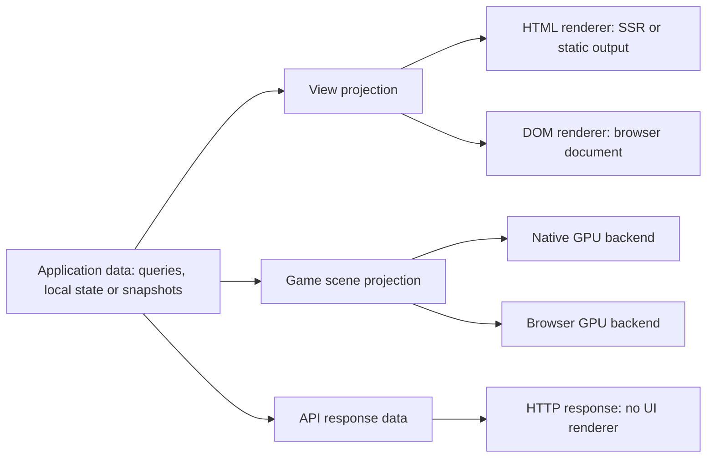
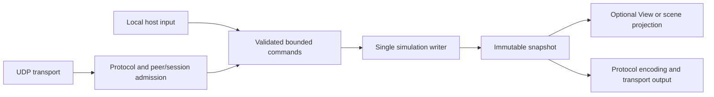

# M28 — Composable Application and Multi-Host Plan

- **Date:** 2026-11-17.
- **State:** M28-A and the owner clarification amendment are complete at independently reviewed documentation scope. M28-B through M28-E remain unimplemented/unqualified.
- **Source baseline:** `c9437357b2bb9e88a13a09435ed9645cea5462a8`, observed remote master at the start of the initial study; this amendment starts from `4e5bdc1c52f4e724f093467478958563dd98ede2`.
- **Decision:** [ADR 0013](adr/0013-composable-application-and-hosts.md) is **Proposed**. A successful document review does not accept its runtime design.
- **Tracking:** [M28 backlog](BACKLOG.md#m28--composable-application-and-multi-host-research), [milestone gates](ROADMAP.md#m28--composable-application-and-multi-host-research).

## Scope and authority

The owner requested investigation of **Yetlet — Composable Application Framework**.
Historical HTML-first language describes existing delivery; it does not constrain
this study. This document does not rename the product, rewrite public package
descriptions, accept a new framework API, refactor Axum, or authorize publication.
The current SDK and CLI contracts remain in force.

The requested end state permits an application without HTTP, a socket, a window,
a GPU, Axum, or Tokio. A host supplies selected execution facilities. Rendering,
transport and protocol remain different responsibilities. Ordinary Rust
composition and explicit opt-in are the starting point.

Requirement provenance:

| Source | Required boundary |
|---|---|
| Explicit owner request, M28 handoff sections 2–12 | Source inventory, at least two candidates, Proposed ADR, staged implementation and acceptance plan, independent review; this delivery changes documentation only |
| Explicit owner request, sections 5–8 | Multiple hosts, one authoritative simulation, thread ownership, bounded ingress, transport/protocol separation and renderer separation |
| Existing [ADR 0011](adr/0011-application-startup-api.md) and [ADR 0012](adr/0012-server-axum-prelude.md) | Preserve Axum startup, native escape hatch, prelude and existing paths |
| Existing [repository instructions](../AGENTS.md) | English documentation, evidence-scoped platform checks, retained failures, strict/builtin Git guard |
| Design assumptions in this plan | Two-player integer-coordinate example and initial numeric budgets; proposed choices to freeze or adjust explicitly in their implementation slice, not already accepted product guarantees |

## 1. Source inventory and gaps

The directory names in the handoff must not be mistaken for current crate
boundaries. The root [workspace](../Cargo.toml) has two public SDK packages,
`yetlet` and `yetlet-browser`. The old Core, Actions, Reactive, DOM, server-Axum
and wgpu directories are historical guide entries.

| Inspected surface | Current carrier and evidence | Useful boundary | Remaining coupling or gap |
|---|---|---|---|
| `crates/yetlet-core` | [Historical entry](../crates/yetlet-core/README.md); [current View implementation](../crates/yetlet/src/view/mod.rs) | Owned View values and ordinary component functions need no runtime | View contains text/elements/attributes; it is not a general game scene |
| `crates/yetlet-actions` | [Historical entry](../crates/yetlet-actions/README.md); [current actions](../crates/yetlet/src/actions/mod.rs) | `Command`, static `ActionExecutor<C>`, `LocalExecutor` do not require HTTP, serialization of local commands, or Send futures | Actions feature includes Serde and HTTP error-envelope vocabulary; there is no scheduler, bounded mailbox, host lifecycle or simulation authority |
| `crates/yetlet-reactive` | [Historical entry](../crates/yetlet-reactive/README.md); [current local graph](../crates/yetlet/src/reactive/mod.rs) | Explicit owner, weak handles, disposal, bounded reentrant passes and published-state reads are useful patterns | `Rc<RefCell<_>>`, synchronous callbacks and local queues are intentionally local; pass limit is not a cross-thread queue-capacity guarantee |
| `crates/yetlet` | [Feature manifest](../crates/yetlet/Cargo.toml), [target gates](../crates/yetlet/src/lib.rs) | Default HTML and opt-in native modules already avoid a mandatory server runtime | No general Application owner or Host contract is implemented; current package wording remains historical |
| `crates/yetlet-server-axum` | [Historical entry](../crates/yetlet-server-axum/README.md); [App](../crates/yetlet/src/server_axum/app.rs), [adapter](../crates/yetlet/src/server_axum/mod.rs) | Opt-in native adapter; `into_router` retains Axum/Tower composition | `App<S>` holds `Router<S>`; its constructors require `S: Clone + Send + Sync + 'static`; serving uses Tokio TCP and Axum |
| `crates/yetlet/src/actions` | [Executor implementation](../crates/yetlet/src/actions/mod.rs) | Domain commands can execute locally; no mandatory remote event circuit | Async method syntax alone does not create a runtime or guarantee Send; queued admission must not be reported as completed domain work |
| `crates/yetlet-browser` | [Manifest](../crates/yetlet-browser/Cargo.toml), [HTTP executor](../crates/yetlet-browser/src/actions/mod.rs) | One-way dependency on base package; HTTP transport is explicitly selected | HTTP executor uses WASM/browser fetch, same-origin endpoint rules, Serde and HTTP status; it is not a native UDP executor |
| `crates/yetlet-dom` | [Historical entry](../crates/yetlet-dom/README.md); [DOM implementation](../crates/yetlet-browser/src/dom/mod.rs) | Shared View and bounded validation can be reused for actual UI | DOM mounting, browser object ownership and HTML vocabulary remain browser-specific |
| `crates/yetlet-wgpu` | [Historical entry](../crates/yetlet-wgpu/README.md); [current CPU contracts](../crates/yetlet-browser/src/wgpu/mod.rs), [browser backend](../crates/yetlet-browser/src/wgpu/browser.rs) | Bounded records, checked versions, lifetime retirement and CPU validation provide precedents | `wgpu` is a CPU-contract feature; `wgpu-browser` selects actual WASM/canvas backend. This is not a native GameHost or complete scene engine |
| `examples/physics-lab` | [Standalone manifest](../examples/physics-lab/Cargo.toml), [sample](../examples/physics-lab/README.md), [simulation](../examples/physics-lab/src/physics.rs) | CPU simulation/snapshots and fixed-step clock are separated from private GPU code | Native executable is Axum/Tokio SSR; active scene is browser/WASM, private GPU owns canvas and generation. The nested workspace does not prove a native winit host |
| `examples/webgpu-scene-research` | [Manifest](../examples/webgpu-scene-research/Cargo.toml), [record](../examples/webgpu-scene-research/README.md) | Native offscreen wgpu 27.0.1/Vulkan proof without Yetlet, DOM, window or HTTP | It has no window/event loop, playable game, networking or multi-host lifecycle; historical measurements are not M28 results |
| Shared identity | [View binding contracts](../crates/yetlet/src/view/binding.rs) | Keys/identity and explicit ownership may inform application composition | HTML slot/attribute constraints are not entity IDs, GPU handles or network peer authentication |

### Dependency observations

Read-only `cargo tree --offline --locked --edges normal` observations at the
source baseline:

| Selection | Observed normal graph |
|---|---|
| `-p yetlet` | Base package only; default HTML adds no normal external dependency |
| `-p yetlet --no-default-features --features actions,reactive` | Base package plus Serde and its derive dependencies; no Axum, Tokio, winit or wgpu |
| `-p yetlet-browser --no-default-features --features wgpu` on native | Browser package plus base package; no GPU backend selected |

These are dependency inspections, not compile, runtime, visual, browser or
network qualification. Dev-dependencies and a full workspace build can have a
larger graph. Actual browser wgpu is target-gated and pinned at 27.0.1 in the
repository. M28-C must select and lock its own compatible winit/wgpu pair; this
study does not upgrade existing dependencies.

### Existing decisions

[ADR 0001](adr/0001-separation-of-concerns.md) already separates execution,
rendering, interactivity and action transport. [ADR 0003](adr/0003-renderers-and-loading.md)
keeps GPU scenes separate from HTML/DOM. [ADR 0005](adr/0005-opt-in-capability-modules.md)
prefers native composition and optional capability costs. These support this
research direction, but none proves a general host lifecycle.

ADRs 0011/0012 deliberately scope `server_axum::App` to the Axum adapter.
In particular, `serve()` is loopback HTTP on port 7878, the application owns its
Tokio runtime, and coordinated shutdown uses native Axum via `into_router()`.
Do not reinterpret that App as an already existing universal Application.

## 2. Candidate comparison

| Candidate | Shape | Abstraction and dependency cost | Thread/lifecycle fit | Compatibility and decision |
|---|---|---|---|---|
| A — Explicit composition with application-owned ports | Concrete owner, typed command ingress, immutable snapshot reads and explicit start/stop/join functions in a research example | No public Host trait, registry, container or new SDK crate; channels and snapshot cost are explicit | Foreground loop stays on its required thread; background workers may use std threads or a caller-owned async runtime | Recommended for B–D; existing Axum API unchanged; repeated contracts can later justify extraction |
| B — Static generic lifecycle adapters | A small private lifecycle interface plus separate foreground/background adapters and typed capabilities | More generic bounds and adapter boilerplate; can remain runtime-neutral without dynamic dispatch | Viable only if it does not require every host to be Send, async, or driven by one executor; foreground run cannot be disguised as background spawn | Candidate for E if at least two real consumers repeat the same contract and the API simplifies their code |
| C — Dynamic HostGroup runtime | Trait objects, registry, dynamic addition/removal and a universal run/supervision interface | Boxed futures/object-safety decisions, registration state, error normalization, lifecycle synchronization and larger API surface | A universal Send future or poll-all-hosts loop conflicts with foreground ownership; would need separate execution classes anyway | Reject for the initial POC; dynamic membership has no demonstrated requirement |

The recommendation is not that no abstraction will ever be useful. The
demonstrated common boundary is **commands, snapshots and explicit lifetime**.
Whether this needs a public `Application` type is an M28-E decision. HostGroup
is initially the composition root's coordination responsibility, not a required
exported class or trait.

## 3. Responsibility and ownership

### Independent composition dimensions

Host (events/resources/lifecycle), renderer (output), execution model
(caller thread, task, worker or process), and state policy are independent
choices. Orthogonal does not mean every pairing is valid: the selected data
representation and environment must support it. A host may use zero, one or
multiple compatible renderers; it does not select a backend by type alone.

This output-capability map is not a deployment or shared-memory diagram.
Queries/local state and simulation snapshots are alternative data sources.
A remote browser has its own process/context and receives data explicitly.

The next diagram is specifically the proposed shared-game-state pattern, not a
mandatory framework request pipeline. Only routes deliberately operating that
simulation use its ingress; ordinary Web handlers call their services directly.

| Responsibility | Owner | Minimal boundary |
|---|---|---|
| Domain state/invariants | Application-selected state/service design | Shared simulation has one writer; Web services need not become one global actor |
| Events/commands | Selected host and domain boundary | Semantic intent and validation; bounded queued admission where the application selects it |
| Snapshots | Shared-state POC publisher | Immutable generation/revision/tick values, no mutable domain alias; not compulsory for Web requests |
| Host lifecycle | Concrete host, coordinated by composition root | Readiness, failure, stop and resource release independent of execution thread count |
| Execution topology | Caller/composition root | Owns scheduler, runtime and any selected workers; no implicit one-thread/process-per-host |
| Transport and Protocol | Separate concrete adapters/codecs | IO versus message/version/validation; neither is a renderer |
| Output projection | Application | View, SceneData or API DTO; no universal render-data representation |
| Renderer | Compatible selected backend | HTML/DOM/GPU output without direct authoritative simulation mutation |
| Window/surface | Foreground host and renderer with explicit lifetime | Main-thread callbacks and backend resource ownership remain distinct |

Identity, typed actions and explicit subscription/disposal patterns remain
reusable where their existing semantics fit. Camera, mesh, materials, textures,
pipelines and hit testing stay game/rendering concerns. No rendering may simply
mean that no renderer is constructed.

### Execution ownership

Multiple hosts normally compose in one application process. A host can be
caller-driven, comprise several async tasks on a shared runtime, or own an
explicit worker when its workload needs one. Host count determines neither
thread count nor process count. A caller-driven lifecycle is still a lifecycle.

| Mode | Example | Ownership rule |
|---|---|---|
| Caller-thread / event-loop driven | B1 cooperative hosts; native window callbacks | No new worker required; respect affinity and avoid blocking the loop |
| Tasks on a shared runtime | Axum plus an explicitly async network adapter | Many tasks may share runtime threads; one host may own several tasks; host stop does not own runtime shutdown |
| Dedicated worker | Selected simulation or blocking native socket worker | Explicit stop and completion/join; do not impose this on other hosts |
| Separate application process | D's second player/client or future isolated deployment | Explicit protocol/transport and supervisor authority; no shared Rust Arc/state references across the boundary |

For C/D, one foreground thread, a simulation worker and a network worker remain
a proposed example topology, not an Application/Host requirement. The browser
is its own event-loop environment, not a native background thread created by
Axum. One native process can contain GameHost plus NetworkHost plus Axum without
creating three child processes. Generic process supervision/IPC is deferred.

Only values actually crossing threads require the applicable Send/Sync bounds.
B1 uses Rc-owned local data without universal Send. A latest-snapshot slot may
hold Arc<Snapshot> behind a short-lived mutex; clone the Arc, release the lock,
then render or serialize. Payloads contain no mutable alias to GameState.
Across processes use explicit messages and keep a single authoritative
simulation with read-only replicas, not independent authorities.

The [winit contract](https://docs.rs/winit/latest/winit/event_loop/struct.EventLoopBuilder.html)
requires main-thread event-loop creation for portable use. Callback-driven
readiness avoids blocking before the loop can initialize its window. A shared
foreground loop is a scarce platform resource, not something each Host creates.
[Tokio tasks](https://docs.rs/tokio/latest/tokio/task/) are scheduled by a runtime,
not one OS thread each. The [bridging guide](https://tokio.rs/tokio/topics/bridging)
explains caller-owned runtime integration; a current-thread runtime must remain
driven. These references constrain the design, not force a new dependency.

### Pure Web preservation

Pure API and SSR remain first-class application modes. No universal Application
owner, HostGroup, actor, command queue, tick, snapshot publication, GPU renderer
or additional supervisor/thread/process is required on their direct HTTP path.
Existing App, native Router/Tower handlers/middleware, extractors/responses,
state and explicit listener/runtime/graceful-shutdown control remain available.
Existing Web CLI templates need no new bootstrap ceremony.

API-only code need not construct or call a UI renderer. This does not claim a
feature-graph change: current server-axum enables html, and that existing
compile-time relationship is preserved. HTML serialization remains useful
without an HTTP listener as well. Only a Web route explicitly controlling a
shared simulation must use that simulation's command/snapshot boundary.

The cost principle is **no mandatory composition overhead**, not a measured
zero-overhead guarantee. Optional multi-host features may not add compulsory
queues, allocations, locks, dependencies or workers to the existing Web path.
Normal Axum/Tokio costs remain. B0 records current source/features/behavior;
later HTTP-path changes require focused before/after evidence. Unchanged source
and graphs do not manufacture a benchmark result; universal zero latency or
throughput regression is not claimed.

## 4. State, scheduling and lifecycle contract

### Single writer and alternatives

| Mechanism | Value | Cost or correctness limitation | Proposed use |
|---|---|---|---|
| Shared `Arc<Mutex<GameState>>` across every host | Small initial code | Hosts can bypass ordering/validation, hold locks during IO/rendering and introduce contention; mutual exclusion alone does not define tick semantics | Do not expose this as the multi-host state model |
| Bounded channels/message passing | Clear ownership, ordered admission, measurable overload | Queue capacity, closure, fairness and application acknowledgment need definition | Use for discrete control commands |
| Latest-value slots | Bounded memory; obsolete input/snapshots can be replaced | Intermediate states intentionally disappear; unsuitable for irreversible one-shot commands | Use for held movement state and rendering/network snapshots |
| Existing LocalGraph | Useful explicit local lifetime and subscription behavior | Rc/RefCell and synchronous observer semantics do not provide cross-thread scheduling | Optional local UI use; no conversion into the simulation runtime |

All producers target the same owner. NetworkHost cannot obtain `&mut GameState`.
In a two-process game the host process owns the only authoritative simulation;
the client process holds a read-only snapshot replica and client UI state.
A future prediction buffer would be distinct and is not part of D.

Admission is not execution. A queued command can return an admission ticket,
while actual application/rejection is reflected in an owner result or snapshot.
The existing ActionExecutor may adapt a typed command where that response
meaning is explicit; it is not a new mailbox, clock or RPC runtime.

### Fixed tick

C uses an original two-square arena with bounded integer coordinates, cardinal
movement and host-local Pause/Resume. It has no Rapier, ECS, rollback or asset
pipeline dependency. Proposed simulation rate is 60 ticks/s. The reducer takes
a tick and a stable, ordered set of commands; it does not read a wall clock,
window or network object.

Headless tests supply tick/input sequences directly. Native scheduling uses a
monotonic clock, a bounded catch-up policy (initial proposal: at most four steps,
admit at most 100 ms of elapsed time, record discarded debt), and no claim of
hard real-time execution. Render callbacks read the newest snapshot at their
own cadence. Pause clears timing debt and held movement; resuming does not
replay a wall-time backlog. Network freshness timers continue while gameplay is
paused. Movement tick and snapshot revision remain distinct.

The owner chooses a stable order for commands consumed at each tick. Record
admitted command order for replay; live network arrival order is not promised
to be deterministic. Tests prove identical output for the same initial state,
ordered inputs, source and arithmetic, not arbitrary floating-point physics or
cross-device replay.

### Readiness, failure and shutdown

Every host has a logical resource lifetime even when it has no dedicated thread.
Use Prepared, Starting, Running, Stopping and Stopped as observable phases;
a failure also records cleanup as pending, complete or timed out. Failed does
not imply that an owned thread/task has terminated. No public lifecycle trait
or separate supervisory thread is required to describe those outcomes.

The composition root coordinates its selected components; concrete hosts own
their resources and report readiness/failure/completion. Shared scheduler/runtime
ownership stays with the caller. Stopping one host must not shut down a borrowed
runtime or unrelated tasks. For a single Web server, reuse existing native
startup/graceful-shutdown behavior; do not add a new lifecycle API to App::serve().

For the shared-state POC:

1. Validate configuration and construct the owner/ports without implicit IO.
2. Prepare selected hosts with ingress closed. Caller-driven hosts need no spawned worker; an explicitly owned worker reports readiness/failure.
3. If a foreground host is selected, enter its event loop on the required thread. Window/GPU readiness is produced by callbacks, not a wait before entering the loop.
4. Open ingress after all required components are ready. No unrelated listener, renderer or scheduler is created.
5. Required host/owner failure or foreground exit closes ingress and requests coordinated stop, preserving the primary error.
6. Reject late generations, cancel/wake owned work through a non-starvable control path, and stop publication. Detach callbacks/listeners/subscriptions where applicable.
7. Observe completion of actual owned tasks/threads and release resources in dependency order. Do not join a nonexistent worker or terminate a caller-shared runtime; retain cleanup errors.

B2/D propose a five-second completion observation, not forced termination.
A deadline expiry remains failed/incomplete cleanup with live/uncertain work;
dropping a thread join handle is not joining it. Suspend/Resume/Pause are
capability-specific behaviors, not compulsory lifecycle methods for all hosts.

All POC hosts are required unless a selected optional policy is separately tested.
There is no silent LAN-to-local downgrade. A peer timeout removes that peer,
not its NetworkHost. Host membership stays static for B–D; reconnect is not
host hot-plugging and does not require process creation.

simulation advancement. They are not interchangeable. Use checked counters;
exhaustion fails or creates a new explicitly fenced lifetime rather than wrapping
into a valid old identity.

## 5. NetworkHost, Transport and Protocol

RPC is a possible later semantic API. It is not the multiplayer host foundation.

| Candidate | Semantics and useful workload | Initial decision |
|---|---|---|
| Local/InMemory | Direct bounded delivery and controlled fault fixtures without a socket | B and D1; cannot establish native network or LAN evidence |
| UDP | Datagram delivery for replaceable input and complete snapshots; application handles loss/order/session policy | D2/D3 first native transport |
| TCP | Reliable ordered byte stream; explicit framing still needed; useful for control/turn-based applications | Compare only; do not implement a second transport merely to justify a trait |
| QUIC | Reliable streams plus separately negotiated unreliable datagrams; mature library, handshake/security/runtime costs | Future candidate; no home-grown QUIC or cryptography |
| WebSocket | Message transport suitable for a future browser adapter with its own origin/security rules | Future adapter; browser support does not imply raw native UDP access |

The distinctions follow [RFC 8085](https://www.rfc-editor.org/rfc/rfc8085.html),
[TCP](https://www.rfc-editor.org/rfc/rfc9293.html),
[QUIC DATAGRAM](https://www.rfc-editor.org/rfc/rfc9221.html) and
[WebSockets](https://websockets.spec.whatwg.org/). Do not hide stream/datagram
or reliability differences behind a premature universal send method.

### Proposed D contract

D1 freezes one small internal wire contract before D2 sends bytes. It includes
magic, protocol version, message kind, exact encoded length, server epoch,
session ID, server-issued peer ID, per-direction sequence, and relevant tick.
Use fixed byte order, finite fields and a bounded decoder. Unknown versions,
unknown message kinds, trailing/truncated bytes and invalid input bits fail
before domain admission.

Message set: Join, Welcome, InputState, Snapshot, Leave and bounded Reject.
Join carries a client attempt nonce; Welcome echoes it and assigns a fresh
server/session identity. Retries reuse the same attempt nonce and return the
same live assignment within a bounded pending-entry lifetime. Only an InputState
that returns that assignment from the expected endpoint activates snapshot
delivery. A new join attempt/reconnect fences previous Welcome/Input/Leave and
snapshot traffic. Join retries and pending entries are finite; this is not a
general reliable-message layer.

Use checked u64 sequence numbers initially. Reject duplicate/older sequence
numbers within the current session; end the session before overflow. A future
wrapping sequence design must specify modular comparison and ambiguous windows,
as illustrated by [RFC 1982](https://www.rfc-editor.org/rfc/rfc1982.html).
The client cannot advance server simulation time by claiming a large tick.

InputState periodically carries complete held movement state. A lost release is
repaired by a later full state or input freshness expiry. Do not place Pause,
purchases or other one-shot irreversible commands on this replaceable channel.
Pause remains host-local in D. Snapshots contain the entire tiny two-player state;
no delta baseline, retransmission history, prediction or interpolation is required.

Initial implementation hypotheses, to freeze and disclose before their tests:

| Resource or policy | Proposed bound |
|---|---|
| Player count | Two total: local host player plus one remote peer |
| Control command queue | 16 entries; try-admission returns Full or Closed |
| Movement and snapshots | One replaceable input slot per player; one latest snapshot per consumer |
| Processing fairness | Finite per-tick control work; at most one latest movement state per player; finite network receive work before checking stop |
| UDP payload | At most 512 bytes including application header; no application fragmentation |
| Receive storage | At least maximum payload plus one byte; reject oversize/truncation outcomes before decode |
| Send rates | At most 30 input datagrams/s and 20 snapshots/s per remote peer |
| Input freshness and peer timeout | Initially 250 ms and 3 seconds, measured by monotonic local time |
| Join control | At most three retries per attempt, one bounded pending remote assignment, bounded reply rate |
| Fault fixture | Fixed seed, 10% drop, 5% duplicate, up to 100 ms reorder delay, finite buffer and test duration |

The payload budget is an application limit, not a universal MTU or
fragmentation guarantee. D records the tested path/MTU assumptions. At these
proposed maxima, data traffic is at most 25,600 application bytes/s per remote
peer before control and UDP/IP headers; this is arithmetic, not measured
throughput or a safe Internet congestion-control policy.

Use `std::net::UdpSocket` first if it meets the bounded POC; its
[documented behavior](https://doc.rust-lang.org/std/net/struct.UdpSocket.html)
includes possible receive truncation and a connectionless peer-selection API.
UDP connect is not a session handshake. A worker uses bounded IO waits or
nonblocking polling plus a wake mechanism; dropping another socket clone is
not assumed to cancel a blocked read.

### Trust and reconnect

Default binds are explicit IPv4 loopback; integration tests may use port zero
and record the actual endpoint. Physical LAN mode requires an explicit selected
interface address. No implicit wildcard bind, discovery broadcast, firewall
change, UPnP or NAT traversal is included.

NetworkHost maps endpoint plus current epoch/session to a server-assigned peer,
enforces bounds/rate/freshness, then submits authorized movement. Endpoint or
token matching is not cryptographic user authentication. Unencrypted LAN tokens
do not resist an on-path attacker; this POC assumes a controlled test network.
Unknown senders must not trigger large snapshots or unbounded allocation.
If authenticated/encrypted hostile-LAN or Internet service becomes a requirement,
select a mature secure transport in a later decision.

Leave is advisory; correctness relies on local stop and timeout. Reconnect
creates a fresh session; delayed old commands, Leave, Welcome and snapshots
cannot revive or delete the replacement. Reject/timeout reasons and bounded
counters are observable. A stopped host stops ingress and sending before
declaring its socket and workers released.

## 6. Renderer and GPU lifecycle

Renderer choice is independent of Host identity, subject to compatible output
data and environment capabilities. View is data; a browser is an execution
environment. Neither is itself a rendering backend. An application may select
zero, one or multiple compatible renderers without adding a universal trait.

| Output model | Compatible output path | Boundary |
|---|---|---|
| Existing Yetlet View | HTML serialization for SSR or static output; DOM rendering in a browser document | Preserve both existing paths; HTML serialization does not require an Axum listener |
| Game SceneData | Native wgpu or browser WebGPU adapter where separately implemented/qualified | Do not promise one shared native/browser game backend or force scene objects into HTML View |
| API DTO / domain response | Existing HTTP response/serialization | No UI renderer, game scene or simulation snapshot required |
| Headless simulation | No rendering output | No window/GPU construction and no mandatory NullRenderer |

A browser application may combine DOM UI and a WebGPU canvas; a Web host may
serve both API and SSR routes, or API only. Compatibility is not an automatic
mapping from Host type to backend. A native window does not acquire DOM support
without a separately chosen browser/WebView environment, which is outside this
POC. Stateless HTML rendering need not implement an artificial start/stop loop;
DOM owners dispose subscriptions/listeners and GPU owners release resources.

For C, GameHost owns event-loop/window lifetime; the chosen WgpuRenderer owns
surface configuration, device/queue, buffers and pipeline. It retains the
window for the surface lifetime. Resize/minimize changes presentation, not
GameState. Zero-size windows suspend rendering; outstanding frames are released
before reconfiguration. Surface/device errors use bounded explicit handling.
The [surface reference](https://docs.rs/wgpu/30.0.2/wgpu/struct.Surface.html)
is research, not a selected upgrade; C checks its pinned version.

Real visual evidence records backend, adapter/device type, environment, window
presentation and keyboard interaction. Offscreen, software, hardware and compile
results are separate evidence classes. The browser/native compatibility map is
not additional C scope or proof that every pairing works today.
## 7. Work breakdown and dependencies

Only YT-265 is in the current authorized implementation scope, and it is
documentation-only. B–E below are a proposed execution plan, not automatic
authority to start runtime work.

| ID | Stage | Deliverable and minimum acceptance | Dependencies |
|---|---|---|---|
| ID | Stage | Deliverable and minimum acceptance | Dependencies |
|---|---|---|---|
| YT-265 | A | Source inventory, candidates, Proposed ADR, corrected orthogonal boundaries and pure-Web preservation plan; independent document review | None |
| YT-276 | B0 | Focused existing pure API/SSR compatibility baseline and normal feature graph; no new runtime API or universal actor; preserve native Axum lifecycle | YT-265 |
| YT-266 | B1 | Private example: two cooperative caller-thread hosts, distinct lifetimes and one shared owner; bounded commands/snapshots, no socket/GPU/Tokio or dedicated worker required | YT-276 |
| YT-267 | B2 | One explicitly owned worker variation plus readiness/failure/saturation/stop; cleanup respects shared scheduler ownership; preserve B0 Web path | YT-266 |
| YT-268 | C1 | Original integer-coordinate two-square simulation and headless runner using the same reducer; deterministic ordered-input tests | YT-267 |
| YT-269 | C2 | Native winit/wgpu GameHost with independently selected scene backend; keyboard movement, Pause and render cadence decoupling | YT-268 |
| YT-270 | C3 | Actual native GPU/window controls, resize/minimize/error/exit evidence, bounded scheduling and measured costs | YT-269 |
| YT-271 | D1 | Internal bounded wire/session contract and InMemory codec/admission/freshness tests; no transport trait promotion | YT-267, YT-268 |
| YT-272 | D2 | Two independent application processes with real UDP: host process composes GameHost plus NetworkHost, client composes GameHost plus NetworkClient; only host owns authority | YT-270, YT-271 |
| YT-273 | D3 | Seeded socket loss/duplicate/reorder, freshness, overload, reconnect/stop and headless network composition | YT-272 |
| YT-274 | D4 conditional | Two physical LAN devices with explicit interface/evidence when available | YT-273 |
| YT-275 | E | Evidence-based promotion decision including pure-Web preservation, API/crate/adapter/template/positioning scope | YT-276, YT-270, YT-273 |

YT-276 is appended without renumbering existing IDs and runs first in B.
D1 can proceed after C1/B2 independently of GPU work. D4 is optional for making
an honest E decision, not for claiming physical-LAN support. Two-process D
means two application instances, not one process for each Host.

### M28-B acceptance

| Gate | Observable result |
|---|---|
| B0 direct API path | Existing Axum handlers and native Router/Tower still serve API responses without constructing a renderer or game/composition runtime; preserve App, prelude, state and native escape hatches |
| B0 SSR path | Existing View-to-HTML SSR remains usable; no GPU, game SceneData, global tick or snapshot subscription is introduced |
| B0 optional costs | Locked normal dependency/feature inspection shows no new winit/wgpu/UDP-host dependency or compulsory scheduler. Compare with existing Web features; server-axum currently enables html, which is not a newly removable requirement |
| B0 evidence scope | Use existing focused API-compatibility, startup, prelude and relevant HTTP/SSR tests; record exact source/features/results. Reuse unaffected platform receipts; no broad browser/Windows rerun or performance certification |
| B1 same-thread composition | Two concrete hosts with separate lifecycle state cooperate on the same caller thread, including Rc-owned local data, using one owner and matching snapshot generation/revision; no one-thread-per-host assumption |
| B1 no IO assumption | The selected POC creates no socket, window, GPU or HTTP listener; normal graph excludes those backends. B0's separate HTTP evidence is not attributed to this no-IO run |
| B2 execution variation | One explicitly owned background worker uses the same domain contract; record which component owns it, without introducing a framework runtime |
| B2 startup | A required host fails to start; already-started owned resources are stopped/released and worker completion is observed; group never becomes Running |
| B2 runtime failure | Required host/owner failure reaches the coordinator and stops the group, preserving the cause |
| B2 overload and stop | Queue full, closed ingress and late generation have explicit outcomes; stop is not blocked by saturation |
| B2 lifecycle vs scheduler | Host cleanup releases its callbacks/subscriptions/tasks/resources without claiming ownership of a caller-shared scheduler. Host lifecycle can finish with no dedicated thread to join; shared scheduler stays usable |
| B2 cleanup and compatibility | Actual owned workers are joined; timeout remains incomplete cleanup. B0's direct Web API/SSR path is unchanged; recheck only evidence invalidated by changes |

B0 records the existing compatibility baseline without creating another HTTP
harness or rewriting product code. Then B1 uses an isolated publish=false
example, proposed `examples/composable-host-research/`, with its own lock and
no root default-workspace expansion. Use concrete functions/structs and existing
typed actions where useful. No public Application, Host, HostGroup, Renderer or
Transport API is introduced. B2 adds the worker/failure cases, C adds native
rendering and D adds networking. A BrowserHost, dynamic host manager or generic
process supervisor is not added to make the documentation matrix appear complete.

### M28-C acceptance

| Gate | Observable result |
|---|---|
| C1 deterministic domain | Same initial state and ordered commands over explicit ticks yield identical states/hashes; pause, bounds and checked counter exhaustion are covered |
| C1 headless isolation | Same simulation runs without window/display variables, GPU construction or socket; selected normal graph excludes graphical/network dependencies |
| C2 interaction | Actual keyboard movement and Pause/Resume change authoritative simulation; render consumes snapshots only |
| C2 frame separation | Different scripted render cadences preserve the same explicit-tick simulation result |
| C3 scheduler bounds | Slow callbacks/catch-up never cause an unbounded work loop; dropped debt is visible |
| C3 lifecycle | Resize, zero-size/minimize, error and close follow foreground ownership; background workers terminate |
| C3 visual | Real native window shows the expected rectangles; backend/adapter and screenshots/readback are retained |
| C3 scope | One supported Ubuntu graphics path is enough for this shared design; no Windows, browser, mobile or hardware claim without corresponding evidence |

Do not install or launch graphical tools in A. C inspects actual available
hardware/backend before one bounded visual attempt. Missing GPU capability leaves
that gate unverified; compiling or selecting a no-op backend cannot turn it PASS.

### M28-D acceptance

| Gate | Observable result |
|---|---|
| D1 decode/session | Unknown version/type, excess length, truncation, invalid bits, bad peer/session/epoch and sequence exhaustion are rejected with state unchanged |
| D1 authority | Peer mapping comes from NetworkHost; local and remote inputs target the same simulation owner |
| D2 real transport | Separate PIDs, actual endpoints and send/receive/session counters; a real socket exchange rather than in-process transport |
| D2 visible game | Both independent processes show both players moving using received authoritative snapshots |
| D3 controlled faults | Fixed-seed user-space fault adapter/proxy records actual drops/duplicates/reordering with bounded buffers; old input/snapshot cannot overwrite newer state |
| D3 convergence | After faults cease, a fresh complete snapshot restores the client to the corresponding authoritative revision; no smoothness guarantee |
| D3 safety | Lost release expires to neutral input; malformed/flood input stays bounded and cannot starve stop or simulation |
| D3 reconnect | Delayed old Input/Leave/Welcome/Snapshot cannot affect the replacement session; timeout removes only that peer |
| D3 lifecycle | Bind failure, worker failure, host exit and client exit have bounded observable cleanup; no uncertain worker is labeled stopped |
| D3 headless | Same authoritative simulation with NetworkHost runs without window/GPU/HTTP |
| D4 physical LAN | Distinct physical devices and explicit LAN addresses with real traffic; unavailable equipment remains Not verified |

Use a small scoped fixture around the POC, not a new validation framework or OS
network-policy modification. Decoder tests and an InMemory fault fixture do not
replace D2/D3 process/socket evidence.

### M28-E promotion gate

E produces a reviewed decision, not an automatic package release:

1. Compare B–D evidence with the original target scenarios and report unsupported combinations.
2. Preserve the B0 pure-Web contract before promoting any shared runtime/module. Reuse exact-source evidence when unchanged; test only affected paths if an implementation changes HTTP or feature boundaries.
3. Extract an Application/Host contract only where consumers demonstrate useful shared invariants. State policy, render-data policy and execution topology remain independent choices; no universal game actor.
4. Decide whether a module, private example or independent crate is justified. Keep Axum App, native Router/Tower and its direct request path intact; an optional composition adapter may consume into_router().
5. Decide whether a CLI game template has a repeatable supported dependency/tooling story. Existing Web templates remain equally supported and need no new HostGroup bootstrap.
6. Decide product positioning only after POC evidence. Promote, simplify, retain private, or reject are valid outcomes; keep ADR Proposed until owner acceptance.

The target matrix includes pure Web/API/SSR, standalone game, headless,
GameHost plus NetworkHost, GameHost plus NetworkClient, headless plus network,
game plus network plus Axum, and CustomHost. Browser DOM and browser GPU are
compatible output directions, not a newly implemented BrowserHost. B–D do not
prove the three-host Axum combination, every renderer combination or CustomHost.
E identifies any additional bounded work needed before claiming those capabilities.

## 8. Costs, risks and migration

| Risk or cost | Consequence | Bounded response/evidence |
|---|---|---|
| Over-generalization | More traits, lifetimes and public API obligations than consumers justify | Keep examples/private ports first; compare repeated code before E |
| Foreground affinity | Startup deadlock or invalid window/surface operations | Main-thread ownership and callback-driven readiness; real C lifecycle proof |
| Queue and lock cost | Admission contention, allocations and lag | Bound queues/slots; never hold snapshot lock during renderer/IO; measure high-water and latency |
| Snapshot copy cost | O(P) projection/copy at publication; serialization and GPU upload are additional costs | P is two players initially; Arc saves reader copies, not producer projection or network serialization |
| Fixed tick lag | Slow work can delay input or discard wall-time debt | Bound catch-up, record tick drift/debt; no hard real-time claim |
| Native threads/runtime | Stack memory, scheduling/context switches and extra shutdown ownership | Explicitly count owners/workers; no hidden runtime; record actual resource use |
| UDP limitations | Lost/reordered input, stale replicas and uncontrolled exposure | Full input/snapshots, expiry/session fences, loopback default, bounded traffic and controlled-network scope |
| Compatibility drift | Accidental SDK feature/default or API changes | No A product edits; B–D private feature graphs; retain existing Axum tests as affected |
| Renderer reuse mismatch | HTML semantics forced into scene/game engine | Reuse only suitable identity/commands/lifetime patterns; game scene remains private |
| Platform evidence | Compile success mislabeled as visual/LAN/cross-platform support | Separate static, native, browser, GPU, process and physical-device evidence |
| Abandoned worker | Shutdown report hides a live thread/task | Explicit join result; report timeout and preserve uncertain execution |

Measure admission-to-application delay, tick work time/drift, queue high-water,
snapshot publication size, native frame presentation and shutdown duration on
the POC's exact backend. Report sample counts and conditions. This study has no
measured M28 performance result and sets no unsupported FPS/latency target.

Migration is additive. Existing `server_axum::App`, `serve`, `serve_on`,
`from_router`, `with_state`, `into_router` and prelude remain. Base/default
features stay GPU/network-runtime-free; browser dependencies stay one-way.
Do not move current browser wgpu into Core as a shortcut. A later promoted
runtime-neutral port may be supplied as Axum State, but the domain state itself
need not acquire Axum's bounds. No SDK/CLI version change or template migration
belongs to A.

## 9. Documentation verification and review boundary

A requires `cargo xtask check docs`, whitespace/new-file checks, focused local
links/anchors and independent semantic review. The existing docs checker validates
its required-file list, English documentation and backlog DAG; it does not
automatically prove every new ADR link or a runtime design. Inspect the new
document links explicitly without adding a new verification framework.

Store raw commands, failures, source identities, reviewer output and final
handoff in ignored evidence locations. Keep a short reviewed result here only
after terminal Reviewer output is available. The document review can complete
YT-265; all B–E runtime gates remain open.

### Initial M28-A acceptance at 4e5bdc1

Independent Reviewer `wc_job_p58KYVEFdOUlz_1C` completed with exit 0, actual JSON PASS and no issues/followups. Its role-directed Codex Job recorded `gpt-6-astra` with effective `high`; this was independent documentation review, not native managed-role identity or runtime assurance. Six reviewed hashes were unchanged, with only declared completion metadata added afterward. The initial docs gate passed with 29 required documents and 272 backlog items; 42 local links/anchors in the two new documents were checked. Original evidence remains under `.pipeline-output/m28-a-20261117/` and `artifacts/verification/m28-a-20261117/`.

### Owner clarification amendment — 2026-11-17

The owner confirmed preservation of View/HTML/DOM rendering, independent Host/Renderer composition, lifecycle separate from execution topology, and pure Web/API non-regression. This amendment corrects the general diagrams, bounds the single-writer model to the shared-state POC, and puts YT-276 / B0 before YT-266. Independent delta Reviewer `wc_job__Fg38dxSv31AqFr5` completed with exit 0, actual JSON PASS and no issues/followups. Observed model/effort were `gpt-6-astra` / `high`; this was a role-directed Job, not native managed-role dispatch. All five input hashes were unchanged at terminal observation. Only review/completion metadata and its header line break changed after review. Docs/DAG checks passed (29 required documents, 273 Backlog items), as did focused scope/whitespace and 42 local links/anchors. Evidence remains under `.pipeline-output/m28-a-web-preservation-20261117/`; original acceptance evidence is preserved separately.

**Runtime POC:** Not run. **ADR status:** Proposed. Neither document review establishes runtime capabilities or measured zero overhead.
