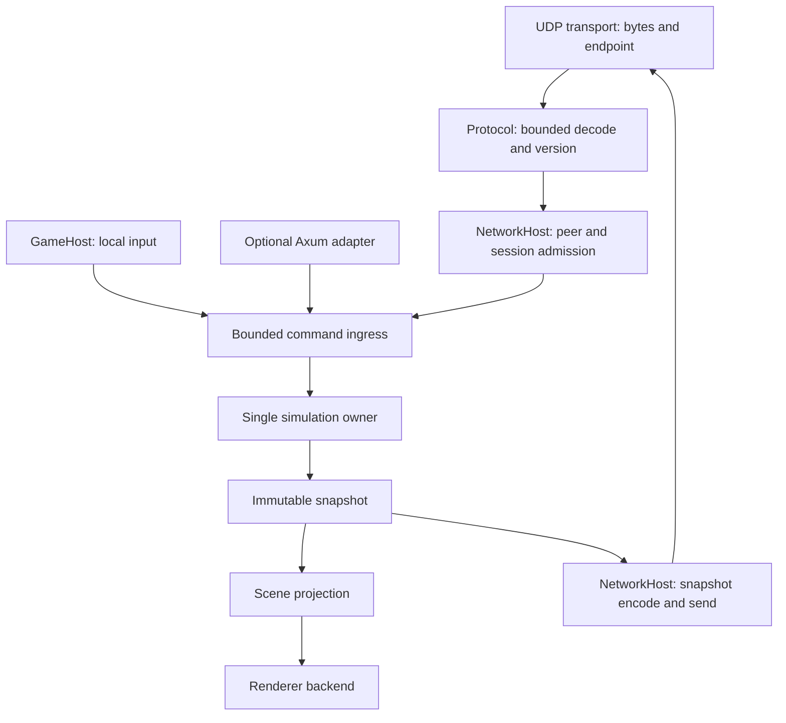

# M28 — Composable Application and Multi-Host Plan

- **Date:** 2026-11-17.
- **State:** M28-A complete at independently reviewed documentation scope. M28-B through M28-E are not implemented or qualified.
- **Source baseline:** `c9437357b2bb9e88a13a09435ed9645cea5462a8`, observed remote master at the start of this study.
- **Decision:** [ADR 0013](adr/0013-composable-application-and-hosts.md) is **Proposed**. A successful document review does not accept its runtime design.
- **Tracking:** [M28 backlog](BACKLOG.md#m28--composable-application-and-multi-host-research), [milestone gates](ROADMAP.md#m28--composable-application-and-multi-host-research).

## Scope and authority

The owner requested investigation of **Yetlet — Composable Application Framework**.
Historical HTML-first language describes existing delivery; it does not constrain
this study. This document does not rename the product, rewrite public package
descriptions, accept a new framework API, refactor Axum, or authorize publication.
The current SDK and CLI contracts remain in force.

The requested end state permits an application without HTTP, a socket, a window,
a GPU, Axum, or Tokio. A host supplies selected execution facilities. Rendering,
transport and protocol remain different responsibilities. Ordinary Rust
composition and explicit opt-in are the starting point.

Requirement provenance:

| Source | Required boundary |
|---|---|
| Explicit owner request, M28 handoff sections 2–12 | Source inventory, at least two candidates, Proposed ADR, staged implementation and acceptance plan, independent review; this delivery changes documentation only |
| Explicit owner request, sections 5–8 | Multiple hosts, one authoritative simulation, thread ownership, bounded ingress, transport/protocol separation and renderer separation |
| Existing [ADR 0011](adr/0011-application-startup-api.md) and [ADR 0012](adr/0012-server-axum-prelude.md) | Preserve Axum startup, native escape hatch, prelude and existing paths |
| Existing [repository instructions](../AGENTS.md) | English documentation, evidence-scoped platform checks, retained failures, strict/builtin Git guard |
| Design assumptions in this plan | Two-player integer-coordinate example and initial numeric budgets; proposed choices to freeze or adjust explicitly in their implementation slice, not already accepted product guarantees |

## 1. Source inventory and gaps

The directory names in the handoff must not be mistaken for current crate
boundaries. The root [workspace](../Cargo.toml) has two public SDK packages,
`yetlet` and `yetlet-browser`. The old Core, Actions, Reactive, DOM, server-Axum
and wgpu directories are historical guide entries.

| Inspected surface | Current carrier and evidence | Useful boundary | Remaining coupling or gap |
|---|---|---|---|
| `crates/yetlet-core` | [Historical entry](../crates/yetlet-core/README.md); [current View implementation](../crates/yetlet/src/view/mod.rs) | Owned View values and ordinary component functions need no runtime | View contains text/elements/attributes; it is not a general game scene |
| `crates/yetlet-actions` | [Historical entry](../crates/yetlet-actions/README.md); [current actions](../crates/yetlet/src/actions/mod.rs) | `Command`, static `ActionExecutor<C>`, `LocalExecutor` do not require HTTP, serialization of local commands, or Send futures | Actions feature includes Serde and HTTP error-envelope vocabulary; there is no scheduler, bounded mailbox, host lifecycle or simulation authority |
| `crates/yetlet-reactive` | [Historical entry](../crates/yetlet-reactive/README.md); [current local graph](../crates/yetlet/src/reactive/mod.rs) | Explicit owner, weak handles, disposal, bounded reentrant passes and published-state reads are useful patterns | `Rc<RefCell<_>>`, synchronous callbacks and local queues are intentionally local; pass limit is not a cross-thread queue-capacity guarantee |
| `crates/yetlet` | [Feature manifest](../crates/yetlet/Cargo.toml), [target gates](../crates/yetlet/src/lib.rs) | Default HTML and opt-in native modules already avoid a mandatory server runtime | No general Application owner or Host contract is implemented; current package wording remains historical |
| `crates/yetlet-server-axum` | [Historical entry](../crates/yetlet-server-axum/README.md); [App](../crates/yetlet/src/server_axum/app.rs), [adapter](../crates/yetlet/src/server_axum/mod.rs) | Opt-in native adapter; `into_router` retains Axum/Tower composition | `App<S>` holds `Router<S>`; its constructors require `S: Clone + Send + Sync + 'static`; serving uses Tokio TCP and Axum |
| `crates/yetlet/src/actions` | [Executor implementation](../crates/yetlet/src/actions/mod.rs) | Domain commands can execute locally; no mandatory remote event circuit | Async method syntax alone does not create a runtime or guarantee Send; queued admission must not be reported as completed domain work |
| `crates/yetlet-browser` | [Manifest](../crates/yetlet-browser/Cargo.toml), [HTTP executor](../crates/yetlet-browser/src/actions/mod.rs) | One-way dependency on base package; HTTP transport is explicitly selected | HTTP executor uses WASM/browser fetch, same-origin endpoint rules, Serde and HTTP status; it is not a native UDP executor |
| `crates/yetlet-dom` | [Historical entry](../crates/yetlet-dom/README.md); [DOM implementation](../crates/yetlet-browser/src/dom/mod.rs) | Shared View and bounded validation can be reused for actual UI | DOM mounting, browser object ownership and HTML vocabulary remain browser-specific |
| `crates/yetlet-wgpu` | [Historical entry](../crates/yetlet-wgpu/README.md); [current CPU contracts](../crates/yetlet-browser/src/wgpu/mod.rs), [browser backend](../crates/yetlet-browser/src/wgpu/browser.rs) | Bounded records, checked versions, lifetime retirement and CPU validation provide precedents | `wgpu` is a CPU-contract feature; `wgpu-browser` selects actual WASM/canvas backend. This is not a native GameHost or complete scene engine |
| `examples/physics-lab` | [Standalone manifest](../examples/physics-lab/Cargo.toml), [sample](../examples/physics-lab/README.md), [simulation](../examples/physics-lab/src/physics.rs) | CPU simulation/snapshots and fixed-step clock are separated from private GPU code | Native executable is Axum/Tokio SSR; active scene is browser/WASM, private GPU owns canvas and generation. The nested workspace does not prove a native winit host |
| `examples/webgpu-scene-research` | [Manifest](../examples/webgpu-scene-research/Cargo.toml), [record](../examples/webgpu-scene-research/README.md) | Native offscreen wgpu 27.0.1/Vulkan proof without Yetlet, DOM, window or HTTP | It has no window/event loop, playable game, networking or multi-host lifecycle; historical measurements are not M28 results |
| Shared identity | [View binding contracts](../crates/yetlet/src/view/binding.rs) | Keys/identity and explicit ownership may inform application composition | HTML slot/attribute constraints are not entity IDs, GPU handles or network peer authentication |

### Dependency observations

Read-only `cargo tree --offline --locked --edges normal` observations at the
source baseline:

| Selection | Observed normal graph |
|---|---|
| `-p yetlet` | Base package only; default HTML adds no normal external dependency |
| `-p yetlet --no-default-features --features actions,reactive` | Base package plus Serde and its derive dependencies; no Axum, Tokio, winit or wgpu |
| `-p yetlet-browser --no-default-features --features wgpu` on native | Browser package plus base package; no GPU backend selected |

These are dependency inspections, not compile, runtime, visual, browser or
network qualification. Dev-dependencies and a full workspace build can have a
larger graph. Actual browser wgpu is target-gated and pinned at 27.0.1 in the
repository. M28-C must select and lock its own compatible winit/wgpu pair; this
study does not upgrade existing dependencies.

### Existing decisions

[ADR 0001](adr/0001-separation-of-concerns.md) already separates execution,
rendering, interactivity and action transport. [ADR 0003](adr/0003-renderers-and-loading.md)
keeps GPU scenes separate from HTML/DOM. [ADR 0005](adr/0005-opt-in-capability-modules.md)
prefers native composition and optional capability costs. These support this
research direction, but none proves a general host lifecycle.

ADRs 0011/0012 deliberately scope `server_axum::App` to the Axum adapter.
In particular, `serve()` is loopback HTTP on port 7878, the application owns its
Tokio runtime, and coordinated shutdown uses native Axum via `into_router()`.
Do not reinterpret that App as an already existing universal Application.

## 2. Candidate comparison

| Candidate | Shape | Abstraction and dependency cost | Thread/lifecycle fit | Compatibility and decision |
|---|---|---|---|---|
| A — Explicit composition with application-owned ports | Concrete owner, typed command ingress, immutable snapshot reads and explicit start/stop/join functions in a research example | No public Host trait, registry, container or new SDK crate; channels and snapshot cost are explicit | Foreground loop stays on its required thread; background workers may use std threads or a caller-owned async runtime | Recommended for B–D; existing Axum API unchanged; repeated contracts can later justify extraction |
| B — Static generic lifecycle adapters | A small private lifecycle interface plus separate foreground/background adapters and typed capabilities | More generic bounds and adapter boilerplate; can remain runtime-neutral without dynamic dispatch | Viable only if it does not require every host to be Send, async, or driven by one executor; foreground run cannot be disguised as background spawn | Candidate for E if at least two real consumers repeat the same contract and the API simplifies their code |
| C — Dynamic HostGroup runtime | Trait objects, registry, dynamic addition/removal and a universal run/supervision interface | Boxed futures/object-safety decisions, registration state, error normalization, lifecycle synchronization and larger API surface | A universal Send future or poll-all-hosts loop conflicts with foreground ownership; would need separate execution classes anyway | Reject for the initial POC; dynamic membership has no demonstrated requirement |

The recommendation is not that no abstraction will ever be useful. The
demonstrated common boundary is **commands, snapshots and explicit lifetime**.
Whether this needs a public `Application` type is an M28-E decision. HostGroup
is initially the composition root's coordination responsibility, not a required
exported class or trait.

## 3. Responsibility and ownership

This is a proposed target diagram. None of the named new hosts is a shipped API.

| Responsibility | Owner | Minimal boundary |
|---|---|---|
| Domain state and invariants | Application/simulation owner | The only mutable state reference stays here |
| Input | Selected host | Converts events into semantic intent; OS callbacks are not domain state mutation |
| Commands | Application ingress | Typed, bounded admission with explicit full/closed/stale rejection; state validation repeats at application time when necessary |
| Snapshots | Application publisher | Owned values with generation, revision and tick; no mutable alias to authoritative state |
| Host lifetime | Composition root and concrete host | Construction, readiness, failure, cancellation and joining are explicit |
| Transport | Concrete transport adapter | Byte IO and endpoint/error metadata; no game rules |
| Protocol | Pure bounded codec/contract | Message format, version, structural validation; no socket or runtime |
| NetworkHost/Client | Network adapter | Peer/session policy, semantic admission, send budgets and replica freshness |
| Scene/render data | Application projection | Finite drawable data derived from a snapshot |
| Window/event loop | GameHost on main thread | Owns winit callbacks and window/surface lifetime coordination |
| Renderer | Chosen backend | Owns GPU resources/presentation or HTML/DOM output; does not advance simulation |
| UI layer | Application UI | Can use existing View/actions for suitable interfaces; full game scenes do not pass through HTML-like View |

Reusable concepts include identity, typed commands, explicitly owned
subscriptions and deterministic disposal. Existing concrete UI primitives should
be reused only where their semantics fit. Camera, mesh, material, textures,
pipeline, scene hit testing and any scene hierarchy stay with the game/rendering
example. Null rendering can simply mean no renderer is constructed; it does not
require a public NullRenderer trait.

### Execution ownership

For C/D, propose one native foreground thread, one simulation thread and one
network worker when selected. This is a POC topology, not a framework requirement.

- The main thread owns winit, the window and foreground render callbacks.
- The simulation thread owns GameState, reduces admitted commands and publishes snapshots.
- The network worker owns its socket, bounded packet buffers and peer metadata.
- An optional Axum host may use an explicitly owned Tokio runtime. Tokio never becomes a domain/core requirement.
- Only values actually crossing threads need Send/Sync. Local hosts may own Rc values; the Application concept does not require every possible state to be Send.
- A latest-snapshot slot may hold `Arc<Snapshot>` behind a short-lived mutex. Readers clone the Arc and release the lock before rendering, serializing or calling user code. The snapshot payload has no interior mutable alias to GameState.
- winit notifications are coalesced wakeups to read bounded state, not an unbounded stream carrying every snapshot.

The [winit event-loop contract](https://docs.rs/winit/0.30.13/winit/event_loop/struct.EventLoopBuilder.html)
requires main-thread creation for portable use, with platform-specific exceptions.
Its [application callbacks](https://docs.rs/winit/latest/winit/application/trait.ApplicationHandler.html)
guide resumed/suspended initialization and redraw handling. This motivates
separate foreground ownership. A synchronous wait for a window-ready signal
before entering the event loop would deadlock startup; readiness progresses
inside the required callbacks.

The [Tokio bridging guide](https://tokio.rs/tokio/topics/bridging) supports
a GUI thread alongside an async runtime. A current-thread runtime progresses
only while driven. No hidden runtime or assumption that async tasks keep running
after block_on returns is permitted.

## 4. State, scheduling and lifecycle contract

### Single writer and alternatives

| Mechanism | Value | Cost or correctness limitation | Proposed use |
|---|---|---|---|
| Shared `Arc<Mutex<GameState>>` across every host | Small initial code | Hosts can bypass ordering/validation, hold locks during IO/rendering and introduce contention; mutual exclusion alone does not define tick semantics | Do not expose this as the multi-host state model |
| Bounded channels/message passing | Clear ownership, ordered admission, measurable overload | Queue capacity, closure, fairness and application acknowledgment need definition | Use for discrete control commands |
| Latest-value slots | Bounded memory; obsolete input/snapshots can be replaced | Intermediate states intentionally disappear; unsuitable for irreversible one-shot commands | Use for held movement state and rendering/network snapshots |
| Existing LocalGraph | Useful explicit local lifetime and subscription behavior | Rc/RefCell and synchronous observer semantics do not provide cross-thread scheduling | Optional local UI use; no conversion into the simulation runtime |

All producers target the same owner. NetworkHost cannot obtain `&mut GameState`.
In a two-process game the host process owns the only authoritative simulation;
the client process holds a read-only snapshot replica and client UI state.
A future prediction buffer would be distinct and is not part of D.

Admission is not execution. A queued command can return an admission ticket,
while actual application/rejection is reflected in an owner result or snapshot.
The existing ActionExecutor may adapt a typed command where that response
meaning is explicit; it is not a new mailbox, clock or RPC runtime.

### Fixed tick

C uses an original two-square arena with bounded integer coordinates, cardinal
movement and host-local Pause/Resume. It has no Rapier, ECS, rollback or asset
pipeline dependency. Proposed simulation rate is 60 ticks/s. The reducer takes
a tick and a stable, ordered set of commands; it does not read a wall clock,
window or network object.

Headless tests supply tick/input sequences directly. Native scheduling uses a
monotonic clock, a bounded catch-up policy (initial proposal: at most four steps,
admit at most 100 ms of elapsed time, record discarded debt), and no claim of
hard real-time execution. Render callbacks read the newest snapshot at their
own cadence. Pause clears timing debt and held movement; resuming does not
replay a wall-time backlog. Network freshness timers continue while gameplay is
paused. Movement tick and snapshot revision remain distinct.

The owner chooses a stable order for commands consumed at each tick. Record
admitted command order for replay; live network arrival order is not promised
to be deterministic. Tests prove identical output for the same initial state,
ordered inputs, source and arithmetic, not arbitrary floating-point physics or
cross-device replay.

### Readiness, failure and shutdown

Lifecycle phases are Prepared, Starting, Running, Stopping and terminal
Stopped/Failed. Concrete code may use a smaller representation if these
observable outcomes remain clear.

1. Validate configuration; construct one state owner and bounded ports without IO.
2. Start required background workers in an admission-closed state. Each reports readiness or failure through bounded status storage.
3. Enter the required foreground loop on the main thread. Window/GPU readiness is reported from lifecycle callbacks.
4. Open domain ingress only when every required component is ready. No unrelated port or renderer is silently created.
5. Required host failure, simulation failure or foreground exit closes ingress and requests group shutdown. Preserve the primary error and any cleanup errors.
6. Cancel/wake workers using a control path that cannot be blocked by a full data queue. Reject late generations and stop publication.
7. Join owned workers and release resources in reverse dependency order; GPU/surface work obeys its foreground lifetime, then the window may be released.

B/D use a proposed five-second bounded completion observation. A deadline expiry
is a failed shutdown with the worker still active/uncertain, not proof it was
killed or joined. std threads cannot safely be force-aborted by dropping a join
handle. Never label detach as cleanup.

All hosts are required by default in the POC. A future optional observer can fail
without ending gameplay only after the caller explicitly selects that policy
and a concrete test proves it. There is no silent downgrade from LAN to local
mode. A peer timeout removes that peer; it is not a NetworkHost failure. Host
membership is static for B–D; peer reconnect is not dynamic host addition.

Generations identify one application lifetime, session IDs identify one peer
binding, snapshot revisions identify published changes, and ticks identify
simulation advancement. They are not interchangeable. Use checked counters;
exhaustion fails or creates a new explicitly fenced lifetime rather than wrapping
into a valid old identity.

## 5. NetworkHost, Transport and Protocol

RPC is a possible later semantic API. It is not the multiplayer host foundation.

| Candidate | Semantics and useful workload | Initial decision |
|---|---|---|
| Local/InMemory | Direct bounded delivery and controlled fault fixtures without a socket | B and D1; cannot establish native network or LAN evidence |
| UDP | Datagram delivery for replaceable input and complete snapshots; application handles loss/order/session policy | D2/D3 first native transport |
| TCP | Reliable ordered byte stream; explicit framing still needed; useful for control/turn-based applications | Compare only; do not implement a second transport merely to justify a trait |
| QUIC | Reliable streams plus separately negotiated unreliable datagrams; mature library, handshake/security/runtime costs | Future candidate; no home-grown QUIC or cryptography |
| WebSocket | Message transport suitable for a future browser adapter with its own origin/security rules | Future adapter; browser support does not imply raw native UDP access |

The distinctions follow [RFC 8085](https://www.rfc-editor.org/rfc/rfc8085.html),
[TCP](https://www.rfc-editor.org/rfc/rfc9293.html),
[QUIC DATAGRAM](https://www.rfc-editor.org/rfc/rfc9221.html) and
[WebSockets](https://websockets.spec.whatwg.org/). Do not hide stream/datagram
or reliability differences behind a premature universal send method.

### Proposed D contract

D1 freezes one small internal wire contract before D2 sends bytes. It includes
magic, protocol version, message kind, exact encoded length, server epoch,
session ID, server-issued peer ID, per-direction sequence, and relevant tick.
Use fixed byte order, finite fields and a bounded decoder. Unknown versions,
unknown message kinds, trailing/truncated bytes and invalid input bits fail
before domain admission.

Message set: Join, Welcome, InputState, Snapshot, Leave and bounded Reject.
Join carries a client attempt nonce; Welcome echoes it and assigns a fresh
server/session identity. Retries reuse the same attempt nonce and return the
same live assignment within a bounded pending-entry lifetime. Only an InputState
that returns that assignment from the expected endpoint activates snapshot
delivery. A new join attempt/reconnect fences previous Welcome/Input/Leave and
snapshot traffic. Join retries and pending entries are finite; this is not a
general reliable-message layer.

Use checked u64 sequence numbers initially. Reject duplicate/older sequence
numbers within the current session; end the session before overflow. A future
wrapping sequence design must specify modular comparison and ambiguous windows,
as illustrated by [RFC 1982](https://www.rfc-editor.org/rfc/rfc1982.html).
The client cannot advance server simulation time by claiming a large tick.

InputState periodically carries complete held movement state. A lost release is
repaired by a later full state or input freshness expiry. Do not place Pause,
purchases or other one-shot irreversible commands on this replaceable channel.
Pause remains host-local in D. Snapshots contain the entire tiny two-player state;
no delta baseline, retransmission history, prediction or interpolation is required.

Initial implementation hypotheses, to freeze and disclose before their tests:

| Resource or policy | Proposed bound |
|---|---|
| Player count | Two total: local host player plus one remote peer |
| Control command queue | 16 entries; try-admission returns Full or Closed |
| Movement and snapshots | One replaceable input slot per player; one latest snapshot per consumer |
| Processing fairness | Finite per-tick control work; at most one latest movement state per player; finite network receive work before checking stop |
| UDP payload | At most 512 bytes including application header; no application fragmentation |
| Receive storage | At least maximum payload plus one byte; reject oversize/truncation outcomes before decode |
| Send rates | At most 30 input datagrams/s and 20 snapshots/s per remote peer |
| Input freshness and peer timeout | Initially 250 ms and 3 seconds, measured by monotonic local time |
| Join control | At most three retries per attempt, one bounded pending remote assignment, bounded reply rate |
| Fault fixture | Fixed seed, 10% drop, 5% duplicate, up to 100 ms reorder delay, finite buffer and test duration |

The payload budget is an application limit, not a universal MTU or
fragmentation guarantee. D records the tested path/MTU assumptions. At these
proposed maxima, data traffic is at most 25,600 application bytes/s per remote
peer before control and UDP/IP headers; this is arithmetic, not measured
throughput or a safe Internet congestion-control policy.

Use `std::net::UdpSocket` first if it meets the bounded POC; its
[documented behavior](https://doc.rust-lang.org/std/net/struct.UdpSocket.html)
includes possible receive truncation and a connectionless peer-selection API.
UDP connect is not a session handshake. A worker uses bounded IO waits or
nonblocking polling plus a wake mechanism; dropping another socket clone is
not assumed to cancel a blocked read.

### Trust and reconnect

Default binds are explicit IPv4 loopback; integration tests may use port zero
and record the actual endpoint. Physical LAN mode requires an explicit selected
interface address. No implicit wildcard bind, discovery broadcast, firewall
change, UPnP or NAT traversal is included.

NetworkHost maps endpoint plus current epoch/session to a server-assigned peer,
enforces bounds/rate/freshness, then submits authorized movement. Endpoint or
token matching is not cryptographic user authentication. Unencrypted LAN tokens
do not resist an on-path attacker; this POC assumes a controlled test network.
Unknown senders must not trigger large snapshots or unbounded allocation.
If authenticated/encrypted hostile-LAN or Internet service becomes a requirement,
select a mature secure transport in a later decision.

Leave is advisory; correctness relies on local stop and timeout. Reconnect
creates a fresh session; delayed old commands, Leave, Welcome and snapshots
cannot revive or delete the replacement. Reject/timeout reasons and bounded
counters are observable. A stopped host stops ingress and sending before
declaring its socket and workers released.

## 6. Renderer and GPU lifecycle

Application state becomes a small scene projection, then the selected renderer
consumes it. HTML/DOM may continue rendering suitable UI; they do not encode
the game world. The native prototype needs only colored rectangles, a viewport
and a small shader.

GameHost owns event-loop/window lifetime. WgpuRenderer owns surface configuration,
device/queue, buffers and pipeline, with the window retained for the required
surface lifetime. Redraw uses a snapshot; resize/minimize does not mutate
GameState. Zero-size windows suspend presentation; outstanding frames are
released before reconfiguration. Surface and device failures have explicit
error/stop handling, not unlimited recovery loops. The
[upstream surface documentation](https://docs.rs/wgpu/30.0.2/wgpu/struct.Surface.html)
is a research reference, not the version selected for Yetlet; C must check these
rules against its pinned version.

Real visual evidence records backend, adapter/device type, driver/environment,
window presentation and keyboard interaction. Offscreen readback, software
rendering, actual hardware rendering and compilation are separate evidence
classes. Existing offscreen and browser experiments do not qualify native M28.

## 7. Work breakdown and dependencies

Only YT-265 is in the current authorized implementation scope, and it is
documentation-only. B–E below are a proposed execution plan, not automatic
authority to start runtime work.

| ID | Stage | Deliverable and minimum acceptance | Dependencies |
|---|---|---|---|
| YT-265 | A | Source inventory, candidates, Proposed ADR, boundaries, risks, phased acceptance, roadmap/backlog; independent documentation review and guarded document commit | None |
| YT-266 | B1 | Isolated research example with one owner and two concrete hosts sharing commands/snapshots; no socket, GPU, winit, Axum or Tokio requirement | YT-265 |
| YT-267 | B2 | Readiness, required-host startup/runtime failure, bounded admission and coordinated stop; source compatibility/dependency evidence | YT-266 |
| YT-268 | C1 | Original integer-coordinate two-square simulation and headless tick runner using the same reducer; deterministic ordered-input tests | YT-267 |
| YT-269 | C2 | Native winit/wgpu GameHost; keyboard movement, Pause, independent render cadence and immutable scene input | YT-268 |
| YT-270 | C3 | Actual native GPU/window controls, resize/minimize/error/exit evidence, bounded scheduling and measured costs | YT-269 |
| YT-271 | D1 | Internal bounded wire/session contract, InMemory codec/admission/freshness tests; no transport trait promotion | YT-267, YT-268 |
| YT-272 | D2 | Real UDP host and client in two independent processes, both players visible; host owns authority, client holds replica | YT-270, YT-271 |
| YT-273 | D3 | Seeded loss/duplicate/reorder, freshness, overload, reconnect and stop tests over real sockets; headless plus NetworkHost | YT-272 |
| YT-274 | D4 conditional | Two physical devices on a LAN with explicit interface and exact evidence, when devices are available | YT-273 |
| YT-275 | E | Evidence-based Promote/Simplify/Retain-private/Reject decision; public API/crate/Axum adapter/CLI template/positioning choices and compatibility plan | YT-270, YT-273 |

D1 can proceed independently of GPU implementation once C1 and B2 pass.
D4 is not a prerequisite for making an honest E decision, but physical-LAN
support cannot be claimed without it. A loopback-only result must remain labeled
two-process loopback, including in any promotion decision.

### M28-B acceptance

| Gate | Observable result |
|---|---|
| B1 single owner | Two concrete hosts affect the same owner through typed ingress; both read snapshots with the same generation/revision |
| B1 local ownership | A caller-thread host with an Rc value works without requiring universal Send bounds |
| B1 no IO assumption | The selected run creates no socket, window, GPU or HTTP listener; feature graph excludes those backends |
| B2 startup | Second required host fails to start; the first and the owner stop and join; readiness never becomes Running |
| B2 runtime failure | Required host/owner failure reaches the coordinator and stops the group, preserving cause |
| B2 overload and stop | Queue full, closed ingress and late generation have explicit outcomes; stop is not blocked by saturation |
| B2 cleanup | Normal exit and failure release owned workers/resources; timeout remains a failure |
| B2 compatibility | Existing Axum startup/prelude/source paths remain unchanged; run only affected existing tests and focused dependency checks |

The first slice YT-266 can be an isolated nested `publish = false` example under
`examples/composable-host-research/`, with its own lock and no root default
workspace expansion. Use concrete functions/structs and existing typed actions
where helpful. No public `Application`, `Host`, `HostGroup` or transport API
is introduced. YT-267 adds the lifecycle fault cases after that shared-state
proof; do not begin a game during B.

### M28-C acceptance

| Gate | Observable result |
|---|---|
| C1 deterministic domain | Same initial state and ordered commands over explicit ticks yield identical states/hashes; pause, bounds and checked counter exhaustion are covered |
| C1 headless isolation | Same simulation runs without window/display variables, GPU construction or socket; selected normal graph excludes graphical/network dependencies |
| C2 interaction | Actual keyboard movement and Pause/Resume change authoritative simulation; render consumes snapshots only |
| C2 frame separation | Different scripted render cadences preserve the same explicit-tick simulation result |
| C3 scheduler bounds | Slow callbacks/catch-up never cause an unbounded work loop; dropped debt is visible |
| C3 lifecycle | Resize, zero-size/minimize, error and close follow foreground ownership; background workers terminate |
| C3 visual | Real native window shows the expected rectangles; backend/adapter and screenshots/readback are retained |
| C3 scope | One supported Ubuntu graphics path is enough for this shared design; no Windows, browser, mobile or hardware claim without corresponding evidence |

Do not install or launch graphical tools in A. C inspects actual available
hardware/backend before one bounded visual attempt. Missing GPU capability leaves
that gate unverified; compiling or selecting a no-op backend cannot turn it PASS.

### M28-D acceptance

| Gate | Observable result |
|---|---|
| D1 decode/session | Unknown version/type, excess length, truncation, invalid bits, bad peer/session/epoch and sequence exhaustion are rejected with state unchanged |
| D1 authority | Peer mapping comes from NetworkHost; local and remote inputs target the same simulation owner |
| D2 real transport | Separate PIDs, actual endpoints and send/receive/session counters; a real socket exchange rather than in-process transport |
| D2 visible game | Both independent processes show both players moving using received authoritative snapshots |
| D3 controlled faults | Fixed-seed user-space fault adapter/proxy records actual drops/duplicates/reordering with bounded buffers; old input/snapshot cannot overwrite newer state |
| D3 convergence | After faults cease, a fresh complete snapshot restores the client to the corresponding authoritative revision; no smoothness guarantee |
| D3 safety | Lost release expires to neutral input; malformed/flood input stays bounded and cannot starve stop or simulation |
| D3 reconnect | Delayed old Input/Leave/Welcome/Snapshot cannot affect the replacement session; timeout removes only that peer |
| D3 lifecycle | Bind failure, worker failure, host exit and client exit have bounded observable cleanup; no uncertain worker is labeled stopped |
| D3 headless | Same authoritative simulation with NetworkHost runs without window/GPU/HTTP |
| D4 physical LAN | Distinct physical devices and explicit LAN addresses with real traffic; unavailable equipment remains Not verified |

Use a small scoped fixture around the POC, not a new validation framework or OS
network-policy modification. Decoder tests and an InMemory fault fixture do not
replace D2/D3 process/socket evidence.

### M28-E promotion gate

E produces a reviewed decision, not an automatic package release:

1. Compare B–D evidence with the original target scenarios and report unsupported combinations.
2. Extract a formal Application/Host contract only if real consumers share a useful invariant and extraction reduces application complexity.
3. Decide whether a module, private example or independent crate is justified; no one-crate-per-noun rule.
4. Keep Axum `App` source-compatible. An optional composition adapter may consume `into_router()`; a deeper split requires a separate compatibility decision.
5. Decide whether a CLI game template has a repeatable supported dependency/tooling story. Do not ship it merely because the example compiles.
6. Decide product positioning after the POC. Promote, simplify, retain private, or reject are all valid outcomes. Keep ADR Proposed until the owner accepts the evidence-based decision.

The eventual target matrix includes Web/Axum, standalone GameHost, headless,
GameHost plus NetworkHost, GameHost plus NetworkClient, headless plus network,
game plus network plus Axum, and CustomHost. B–D deliberately do not prove the
three-host Axum combination or every CustomHost; E must identify additional
bounded work if those are selected for promotion.

## 8. Costs, risks and migration

| Risk or cost | Consequence | Bounded response/evidence |
|---|---|---|
| Over-generalization | More traits, lifetimes and public API obligations than consumers justify | Keep examples/private ports first; compare repeated code before E |
| Foreground affinity | Startup deadlock or invalid window/surface operations | Main-thread ownership and callback-driven readiness; real C lifecycle proof |
| Queue and lock cost | Admission contention, allocations and lag | Bound queues/slots; never hold snapshot lock during renderer/IO; measure high-water and latency |
| Snapshot copy cost | O(P) projection/copy at publication; serialization and GPU upload are additional costs | P is two players initially; Arc saves reader copies, not producer projection or network serialization |
| Fixed tick lag | Slow work can delay input or discard wall-time debt | Bound catch-up, record tick drift/debt; no hard real-time claim |
| Native threads/runtime | Stack memory, scheduling/context switches and extra shutdown ownership | Explicitly count owners/workers; no hidden runtime; record actual resource use |
| UDP limitations | Lost/reordered input, stale replicas and uncontrolled exposure | Full input/snapshots, expiry/session fences, loopback default, bounded traffic and controlled-network scope |
| Compatibility drift | Accidental SDK feature/default or API changes | No A product edits; B–D private feature graphs; retain existing Axum tests as affected |
| Renderer reuse mismatch | HTML semantics forced into scene/game engine | Reuse only suitable identity/commands/lifetime patterns; game scene remains private |
| Platform evidence | Compile success mislabeled as visual/LAN/cross-platform support | Separate static, native, browser, GPU, process and physical-device evidence |
| Abandoned worker | Shutdown report hides a live thread/task | Explicit join result; report timeout and preserve uncertain execution |

Measure admission-to-application delay, tick work time/drift, queue high-water,
snapshot publication size, native frame presentation and shutdown duration on
the POC's exact backend. Report sample counts and conditions. This study has no
measured M28 performance result and sets no unsupported FPS/latency target.

Migration is additive. Existing `server_axum::App`, `serve`, `serve_on`,
`from_router`, `with_state`, `into_router` and prelude remain. Base/default
features stay GPU/network-runtime-free; browser dependencies stay one-way.
Do not move current browser wgpu into Core as a shortcut. A later promoted
runtime-neutral port may be supplied as Axum State, but the domain state itself
need not acquire Axum's bounds. No SDK/CLI version change or template migration
belongs to A.

## 9. Documentation verification and review boundary

A requires `cargo xtask check docs`, whitespace/new-file checks, focused local
links/anchors and independent semantic review. The existing docs checker validates
its required-file list, English documentation and backlog DAG; it does not
automatically prove every new ADR link or a runtime design. Inspect the new
document links explicitly without adding a new verification framework.

Store raw commands, failures, source identities, reviewer output and final
handoff in ignored evidence locations. Keep a short reviewed result here only
after terminal Reviewer output is available. The document review can complete
YT-265; all B–E runtime gates remain open.

**Independent review:** PASS. Job `wc_job_p58KYVEFdOUlz_1C` completed with exit 0 and actual JSON `overall_status = pass`, `issues = []`, `required_followups = []`, `optional_notes = []`. The role-directed Codex Job used the saved Reviewer configuration; its actual turn context records `gpt-6-astra` and effective `high`. This is independent review, not native managed-role identity or formal runtime assurance.

The six reviewed input hashes were unchanged at terminal observation. Only this completion record and the M28-A/Backlog completion metadata were updated afterward. The architecture and Proposed ADR content remain as reviewed. `cargo xtask check docs` passed (29 required documents, 272 backlog items); focused checks covered the six intended paths, new-file whitespace and 42 local links/anchors in the two new documents. Raw evidence and the complete ignored handoff remain under `.pipeline-output/m28-a-20261117/` and `artifacts/verification/m28-a-20261117/`.

**Runtime POC:** Not run. **ADR status:** Proposed. Document review does not qualify any M28-B through M28-E runtime capability.
