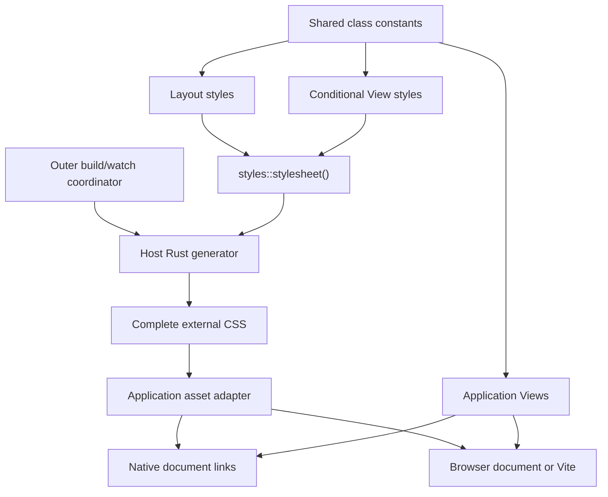

# YT-237 — Style registration and CSS generation contract

**Date:** 2026-11-08 (Asia/Taipei)

**Status:** Done at contract-research scope; independent design Reviewer PASS.

**Scope:** Architecture research and documentation only. No CSS builder,
generator, CLI setting, asset adapter or published API is implemented here.

**Source baseline:** `feature/style-css-roadmap`,
`3ecbfc36a91a2a06ef2dee69a7a0d848a2ecd16e`, including the three preserved
uncommitted roadmap files.

**Authority:** The owner explicitly requested YT-237 research, alternatives,
documentation and independent review, excluding YT-238/239/240 implementation
and all Commit/Push/Merge operations.

## 1. Recommended decision

Use **ordinary Rust function composition through one application-owned
stylesheet entrypoint**, evaluated by an explicitly selected **host-side Cargo
binary**. The outer build/watch coordinator publishes its complete CSS output.
Views reference stable class-name strings and never discover or register styles
while rendering.

The word registry means an explicit list of ordinary function calls. It does
not introduce a runtime service, global mutable collection, new component trait,
macro system or framework registration API.

| Concern | Selected contract |
|---|---|
| Default authoring | Ordinary CSS; Rust authoring is independently opt-in |
| Membership | One app-owned `styles::stylesheet()` composes named style modules |
| Conditional Views | Emit the registered superset before any View executes |
| Class identity | Shared string constants; no mandatory `CssClass` type |
| Rule ownership | One module owns a generated class; duplicate membership/conflicts are errors |
| Order | Explicit module, rule and declaration order; no alphabetical reordering |
| Execution | Separate small host generator package inside the app, with its own manifest/lock |
| Data exchange | Complete UTF-8 CSS on stdout; diagnostics on stderr; nonzero means no publish |
| Consumers | Ordinary external CSS through app-owned assets/document links or Vite |
| Core/browser cost | No new Core API, normal dependency, request work or WASM generator |
| Promotion | YT-238 proof and owner decision precede YT-239; no public package selected |

This preserves [ADR 0003](adr/0003-renderers-and-loading.md) and
[ADR 0005](adr/0005-opt-in-capability-modules.md). No fundamental ADR decision
changes, so neither ADR needs rewriting.

## 2. Alternatives assessed

| Option | Strength | Cost against this task | Decision |
|---|---|---|---|
| Plain CSS, optionally Tailwind/Vite | Complete CSS vocabulary, direct browser tooling, no Rust generator setup | Does not provide Rust token/function reuse | Keep as default and comparison baseline |
| Explicit function composition | Visible membership/order, ordinary Rust references, small debugging surface | A developer can forget to register a module | Select for the bounded proof |
| `inventory` distributed registration | Contributions from linked crates without a central list | Constructor-based collection, unspecified iteration order, linked-feature membership still needs definition | Do not add for this scope |
| `linkme` distributed slices | Compile/link-time static collection without runtime initialization | Macro/linker mechanism and platform qualification; CSS ownership/order still need policy | Reconsider only for demonstrated distributed-plugin need |
| Proc macro / Rust source scanner | Less repetitive declarations within a restricted syntax | Token input is not whole-program discovery; modules, expansion, cfg and computed values need extra machinery | Reject as the initial discovery mechanism |
| Execute/traverse Views | Can observe classes in a rendered tree | Misses inactive branches and couples generation to application data/routes/renderers | Reject |
| Direct serializer calls from `build.rs` | Can generate package-local build output | Couples CSS to Cargo build-script lifecycle/OUT_DIR and still needs an app-asset publication step | Viable narrow alternative, not selected for build/watch ownership |

These are architectural judgments, not performance measurements. In particular,
`linkme` is not a mutable runtime registry, and `inventory` is not rejected
for an alleged lack of WASM support. Both collect only contributions that are
actually linked into the selected executable. A stable explicit ordering policy
would still be needed for CSS. The primary documentation supports these
distinctions: [inventory](https://docs.rs/inventory/latest/inventory/),
[linkme](https://docs.rs/linkme/latest/linkme/struct.DistributedSlice.html)
and [Rust procedural macros](https://doc.rust-lang.org/reference/procedural-macros.html).

## 3. Membership, modules and View linkage

### Composition boundary

Illustrative API shapes below are proposals, not existing SDK methods or
compile-tested examples. YT-238 may refine local method/error ergonomics without
changing the membership, ownership and ordering semantics.

```rust
// Application-owned stylegen/src/styles/mod.rs
pub fn stylesheet() -> Result<StyleSheet, StyleError> {
    StyleSheet::compose([
        ("layout", layout::styles()?),
        ("dashboard", dashboard::styles()?),
        ("dialog", dialog::styles()?),
    ])
}
```

Each function returns ordered style data. Composition accepts stable diagnostic
module names and keeps that order. A feature-area function may compose smaller
modules, preserving their qualified owner names and order; a root does not need
to list every HTML element or component instance. Reused components are
registered once, regardless of how many routes or instances render them.

**Completeness means every rule reachable from the selected stylesheet
entrypoint is emitted.** It does not mean every Rust function anywhere in the
repository is found. An unregistered module is omitted; the compiler can check
called functions, but cannot prove that the author remembered every call.
The prototype's explicit expected-class fixture checks the selected sample's
membership, not universal View coverage.

### Shared names, without renderer changes

```rust
// src/style_names.rs: target-neutral constants, with no runtime dependencies
pub const TOOLBAR: &str = "app-toolbar";
pub const CONTENT: &str = "app-content";
pub const DIALOG_OPEN: &str = "app-dialog-open";

// Ordinary application View code
fn dialog(is_open: bool) -> View {
    if is_open {
        div().class(style_names::DIALOG_OPEN).text("Ready").into()
    } else {
        View::text("")
    }
}
```

The generator's `dialog::styles()` always declares `app-dialog-open`, and the
root always includes that module. CSS is therefore present when the initial
SSR/DOM View takes the false branch and a later browser update takes the true
branch. Generation never calls `dialog(false)` or `dialog(true)`.

The same data-only names file can be included by the app and generator using
ordinary Rust module declarations. For the proposed layout,
`#[path = "../../src/style_names.rs"] mod style_names;` in
`stylegen/src/main.rs` is sufficient; its canonical source remains inside the
selected app root. A separately published shared-names crate is unnecessary.
Adjacent component style files can also be composed explicitly if they stay
target-neutral and do not import View/application startup code.

Current [tag builders](../crates/yetlet/src/view/tags.rs) already accept
`impl AsRef<str>` for `.class()` and `.add_class()`. The generic Element path
continues using ordinary class attributes. No CSS property methods are added to
the 101 HTML builders. A future optional `CssClass` may implement `AsRef<str>`
or expose `as_str()`; it would validate a token, **not prove registration**.
Defer that wrapper until the prototype shows an advantage over constants.

### Host, target and feature conditions

Generate a target-neutral union of the selected application's styles, including
native-only and browser-only Views and all runtime alternatives. YT-238 does
not prune CSS by application feature, runtime data or `target_arch`.
Definitions/names must not disappear behind `#[cfg(target_arch = "wasm32")]`
when compiled by the native generator.

Host compilation and browser compilation observe different cfg values.
Cargo features belong to packages; equal feature names do not automatically
synchronize separate packages. See [Rust cfg](https://doc.rust-lang.org/reference/conditional-compilation.html)
and [Cargo features](https://doc.rust-lang.org/cargo/reference/features.html).
These facts motivate the selected superset policy. A later smaller per-feature
bundle requires an explicit application-to-generator feature mapping and new
coverage evidence; it is not implied here.

A compile-time optional component must expose its target-neutral style data to
the generator independently, or its styles remain in authored CSS. Do not import
a WASM-only component crate just to discover its classes. Some unused CSS is an
accepted initial cost. The stylesheet must contain no secrets or private data;
a hidden View branch is not an access-control boundary.

## 4. Ownership and deterministic CSS

| Case | Required result |
|---|---|
| Same source, registry order and selected inputs | Byte-identical UTF-8 CSS, LF newlines and one final newline |
| Same module registered twice, even with equal data | Error identifying both registrations; no silent deduplication |
| Different modules claim the same class, even with equal declarations | Collision error naming both owners |
| One owner supplies a base rule and a media rule for the same class | Allowed; they are distinct explicit rule contexts |
| Same owner repeats the same class/context rule | Error; put ordered declarations into the existing rule |
| Repeated declarations inside one rule | Preserve insertion order, including fallback and shorthand/longhand behavior |
| Application changes root/rule/declaration order | Output may change intentionally; CSS order is semantic |
| Class also exists in ordinary CSS or Tailwind | Not automatically detected; ordinary browser cascade applies |

Composition repeatability is not duplicate-registration idempotence. Repeated
generation produces the same bytes; repeated membership is diagnosed. A module
owner identifier must be unique in the final composition, including nested
aggregators. Neither pointer addresses nor function addresses establish identity.

Serialize depth-first in explicit composition order, then rule order, then
declaration order. Preserve the position of media blocks instead of globally
grouping or sorting them. Hash maps may support membership checks, but must not
choose output order. No timestamp, absolute path, random identifier, host name,
environment-derived value or locale-dependent number formatting enters CSS.
Different compiler hosts must produce identical bytes for the same supported
input; actual Linux/Windows proof remains future qualification.

Generated class names are case-sensitive single tokens in the initial grammar
`[A-Za-z_][A-Za-z0-9_-]*`, 1–128 ASCII bytes. A name is emitted unchanged after
validation; no lowercasing, sanitizing, implicit hashing or runtime name creation.
An app prefix such as `app-` is recommended. Arbitrary CSS class syntax,
including Tailwind tokens, remains usable through existing View strings; this
narrow grammar only limits names authored by the proposed generator.

## 5. Bounded authoring and failure examples

The proof should cover this finite vocabulary, leaving other CSS in authored
stylesheets:

| Area | Candidate minimum |
|---|---|
| Layout | `display`: block, flex, grid, none; common align-items/justify-content |
| Spacing/sizing | gap, padding, width/height; px, rem, percent and property-valid auto |
| Grid | Explicit repeat count and positive fractional track, e.g. `repeat(3, fr(1))` |
| Typography/color | font-size, normal/bold weight, validated RGB/hex color |
| Tokens | Validated `--app-*` custom-property names, typed length/color values and references |
| Responsive | One typed minimum-width `@media` condition; ordered nested class rules |

For example, the proposed toolbar declaration
`.display(Display::Flex).align_items(Align::Center).gap(px(12))`
should serialize an ordinary class rule. A Grid definition and an explicit
minimum-width media rule exercise the same serializer, not a different renderer.
Custom properties can live on an `app-shell` class; `:root` support is not
required for this proof.

Typed constructors/property validation reject non-finite numbers, negative
gap/padding/size, nonpositive grid counts/fractions, invalid color channels,
malformed custom-property names and unsupported value/property combinations.
No silent clamping or partial stylesheet publication. Repeated valid property
calls append declarations; they do not secretly sort or replace earlier ones.

| Illustrative input | Expected diagnostic |
|---|---|
| Class `"app-toolbar active"`, `"9panel"` or `"x{color:red}"` | Invalid generated class token |
| A gap with `NaN`, infinity or a negative length | Invalid gap value |
| `repeat(0, fr(1))` | Invalid grid repetition |
| `layout` and `dialog` both define `app-toolbar` | Class ownership conflict |
| Root includes `layout` twice | Duplicate module registration |
| Base `app-content` plus its minimum-width media rule | Valid, ordered output |
| A property value containing `"} body { ..."` | No raw-value API in the bounded prototype |

Errors identify module, class, rule context and property where applicable.
Constructor versus finalization error timing is an implementation choice, but
serialization must fail as a whole before publication. Error wording is not a
public compatibility promise.

There is no general raw selector/declaration/string escape hatch in YT-238.
Use a separate ordinary CSS file for selectors, URLs, fonts, animation,
`@supports`, layers, complex media conditions or other unsupported syntax.
This avoids claiming that a partial validator sanitizes arbitrary CSS.
A future explicitly trusted raw API requires its own justification; it must
never accept request/user strings as though they were safe CSS.

Rust generator code and authored CSS are trusted developer inputs. The contract
does not sandbox arbitrary Rust, build scripts or dependency code, nor guarantee
that malicious code cannot read files/network. The intended generator uses
only deterministic Rust style definitions/constants. Runtime values change
predeclared class names; they are not interpolated into generated CSS or inline
styles.

## 6. Process and dependency boundary



There is deliberately no arrow from executed Views to the registry.

| Proposed app-relative location | Owner/purpose |
|---|---|
| `Cargo.toml`, app lock and `src/` | Existing standalone native/browser app |
| `src/style_names.rs` | Portable class-name constants only |
| `stylegen/Cargo.toml`, `stylegen/Cargo.lock` | Explicit private generator package, own empty `[workspace]`, `publish = false` |
| `stylegen/src/styles/` | Ordinary Rust modules and the composition root |
| `stylegen/src/main.rs` | Call root, validate/serialize, write CSS stdout |
| `stylegen/target/` | Reusable host build cache; not a public asset root |
| Configured generated CSS destination | Coordinator-owned files, separate from authored CSS |
| Private build metadata outside frontend/static roots | Publication identity, ownership and errors; never served |

The separate generator package is selected because putting a second binary in
the app package can still compile that package's normal dependencies, including
server or browser-only libraries. It must not depend on the application crate,
HTTP startup, browser runtime or Yetlet Core merely to serialize CSS. A larger
workspace is unnecessary: the CLI continues selecting one standalone app, then
one explicitly configured subordinate standalone generator. This is not general
multi-package app support.

The bounded prototype can keep all builder support local to that generator.
No `yetlet-style` package, feature, new runtime or release commitment is made.
The additional manifest, lock and entrypoint are real DX costs to measure.

### Host invocation

From the validated generator directory, resolve the selected toolchain's host
triple using its Rust compiler identity, then invoke the exact binary with literal
argv. Conceptual invocation, **not an implemented Yetlet command**:

```text
cargo run --frozen --quiet --manifest-path Cargo.toml --bin app-stylegen \
  --no-default-features --target <resolved-host-triple> --target-dir target
```

Use the generator's selected toolchain consistently for host discovery and
execution. An omitted `--target` is insufficient if Cargo configuration defaults
to WASM. An explicit target-dir keeps reusable host output separate from the app
build. Select the explicit manifest/bin, not whichever binary Cargo finds first.
Default generator features are disabled; the selected superset definitions must
be available in that configuration.

Cargo supports explicit manifest, binary and target selection; see
[cargo run](https://doc.rust-lang.org/cargo/commands/cargo-run.html).
The actual CLI adapter must pin human/quiet Cargo diagnostics and reserve
stdout for CSS, without JSON/verbose Cargo output mixed into that stream.
No arbitrary command string, shell expansion or unknown-argument forwarding.

The outer coordinator completes this invocation before starting dependent app
or frontend builds. It never starts Cargo from the application's `build.rs`,
a server request, a View constructor or WASM updates. A build script directly
using a small serializer could be valid, but does not replace the selected
outer orchestration/asset ownership. Do not claim every nested Cargo call
necessarily deadlocks; the relevant concerns are reentry, locks, invalidation,
cross-target selection and output ownership.
[Cargo build scripts](https://doc.rust-lang.org/cargo/reference/build-scripts.html)
have their own host/target and OUT_DIR contract.

Existing frozen/offline/no-install expectations remain. Missing locks, tools,
cache or an invalid target fail explicitly; no network fallback, lock rewrite,
Node/Vite download, rustup installation or settings repair occurs.

## 7. Proposed build/watch selection

The following is a **future YT-239 settings shape**, not configuration supported
by the current CLI. The current strict settings parser would reject it.

```toml
[cli.styles]
enabled = true
manifest = "stylegen/Cargo.toml"
bin = "app-stylegen"
output = "assets/generated/app.generated.css"
```

Use the existing base/profile/public settings loader and APP_CLI overrides,
without Cargo metadata, a new settings file or another parser. Absent styles
settings mean disabled with no discovery, tool probing, generator dependency,
directory creation or child process. A present section is strictly validated;
enabled=false still validates its shape but starts no generator. No `--styles`
or `--with-styles` public flag is selected.

Paths resolve from the selected app manifest directory, including when public
settings come from another approved configuration root. The manifest must select
a protected in-app standalone generator; `bin` is an exact Cargo target name,
not executable text. YT-239 must update CLI/runtime strict settings projections,
inspect output and scaffolds together. No current public schema is silently
changed by this design.

| Command/state | Selected future behavior |
|---|---|
| `build`, styles disabled | Existing build behavior exactly |
| Native `build`, styles enabled | Validate; generate CSS; selected frontend production build if any; app build; accept complete artifacts only on required-stage success |
| Browser `build` | Preserve existing disabled frontend skip; when selected, generate before npm/WASM/Vite build |
| Native `run` | Generate once before selected backend/frontend startup; do not turn run into an unrequested production frontend build |
| Native `watch`, or run with Rust watch enabled | Initial generation, then one serialized style/app rebuild sequence per relevant edit |
| Browser `run` | Preview already prepared dist; do not rebuild or alter CSS behind a prebuilt bundle |
| Browser `watch` | Preserve auto_start/auto_build gate; when selected, generate before initial frontend startup and coordinate later Rust/CSS changes |
| `inspect` | Explain selected/skipped style stages without executing them or claiming freshness |
| `doctor` / `new` | No automatic generator execution; existing environment-only/creation semantics remain |

A skipped Vite production stage cannot be described as current bundled CSS.
For a Vite-owned output, build freshness requires the selected Vite stage; if it
is disabled, report the incomplete/skipped asset stage rather than success for a
fresh deployable style bundle. Runtime preview keeps its prebuilt-artifact rule.

Watch includes registered style Rust files, names, generator/app manifests and
locks inside the app root, and relevant existing Rust inputs. It excludes
generated CSS/state/temp files, all owned Cargo targets and frontend output.
Changing registration or a class used only in a conditional View still triggers
generation. Arbitrary external mutable inputs and external path dependencies
are not auto-watched; the initial generator contract keeps mutable style inputs
inside the app. Policy/settings changes require restarting the CLI.

There is **one owner of a generation**, not competing CLI and Vite Rust-style
watchers. Debounce/coalesce edits, never overlap generation, and do not publish a
result made obsolete by a newer queued input change. Generator failure waits for
a source edit; it is not an automatic retry loop. YT-239 must coordinate this
with the existing browser WASM watcher so it does not consume a mixture of new
Rust code and old generated CSS. Vite retains JS/CSS HMR; no new runtime style
injection is introduced.

## 8. Publication, errors and asset lifetime

### File ownership and publication

The generator has no output-path argument and does not write application assets.
The coordinator captures the complete CSS in private staging, validates its
UTF-8/size and generator success, then publishes. The initial bound is 2 MiB per
CSS file, matching the current asset experiment's file ceiling. Stderr remains
diagnostic output; successful process exit alone does not prove a valid artifact.

The configured output is a protected app-relative `.generated.css` file in a
dedicated generated directory. Reject absolute paths, traversal, symlink/reparse
components, nonregular files, source/config/lock destinations and cache roots.
Do not overwrite an existing unowned file. First ownership requires an absent
destination; later replacement requires the prior private ownership record and
matching previous content. A manually edited generated file is a conflict.
Keep ownership metadata outside served/frontend roots.

Write to a sibling temporary file and use a platform-qualified atomic replace;
publish metadata only after the referenced CSS is complete. Generator and
pre-publication write failures preserve the prior accepted file/record. Do not
truncate the live file or rewrite byte-identical successful CSS. A CSS-file
replacement and a separate metadata replacement are not one atomic transaction:
post-replacement metadata failure or a crash makes the generation unaccepted,
requires explicit reconciliation, and must not claim unchanged last-good bytes
or successful freshness. Keep the prior accepted metadata/evidence to diagnose
that case. The trusted-owner filesystem assumptions in [ASSETS](ASSETS.md)
remain; this is not hostile-filesystem race isolation.

These are product requirements for YT-238's bounded output-selection proof and
YT-239's actual lifecycle integration, not a request to build a new verification
framework. A shell redirect to an arbitrary filename is not the safe publisher.

### Development failure and cancellation

Keep last successful CSS bytes on disk when generation fails, but clearly mark
the current generation failed/stale. They are not evidence that the new source
built successfully. Before any successful generation, dependent startup fails;
there is no empty-file fallback.

The existing native watcher stops/reaps its old backend before a replacement.
This design does not promise to keep that backend alive after a failed rebuild.
An app-owned immutable asset snapshot also needs replacement/restart before it
can serve new CSS; changing a disk file alone is insufficient. Native-only
development may require a normal page refresh.

Existing Vite/browser last-good behavior remains within its documented scope.
Failed Rust style generation must not trigger an apparently successful new
browser generation. Cancellation stops/reaps the exact owned generator/Cargo
and other supervised children before returning; cleanup uncertainty is failure.
No process-name kills or changes to unrelated running applications.

### Production and rollback

In standalone mode, produce `app.<sha256>.css` using the full lowercase SHA-256
of exact CSS bytes. A private app-owned record binds logical `app-css` to the
validated relative file and digest. This is a narrow producer record consumed by
the existing app-owned asset graph, not a new stable framework manifest format.

Publish candidate content-addressed assets before their references, and accept
the build's new logical record only after all selected dependent build stages
succeed. A later app/frontend failure leaves an unaccepted candidate, not a new
successful deployment record. Preserve the prior accepted record/assets.
A record consumer verifies digest/file agreement before linking or serving.
Existing digest assets are never overwritten with different bytes.

Vite mode instead imports the stable generated source CSS inside the configured
frontend root, for example `frontend/src/generated/app.generated.css`.
Vite then owns bundled outputs and its existing manifest; do not add a second
standalone hash/link for the same CSS. Generator/private metadata stays outside
the frontend root. Configuration must select a destination compatible with the
chosen consumer; it must not broaden Vite's existing source confinement.

The current asset experiment still uses `Cache-Control: no-store`; this
contract does not silently enable immutable caching. Hashing does not guarantee
old-file availability. Deployment owners must retain the complete old asset
graphs needed by old HTML/lazy code throughout cache, rollout and rollback
lifetimes. Keep [YT-103](YT-103-ROLLING-ASSET-PLAN.md) separate. No automatic
cache cleanup, HA, rolling deployment, source export or container qualification
is granted by a generated CSS filename.

## 9. Native CSS, Tailwind, Vite and CSP

Native mode uses normal same-origin document `link rel="stylesheet"` elements,
`text/css; charset=utf-8`, and the existing validated asset whitelist. Only
CSS bytes and approved links enter runtime delivery; Cargo sources, manifests,
ownership records, build errors and private configuration never become static
files. The app-owned document/asset boundary supplies head links, not an ordinary
View `link()` builder or a new `App::page` feature.

The prototype uses unlayered CSS. A suggested application order is base/vendor
or Tailwind CSS, generated application CSS, then explicit authored overrides.
Preserve user-selected order and stable first-occurrence link deduplication.
For Vite, imports/its manifest own order; do not append another runtime link.

Later source order decides only after other cascade priorities. Layers,
specificity and importance still matter; in particular unlayered normal CSS
can outrank layered normal utilities. Do not promise that placing a link last
always wins or that all Tailwind utilities override generated styles.
See the [CSS cascade specification](https://www.w3.org/TR/css-cascade-5/).
Users can keep overlapping rules in authored CSS or choose deliberate names and
composition. There is no cross-producer collision analyzer or Tailwind reimplementation.

Keep standalone Tailwind and Vite independent opt-ins. Native SSR styles need
neither Node nor Vite nor WASM. Production `DEFAULT_CSP` stays byte-for-byte
unchanged; no inline style attributes, runtime style-tag generation, unsafe-inline
or new remote origins. Existing explicitly selected Vite development nonce/HMR
rules remain unchanged rather than being generalized to native/production.

## 10. Responsibility and evidence matrix

| Surface | Responsibility | What YT-237 does not claim |
|---|---|---|
| View/Core | HTML structure and existing class values | Style discovery, CSS compilation, new tag/renderer API |
| Style modules/root | Complete declared membership, class ownership and ordered values | Finding forgotten modules or all possible View branches |
| Host generator | Deterministic validated CSS bytes; errors | HTTP work, WASM execution, Node dependency or path publication |
| CLI coordinator | Explicit settings/host target, serialized execution, output ownership, failure/cancellation | Implemented support for proposed settings today |
| App-owned asset adapter | Validated same-origin CSS links/bytes and record verification | A stable `yetlet-assets` package or automatic rollback retention |
| Native SSR | Existing document generation consuming prepared CSS | Generator dependency or JS needed at runtime |
| Browser/WASM | Existing class/DOM updates consuming prepared CSS | Runtime CSS compilation or new CSP exception |
| Vite/Tailwind | Existing optional frontend production/HMR or utility compilation | Replacement by a Rust utility engine |
| Deployment owner | Accepted build selection, retained old graphs and rollout policy | Production/HA guarantees from this design review |

## 11. DX comparison and YT-238 acceptance plan

The concrete payoff to test is Rust token/function reuse, IDE discovery and
refactoring for common layout values. Ordinary CSS remains more direct for
copying browser examples and using the full language. Rust also adds compilation,
registration, a second manifest/lock and limited vocabulary. No speed, bundle
size or productivity benefit is claimed before measurement.

Implement the same small toolbar/Grid/dialog layout in ordinary CSS and the
bounded DSL. Report style-only and total setup lines separately, module
registration effort, shared-token changes, diagnostics, dependency footprint,
cold/warm/one-rule-edit generation time and emitted CSS bytes. Record toolchain,
commands and scope; do not benchmark unrelated framework code or rerun old
qualification. Measure whether the setup cost is reasonable for a small app
rather than declaring the DSL inherently superior.

| Future case | Required focused evidence | Item |
|---|---|---|
| Two or more modules and a conditional-only class | Expected rules present without executing Views | YT-238 |
| Host with a browser-target app | Superset CSS retained; generator graph excludes app/Core/browser startup | YT-238 |
| Ordering and deterministic formatting | Repeated bytes identical; declaration/media order preserved | YT-238 |
| Invalid values and duplicate ownership | Useful errors and no accepted partial CSS | YT-238 |
| Output selection | Bounded app-local publisher rejects unsafe/unowned destinations and preserves prior output on failure | YT-238 |
| CSS versus DSL | Same visual intent/source fixtures and measured setup/edit costs; go/simplify/no-go recommendation | YT-238 |
| Disabled settings and legacy CLI behavior | No style effects, strict schema and inspect/skip semantics | YT-239 |
| Build/watch, concurrent edits, correction, cancellation | One owner, no stale-success publication, owned-child cleanup | YT-239 |
| Standalone/Vite/Tailwind, paths and digest records | Correct producer/order/MIME/CSP and failure/rollback limits | YT-239 |
| Native no-JS and real browser | Computed layout, responsive breakpoints, later conditional class and no CSP violations | YT-240 |
| Windows support claims | Actual selected Windows execution evidence | Relevant implementation qualification |

Do not execute these implementation tests in YT-237. The present required checks
are `cargo xtask check docs`, tracked/untracked whitespace/source-scope checks,
and independent review of the actual contract and immediate repository boundaries.

**Go:** the small DSL demonstrates useful token/composition reuse with acceptable
measured setup/edit costs, deterministic complete registered output, bounded
diagnostics and no new Core/browser cost.

**Simplify:** reduce the authoring vocabulary or keep it app/tooling-local if
benefits do not justify a reusable API.

**No-go:** keep ordinary CSS/Tailwind/Vite when registration, build overhead or
unsupported syntax outweigh the measured benefit. No artificial performance
threshold is invented before a baseline exists. The owner decides promotion;
a Reviewer PASS is not an instruction to start YT-239.

## 12. Decisions left to the next authorized slice

The architecture decisions above are selected recommendations. YT-238 still
needs actual source evidence for fluent API/error ergonomics, builder helper
placement, serializer formatting implementation and measured DX/build cost.
Prototype support remains local; extracting an optional package or feature is
a later post-prototype choice.

YT-239 must turn the proposed settings/output-record shape into an implemented,
reviewed contract, including strict runtime settings compatibility, host process
supervision, Vite/browser coordination and platform-specific atomic publication.
The browser watcher integration is a real integration cost, not assumed existing
functionality. YT-240 must verify actual rendering/CSP and selected platforms.
No owner decision to implement or promote those items has been recorded here.

The next unblockable item after accepted YT-237 review is **YT-238, only after
explicit owner authorization**. YT-238/239/240 remain Todo.

## 13. Validation and independent review

The documentation-only YT-237 contract is **Done after independent design
Reviewer PASS** on 2026-11-08. This accepts the research deliverable and selected
recommendation; implementation/promotion still requires the owner's next decision.

| Evidence | Observed result |
|---|---|
| `cargo xtask check docs` | PASS: repository document/language/link/structure/whitespace/DAG checks |
| `git diff --check` | PASS for tracked changes |
| Per-new-file `git diff --no-index --check -- /dev/null FILE` | PASS: exit 1 for expected content differences, no whitespace diagnostics |
| Additional direct checks on both new documents | Balanced fences, final newlines and all checked internal file links valid |
| Four registered items and order | YT-237 then YT-238, go/no-go, YT-239, YT-240; future three remain Todo |
| Independent Reviewer | Job `wc_job_hrrQG-bXFiMCgGQ3`, terminal completed, exit 0, `overall_status=pass`, 0 issues/followups/optional notes |
| Review input preservation | All four reviewed document SHA-256 values unchanged during review |
| Role execution | Separate role-directed Codex Job with the exact saved Reviewer contract; not current-session self-review |
| Observed configuration | Saved `gpt-6-astra` and resolver-selected `high` match process telemetry; no native managed-role identity claim |

The repository checker has a fixed 75-document structural/link list and checks
233 tabulated backlog IDs; it does not by itself prove the two new documents'
structure or the four newly listed items. The explicit additional checks above
cover those additions without changing the checker. Six initial Markdown
hard-break trailing-space findings were corrected; the original failure remains
in the evidence directory. No Rust CSS implementation, runtime/browser smoke,
Windows execution, public API qualification or historical suite replay is claimed.

Evidence is retained under
`artifacts/verification/yt237-style-contract-20261108/`: exact reviewed copies,
source hashes, original/corrected checks, document logs, saved role/resolver
records, process logs, Reviewer JSON and observed telemetry. Completion/status
annotations follow the PASS; substantive Contract sections 1–12 remain unchanged
from the reviewed input, checked by their separate digest.

The earlier roadmap-only Reviewer `wc_job_zVhJeQacmnaDxXdW` remains historical
planning acceptance. The current Job independently reviewed this Contract.
Final state is the same branch and baseline HEAD, with the four documentation
paths uncommitted; no Commit, Push, PR, Merge or YT-238/239/240 implementation.
There is no active or uncertain task execution after the reviewed Job's terminal
observation. See the retained final handoff for final file hashes and Git status.

## 14. Owner follow-up: default wiring and YT-238 authorization

**2026-11-08 follow-up:** The owner explicitly authorized YT-238 implementation
and requested automatic default registration in suitable future `yetlet new`
templates. This supersedes the pre-implementation status statements in sections
12–13 for YT-238 only. The earlier review and its exact input remain historical
evidence; this addendum and the prototype require the separate YT-238 review.
YT-239/240 and Git delivery remain unapproved.

When an application template selects optional Rust CSS authoring, scaffolding
must emit a complete app-owned `styles::stylesheet()` entrypoint, useful starter
style definitions, shared class constants and their explicit registration.
The generated project must not require manual connection of its initial pieces.
The same root is the registration list; do not add a second registry manifest.
The selected template must also provide the subordinate generator manifest/lock,
the accepted opt-in settings and the external stylesheet/asset connection once
YT-239 implements those contracts. `new` creates these files; it does not execute
the generator or claim to have built CSS.

Use the existing template/configuration selection mechanism; this requirement
does not select a new public flag or enable Rust styles in every new project.
Ordinary-CSS templates retain their existing authoring and dependency behavior.
The current CLI accepts only `--template native|browser`; neither option selects
Rust styles today. The exact optional variant/profile and its public selection
syntax remain YT-239 decisions, grounded in the existing scaffold/strict-settings
contract rather than an assumed Rust-style option.

Initial setup does not discover future Rust modules. A new module participates
only after the root or an explicitly composed aggregator includes it. The sample
and template instructions must show that additional-module step and explain that
creating a source file alone does not register its styles.

YT-238 must demonstrate this default wiring in its application-local reference
fixture: populated root, at least two registered modules, shared View class
names, and a pre-registered conditional-only class. Focused tests must show that
the generator produces useful, complete registered CSS without initial manual
registration edits or executing Views. This is prototype evidence, not shipped
CLI scaffolding. YT-239 must later test actual `new`, build/watch and asset
integration, including unchanged ordinary-CSS templates, after the owner
separately approves promotion.

**YT-238 completion:** The default-wired reference fixture and this addendum
received independent Reviewer PASS in Job `wc_job_hfecy9ZrNUTO61BZ` (exit 0,
zero issues/followups). See the [prototype proof](YT-238-STYLE-BUILDER-PROOF.md).
YT-238 is Done at prototype scope with a SIMPLIFY recommendation; YT-239/240
and Git delivery remain separately gated.

## 15. Owner approval of YT-239 and language preference

**2026-11-08 follow-up:** The owner approved proceeding to YT-239 under the
YT-238 SIMPLIFY recommendation. The builder remains application/tooling-local;
ordinary CSS remains the default. This supersedes earlier statements that
YT-239 still awaits owner authorization. YT-240, Git delivery and release
remain separately gated. At entry, YT-239 stayed Todo until implementation,
required verification and independent Reviewer PASS. Section 16 records completion.

The owner prefers reducing reliance on Python, while allowing it when necessary
or convenient. Implement the actual stylesheet generation/publication lifecycle
in the existing Rust CLI and private Rust generator. Generated applications and
their normal `new`/build/run/watch path must not acquire a Python dependency.
The existing Vite/browser Node tooling remains optional; established auxiliary
test/artifact scripts may still use Python. Preserve the accepted YT-238 Python
publisher as historical experimental evidence instead of expanding this task
into an unrelated toolchain rewrite.

Selected implementation direction (delivered and reviewed in YT-239; section 16):

- Extend the existing `--template` mechanism with `native-style` and
  `browser-style`; no new `--styles`/`--with-styles` flag. Emit a populated
  stylesheet root, starter modules and shared names; ordinary variants retain
  their behavior.
- Use a private flat `stylegen/` package with an explicit binary path and
  ordinary style modules. This refines the illustrative section 6 layout to fit
  the existing protected one-level scaffold publisher without a general nested
  filesystem refactor. The generator still has its own manifest/lock and empty
  workspace, with no Core/application dependency.
- For Vite, prefer a dedicated `style-output/app.generated.css` under the selected
  frontend root. The existing browser server rejects components named
  `generated`; preserve that confinement rather than exposing generator outputs
  broadly. Native development retains the dedicated assets/generated path.
- Reuse existing process supervision and the single browser WASM generation
  sequence. Pass only the parent's validated finite public style selection to
  any internal worker; preserve frontend environment filtering and keep private
  metadata/generator sources outside served roots.

These choices are implemented at source and bounded Linux integration scope.
Windows and real-browser rendering qualification remain outside this completion.

## 16. YT-239 integration completion

The [YT-239 implementation and evidence](YT-239-STYLE-INTEGRATION.md) received
independent Reviewer PASS in Job `wc_job_3s_tnZYc7hUssjK5`, terminal completed,
exit 0, with zero issues/followups. The saved `gpt-6-astra` and resolver-selected
`high` matched process telemetry. All 61 reviewed worktree source hashes stayed
unchanged during review, including the 18 preserved prototype/proof files.

YT-239 is Done at source and bounded Linux integration scope. The implementation
uses the existing Rust CLI, default-wired selected templates, explicit registry,
private host generator and external assets. Native watch/recovery, Vite/Tailwind
and browser WASM production build evidence is retained with the independent
review. The pending-state reconciliation fix and real native Tailwind page
composition are included in that accepted source.

The two recorded cloud-lock test failures remain unresolved, and Windows
compilation/runtime remains unverified. YT-240 remains Todo for owner-selected
sample, computed-style, browser/CSP and platform qualification. No Commit,
Push, PR, Merge or public release is authorized by this acceptance.
