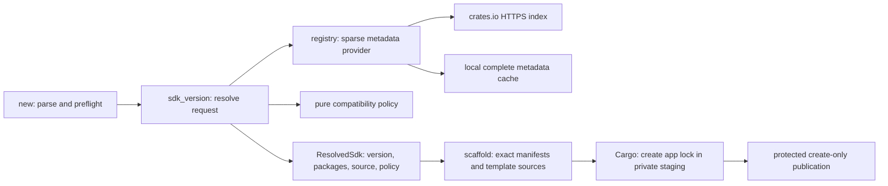
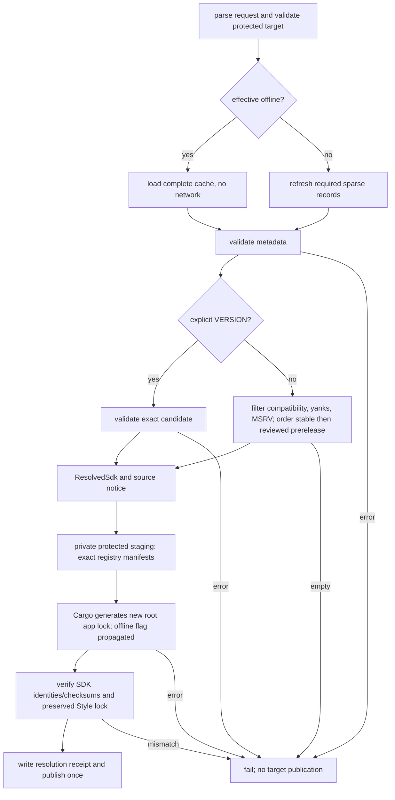

# YT-247 — Dynamic SDK Version Resolution CLI Contract

Date: 2026-11-10 (Asia/Taipei). **Owner accepted Contract and ADR 0010; Phase B source implemented, independent Reviewer PASS**.
Independent review and Git delivery are recorded in the [Phase A handoff](YT-247-PHASE-A-HANDOFF.md).
[ADR 0010](adr/0010-dynamic-sdk-version-resolution.md) records the decision and tradeoffs.
The [Phase B implementation record](YT-247-SDK-VERSION-RESOLUTION-IMPLEMENTATION.md)
separates checkout behavior and verification from the unchanged published CLI 0.2.0.

## Scope and gates

YT-247 is an independent Developer Experience item with two phases:

- Phase A delivers this contract, ADR, task split and independent read-only review.
  After review PASS, deliver the documentation through Strict/Builtin Commit Guard,
  commit, PR, exact-head CI, merge and master CI; then stop for Owner acceptance.
- Phase B implements only the accepted resolver contract, with focused tests and
  independent review. It requires a new Owner instruction after Phase A delivery.
- [YT-248](CLI-030-RELEASE-PREPARATION.md) retains the reviewed CLI 0.3.0 Style
  template release plan and depends on completed YT-247 Phase B. Neither item
  authorizes a release, SDK republication or a public reader-edition upgrade.

The accepted SDK alpha.7 archives/tags and historical CLI records remain immutable.
The public Reader Edition stays SDK alpha.6 / CLI 0.2.0.

## Observed starting behavior

Inspection baseline: branch `feat/cli-030-style-templates`, HEAD
`54c1e4436ad15ece4e1fad74fbc26c98884a98c4`, plus the four preserved planning files.

| Surface | Actual behavior before Phase B |
|---|---|
| `tools/yetlet-cli/Cargo.toml` | CLI 0.2.0 compiles against exact SDK alpha.6, with `html`, `config`, `signing`. |
| `src/framework.rs` | `package_version()` reads the embedded `resources/workspace.toml`; it is currently alpha.6. |
| `src/scaffold.rs`, `src/browser.rs` | Release-facing `new` writes registry pins using that embedded version. Browser pins both SDK crates equally. No SDK source is copied by `new`. |
| `src/main.rs`, `src/lib.rs` | `new NAME` is create-only, executes no tools, and produces no root app lock; the user prepares it separately. |
| `resources/framework.json` | A closed source map of `crates/yetlet`, excluding its Cargo.lock; not a registry metadata cache and not a browser SDK source map. |
| `resources/workspace.toml`, `resources/framework.lock` | Qualified workspace inheritance and root dependency baseline for source delivery/tests; not a generated app lock. |
| `src/framework_source.rs`, `src/docker.rs`, `src/compose.rs` | Match qualified local source/lock input against that closed baseline and export a sanitized native Docker/Compose build context. They do not fetch arbitrary SDK source. |
| `scripts/sync_resources.py`, `tests/resources.rs` | Currently require compile dependency, selected checkout SDK, snapshot and workspace version to agree. The snapshot equality test needs the matching SDK checkout, not just any later checkout. |
| `src/styles.rs`, `templates/styles/` | Copy a separate application-owned, dependency-free Style generator and its existing lock. This is template source, not the embedded SDK snapshot. |
| Browser startup assets | Fixed template assets copied from reviewed source by resource sync; their compatibility is part of the template policy. |

These observations preserve the [YT-246 historical version authorities](YT-246-VERSION-SOURCE-AUDIT.md).
Changing only the CLI compile dependency to alpha.7 cannot implement this contract.

## Three version lifecycles

| Identity | Authority and lifetime | Use |
|---|---|---|
| CLI build SDK | Exact dependency in CLI Cargo.toml and CLI Cargo.lock, fixed in immutable CLI source C/archive | Runs CLI configuration/signing/HTML code. Never chosen by the user's resolver request. |
| Embedded SDK snapshot | Reviewed SDK source identity, SDK version and resource digests, fixed in CLI archive | Existing bounded native source delivery only. No dynamic substitution, relabeling or fallback. |
| Generated app SDK | One `ResolvedSdk` value from registry/cache plus the shipped template compatibility policy | Writes exact registry dependencies and generates that new app's own lock. Independent of the other two identities. |

Template identity is also explicit: CLI package version plus built-in selector
(`native`, `browser`, `native-style`, `browser-style`) and policy revision. It
identifies CLI-owned app source and browser startup assets; it is not an SDK
version. Phase B may retain the existing build-SDK/snapshot equality as a release
invariant; decoupling their responsibilities does not require gratuitously
changing their selected versions. YT-248 still selects alpha.7 for those two
release inputs, independently of the range of app choices.

`new` must never consult the snapshot to pick an app version, copy it into an
app, create a path/patch/git replacement, or fetch an arbitrary SDK source tree.
Existing Docker/Compose source exporters remain limited to their qualified
snapshot source representation. An app outside that representation receives the
existing unsupported-source error; dynamic creation does not expand generator
support. Registry app creation must not enter the local-source exporter.

## Command and error contract

The accepted additions apply only to `new`:

```text
yetlet new NAME [existing options] [--sdk-version VERSION] [--offline]
yetlet new demo --sdk-version 0.9.0-alpha.7
yetlet new demo --template browser --offline
```

`NAME`, default `native`, parent protection and existing template/option checks
stay as documented. NAME is required; the shorthand without NAME is not valid.
Both `--sdk-version VERSION` and `--sdk-version=VERSION` are accepted exactly once.
`--offline` is a non-repeated boolean. Missing/empty/non-UTF-8 values, duplicate
options, or using them on other commands are usage errors (exit 2).

VERSION is a complete canonical SemVer `major.minor.patch[-prerelease]`, at most
128 ASCII characters, with valid numeric identifiers and no leading zeroes.
Reject `v` prefixes, whitespace, `=`, ranges, wildcards, partial versions, URLs,
Git refs and `+build` metadata. Rejecting build metadata aligns identity with the
repository release-record version contract and avoids precedence ties.
An explicit prerelease is a version request, not permission to bypass policy.

Preflight validates syntax, template/parent/destination and installed Rust/Cargo
before network work. Help/version and an already-existing destination perform
no refresh, cache write or Cargo invocation. No successful command may overwrite
an existing project, including its manifest, receipt or either lockfile.

Errors include a stable category, requested version (when present), relevant
package/template, effective mode and an actionable remedy. Human text may evolve.
All resolution/setup failures exit 1, with no success message or published target:

| Category | Meaning and recovery |
|---|---|
| `SDK_VERSION_NOT_FOUND` | Explicit version absent from complete refreshed metadata, or absent from the selected cache (say which). Refresh online when cache may be incomplete. |
| `SDK_VERSION_YANKED` | Any required package at the explicit version is yanked; choose another version. No override. |
| `SDK_INCOMPATIBLE` | Outside shipped policy, wrong/missing required features or MSRV too high/unknown; report the failing predicate. |
| `SDK_PACKAGE_UNAVAILABLE` | Explicit version exists for `yetlet` but matching `yetlet-browser` is missing. Never mix versions. |
| `SDK_NO_COMPATIBLE_VERSION` | No candidate survives all default filters; display the policy revision and supported choices. |
| `SDK_OFFLINE_CACHE_MISS` | Required cache package/set is absent. Explicit version is not enough to skip metadata validation. |
| `SDK_METADATA_INVALID` | Malformed/unsupported/incomplete metadata or corrupt cache; do not treat it as an empty registry or use stale data. |
| `SDK_REGISTRY_UNAVAILABLE` | DNS/TLS/HTTP/rate-limit/deadline failure; fail online, suggest an explicit offline retry. |
| `SDK_LOCK_FAILED` | Cargo cannot resolve the app graph, including offline Cargo cache gaps; retain bounded diagnostics and the selected SDK, but publish no app. |
| `SDK_LOCK_MISMATCH` | Cargo output lacks the selected SDK version/registry/checksum or changes a preserved template lock. Fail rather than repair the lock by hand. |

Usage validation precedes existence/policy checks. For explicit resolution after
valid metadata: `yetlet` existence, required companion existence, any yank,
policy/features/MSRV, then lock setup. Default resolution instead filters all
candidates and reports no compatible version with bounded rejection reasons.
Existing spawn/cancellation/cleanup exit conventions (including 125 for process
infrastructure failure) still apply; never mask uncertain cleanup as exit 1/0.

## Minimal module boundary

This is an internal Rust CLI module, not a framework crate or public plugin API.
Use ordinary structs/functions and one injectable metadata provider boundary;
keep the compatibility predicate pure and local cache I/O small. Do not create
five trait hierarchies, a DI container, a daemon or a Python runtime dependency.



`ResolveRequest` carries exact-or-default selection, template/options and mode.
`ResolvedSdk` carries one canonical version; required package names and index
checksums; registry identity; `registry-refresh` or `offline-cache`; each package's
validation time and metadata digest; policy/template identity; prerelease reason.
Only successful typed results reach scaffold. Neither scaffold nor `new` issues
registry HTTP requests. Registry provider/cache validation is separate from
candidate ordering; Cargo remains responsible for the transitive dependency graph.

The production provider uses public crates.io sparse index records for
`yetlet` and, for browser templates, `yetlet-browser` at the standard package
paths. No REST `max_version` shortcut or registry-selected compatibility code.
Read version, yank status, checksum, rust_version, dependency and feature maps
(including `features2`/supported index schema). Validate names, duplicate versions,
SemVer and required fields. Optional unknown fields may be ignored; an unsupported
index schema affecting interpretation fails closed. No credentials are needed.
Use HTTPS, bounded response size/time (initial limits: 8 MiB per package,
30 seconds total metadata deadline), and no automatic retries or redirects to
untrusted endpoints. Fixture providers use no production URL override flag.

## Compatibility and prerelease policy

Policy `sdk-compat-v1` is shipped and reviewed with the CLI/template sources.
It describes app compatibility, not a promise that every prerelease with the
same numeric core has compatible APIs. Initial accepted supported sets are:

| Template | Accepted SDK versions | Required SDK packages/features |
|---|---|---|
| native | `0.9.0-alpha.6`, `0.9.0-alpha.7` | `yetlet`: `server-axum`; `config` when settings/Vite is selected |
| browser | `0.9.0-alpha.6`, `0.9.0-alpha.7` | Same-version `yetlet`: `reactive`; `yetlet-browser`: `dom`, `dom-keyed` |
| native-style | `0.9.0-alpha.7` | Native requirements; app-owned Style source and locked generator |
| browser-style | `0.9.0-alpha.7` | Browser requirements; matching startup assets and app-owned Style source |

All require declared SDK MSRV at most Rust 1.99 and supported template API/target
shape; missing rust_version is incompatible, not inferred from CLI's build SDK.
The generated app declares Rust 1.99. An installed newer compiler does not widen
the policy. Browser creation needs no installed WASM target/Node to generate a
lock; actual build needs the existing documented tools. The Phase B record
contains compile results for these combinations; this table is not browser evidence.

First intersect the applicable policy set with available package versions,
remove a version if **any required package** is yanked, then check feature
availability (including supported feature references), MSRV and template row.
Registry metadata validates availability, not API compatibility: shipped policy
and Phase B consumer evidence establish the latter. Lock generation remains a
separate check of the whole graph and can still fail on transitive constraints.

Default ordering is explicit:

1. Choose the greatest SemVer **stable** version in the surviving compatible set.
2. If none exists, choose the greatest version in the policy's exact, reviewed
   prerelease set for that template. Print an Experimental-prerelease notice
   with the policy revision and the reason stable was unavailable.
3. If neither exists, fail. There is no compiled SDK/snapshot fallback.

The initial stable set is empty. With both unyanked SDK releases available,
default new selects alpha.7; ordinary native/browser may select alpha.6 if
alpha.7 is unavailable/yanked, with the exact selected version displayed.
Style templates fail in that situation. Unknown alpha.8, beta, rc, 0.9.0 stable,
0.9.1, 0.10 or 1.x are excluded even if they sort higher. Explicit requests
outside the set also fail. No generic `--prerelease` or range flag is needed in
v1. This is intentional finite prerelease compatibility, not an automatically
trusted future alpha train. A future reviewed policy can add stable intervals
with numeric bounds and a separate prerelease set without changing `new` or
provider/scaffold boundaries; initial code need not implement unused intervals.

## Online and offline semantics

| Invocation | Metadata source and freshness | Failure behavior | Cargo lock setup |
|---|---|---|---|
| Default online, exact or latest | Refresh every required package; conditional GET/304 counts as revalidation. Result source `registry-refresh`. | Any refresh failure stops; no stale fallback and no selection from a partially refreshed set. | Normal Cargo resolution, allowed to access registry metadata. |
| Explicit `--offline`, exact | Valid complete local metadata; verify exact version/policy/yank as last observed. Result `offline-cache`. | Missing package cache fails; absent cached version reports cache-scoped not-found. | Cargo `generate-lockfile --offline`; missing Cargo cache fails. |
| Explicit `--offline`, latest | Greatest compatible candidate known to complete local metadata, using the same policy/ordering. | Cache miss/corruption/no compatible candidate fails. Do not claim global latest. | Same offline-only command. |
| Online network failure with usable old cache | No successful resolution. Print an explicit offline retry remedy. | Never silently reuse stale metadata. | Not started. |

`CARGO_NET_OFFLINE=true` also selects effective offline mode; `--offline` wins
over false. The CLI documents these two mode inputs and reports the effective
mode before I/O. Cargo's own configuration can further restrict its lock step;
it cannot authorize a network request in effective offline mode. Users relying
on Cargo config alone must also select CLI `--offline` to forbid resolver HTTP.
No startup/toolchain installer, HTTP probe, Cargo refresh or subprocess may make
a network request during effective offline creation.

Use a CLI-owned cache beneath `$CARGO_HOME/yetlet/sdk-index-v1` (default Cargo
home when unset), keyed by canonical registry and package. Store validated public
index bytes, checksum/digest, schema and fetch/revalidation timestamps with the
HTTP validator when available. Publish a complete required-package set atomically;
concurrent readers see an old complete set or a new complete set. Corrupt/partial
writes never replace accepted data. A browser request needs both package entries;
a native-only refresh does not falsely refresh the browser companion.

Do not parse Cargo's private sparse `.cache` binary format. The first provider
uses this CLI-owned public-index cache; Cargo's own index/archive cache serves
Cargo lock/build operations separately. Installing the CLI or having an SDK crate
archive cached does not imply resolver metadata exists. A successful online new
populates resolver cache; preparing offline use additionally requires Cargo's
normal dependency cache preparation. No general cache management command is added.

Offline use explicitly accepts metadata of any age, while printing package
validation timestamps, age and “latest known to this cache; current registry
and yank status not checked.” A future-dated timestamp/corrupt schema is invalid.
No hidden TTL or silent expiry fallback. Offline cannot know a subsequent yank;
online always revalidates. Cache digests detect corruption, not signed provenance
or protection from an administrator who can replace the local cache.

## Selection, manifest and locking flow



Scaffold receives `ResolvedSdk` explicitly; replace every generated SDK version
use in native/browser manifest and README assembly. Emit `yetlet = "=VERSION"`
(or the equivalent feature table), and for browser `yetlet-browser = "=VERSION"`
in its existing wasm target table. Never write a floating SDK requirement.
SDK source always comes from the registry through Cargo, not framework.json.

**Intentional change from CLI 0.2.0:** successful new now includes a valid root
`Cargo.lock`. Document the new metadata access and Cargo process in help/README;
remove current assertions that new never runs tools/generates a lock only for
the new behavior. Do not retroactively rewrite published CLI0.2 instructions.

Assemble files in a private, exclusively owned staging directory under the
protected parent, using existing OS filesystem/process adapters. Invoke installed
Cargo with literal argv, explicit staging manifest/cwd, no shell or user hooks,
and bounded deadline/output (initial lock deadline 120 seconds). Online uses
`cargo generate-lockfile --manifest-path <staging>/Cargo.toml`; offline adds
`--offline`. Do not use `--locked` on the first absent lock. Do not build/run
application code, install tools/Node packages or refresh an existing app lock.
Reuse owned-child cancellation/teardown and no-overwrite publication protections;
Phase B must cover Linux and Windows applicable adapter behavior without a new
process-proof framework. If lock setup or publication fails, remove only owned
staging after bounded diagnostics are retained; never remove an existing target
or historical evidence. Uncertain cleanup stays an infrastructure failure.

Validate each required SDK package in the Cargo lock against selected version,
crates.io registry source and index checksum. Retain Cargo's registry checksums
for the entire graph; never synthesize or strip them. Reject registry/source
replacement of SDK crates, mismatched versions or path/git SDK entries. Preserve
any already emitted `stylegen/Cargo.lock` byte-for-byte; it is a separate nested
workspace and does not become the root app lock. `resources/framework.lock`
and the CLI's own Cargo.lock must never seed/replace the generated app lock.

Store a small app-local `.yetlet/sdk-resolution.json` receipt (schema 1) containing
CLI version, template selector, policy revision, request exact/default, selected
SDK/package checksums, canonical registry, source, per-package metadata digests
and validation times, and root Cargo.lock SHA256. It records creation, not an
update authority or signed release attestation. Preserve it on subsequent build.
Print the same selected version, source and prerelease/cache notice, then success
only after protected publication. The manifest and committed app lock govern
subsequent builds; a receipt mismatch must never silently rewrite either.

`build`, `run`, `watch`, static export and generators never call this resolver.
Keep their frozen/locked behavior, including browser WASM Cargo invocation.
Missing/stale lock errors require an explicit user Cargo action; no SDK upgrade
command or periodic refresh is added. Re-running new at the same destination
fails without changes, even if registry state has changed.

Two new apps with the same explicit SDK selection always have the same SDK pin;
they need not have identical transitive locks across dates, online/offline caches
or Cargo versions. Byte-identical graph reproduction requires retaining the
actual Cargo.lock, matching tools/registry checksums and required archives.
Default latest may deliberately select a different SDK on another date. The
receipt distinguishes those cases; neither exact pin nor a fresh lock promises
bit-for-bit reproducible binaries.

## Release automation and historical compatibility

This is a design inventory, not authorization to edit/execute the scripts.

| Inspected surface | Existing coupling and required later change |
|---|---|
| `scripts/release_record.py` | schema3/cli binds immutable C, CLI version/tag and exactly one subject. Preserve `cli_sdk_version()` historical meanings; a new CLI binding describes **build SDK**, not all future app SDKs. |
| `scripts/release_registry.py` | Validates exact CLI archive dependency and README through the closed binding. Keep build dependency validation; distinguish generated compatibility policy from that pin. |
| `scripts/release-sign.py` | Binds record digest, C, separate S, original package/provenance and custody. Dynamic resolver output must not rewrite these inputs. |
| `scripts/release-result-verify.py` | Independent V checks original signed frozen inputs and package subjects; preserve those bindings. |
| `scripts/release-public.py` | Derives tag/public allowlist and verifies immutable provenance/approval; retain five-file CLI allowlist and no runtime SDK material as a release subject. |
| `scripts/release-publish.py` | `cli_consumer()` currently asserts generated SDK equals `cli_sdk_version()`. Split historical branch from new resolver receipt/selection checks; installed CLI lock is distinct from generated app lock. |
| `.github/workflows/release.yml` | schema3 source/tag/workflow C gate exists; archive must include policy and resource identity from C. No live default resolver during package build. |
| `.github/workflows/release-sign.yml` | Actual shared record path supports CLI; input description omits schema3. Correct description later, preserve S and permissions. |
| `.github/workflows/release-result-verify.yml` | Same description debt; preserve independent no-signing V identity and original digests. |
| `.github/workflows/release-publish.yml` | Existing separate P, protected owner Environment, GitHub-first exact registry bytes and consumer. Keep gates, no automatic retry. |

Historical immutable bindings remain exactly:

| CLI | Build SDK and historical generated SDK |
|---|---|
| 0.1.0 | 0.9.0-alpha.5 |
| 0.1.1 | 0.9.0-alpha.5 |
| 0.2.0 | 0.9.0-alpha.6 |

Do not repurpose a historical field/digest or accept unknown CLI versions by
consulting latest registry state. Preserve record schemas 1/2/3 and their closed
validation. No new release-record schema is needed: ship a versioned compatibility
policy and snapshot identity resource inside the new CLI crate, covered by its
existing package checksum and C provenance. The identity resource records build
SDK, snapshot SDK/source commit and resource digests; it is fixed before C.
Template identity and policy digest are also fixed in C/package bytes. Runtime
app selection is recorded only in the generated project receipt and consumer
results, never substituted for the CLI release's source/version binding.

Later YT-248 can add the explicit `0.3.0 -> alpha.7` **build** binding, regenerate
its snapshot from the reviewed SDK alpha.7 source and qualify equality. A future
checkout with different SDK sources must verify the recorded snapshot source,
not relabel it or require it to match an unrelated current workspace. Existing
sync equality can remain for the selected matching alpha.7 release checkout;
any later relaxation needs source/digest-based tests, not removal of provenance.

Update `release_docs.py`, `sync_workspace_versions.py`, release README checks
and the YT-246 authority map in Phase B where they currently derive a universal
generated SDK pin from the CLI build dependency. New CLI docs derive supported
app choices/default algorithm from policy and build SDK separately. Legacy
CLI/Reader Edition behavior and the accepted publication authority stay fixed.
Release-package tests use a fixed explicit compatible SDK to prove installation;
separate opt-in online integration checks compare default output to captured
metadata. Never assert that dynamic default must forever equal alpha.7.

## Reproducible testing and evidence contract

Normal unit/integration tests use injected fixture index records, cache roots,
clock and transport outcomes. No live crates.io, secret, sleep-based race or
external state is needed. Reuse the existing CLI test and OS adapter patterns.

| Test group | Required deterministic acceptance |
|---|---|
| Parsing and ordering | Canonical exact versions, rejected ranges/build metadata/duplicates; numeric SemVer ordering (alpha.10 after alpha.9), stable/prerelease precedence and tie rejection. |
| Policy filtering | Unknown alpha/beta/rc/stable/minor rejected; fixture policy with allowed stable candidates proves stable-first; per-template sets, missing features/MSRV, too-new MSRV, required browser pair and any-package yank. |
| Explicit/latest | Exact found/not-found/yanked/incompatible/companion-missing; latest filters before ordering; no compatible candidate and no snapshot fallback. |
| Cache and transport | Online refresh/304; offline explicit/latest hit; absent version/cache, corruption/incomplete set, age notice; zero transport calls offline; timeout/TLS/HTTP failure never stale fallback; concurrent/failed cache publication retains complete old set. |
| Scaffold and locking | Native/browser exact equal pins and README values passed from result; fake Cargo process for lock success/failure/checksum mismatch; real Cargo with local fixture registry/cache for app lock creation; nested Style lock preserved. |
| Repetition | Same fixtures/request/template/toolchain produce identical manifest/lock except recorded time; second new on an existing destination has zero resolver/Cargo calls and preserves all files. |
| Post-creation | Build/run/watch retain SDK pins, receipt and both lock bytes; registry changes do not call resolver; missing/stale lock stays a frozen-build error. |
| Release regression | Historical three CLI bindings/records unchanged; new build-SDK pin remains exact; snapshot source/digest mismatch rejected; package policy included; installed CLI lock and app lock treated separately. |
| Failure ownership | Network/lock/cancel/publication failures publish no target, retain diagnostics and clean only owned staging/children through existing platform adapters. |

An opt-in real registry integration lane remains separate: capture refreshed
metadata/checksums, select a policy-compatible explicit release, produce both
native and browser projects and real locks, check registry-only SDK identities,
then test default against the captured candidate set. Yank/availability/network
changes may fail this lane and must be reported, not hidden or converted into
unit-test updates. Compile/MSRV, native runtime, browser/CSP and process cleanup
evidence are separate results. YT-248 retains the already reviewed installed
Style native HTTP/CSS and browser Vite/WASM/runtime acceptance; Phase A replays
none of it. Windows Style revalidation remains paused/unverified.

## Primary references

The index schema and checksum fields follow the Cargo Book's
[registry index format](https://doc.rust-lang.org/cargo/reference/registry-index.html).
Version ordering follows [SemVer 2.0](https://semver.org/); the CLI's admitted
version set is an additional Yetlet decision. Cargo owns
[dependency resolution](https://doc.rust-lang.org/cargo/reference/resolver.html)
and [lock generation/offline/frozen semantics](https://doc.rust-lang.org/cargo/commands/cargo-generate-lockfile.html).
These references informed the contract; they are not evidence that Phase B is implemented.
